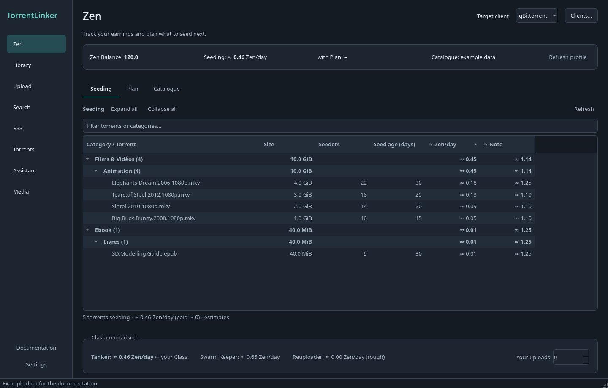

# TorrentLinker

Main repository: [GitHub](https://github.com/Vietnoirien/TorrentLinker) · [Repository mirror](https://git.mma.dev/Vietnoirien/TorrentLinker)

[Français](README.md) · English · [Documentation](docs/README.md)

Find torrents matching your existing files and reseed them in **qBittorrent, Deluge or Transmission**, with experimental support for **µTorrent Classic and BitTorrent Classic**. TorrentLinker searches a Torznab Indexer such as **c411**, then asks your torrent client to verify the files before seeding.

*English interface, dark theme, example data.*

## What you can do

- **Built-in Assistant**: local or API models, chat, Web research and scheduled tasks. [Guide](docs/guide/en/assistant.md).
- **MCP agents**: connect an assistant, prepare Plans and approve its actions. [Guide](docs/guide/en/agents.md).
- **Named clients**: multiple connections, a combined overview and Plans distributed across selected clients.
- **Library**: find files no longer seeded, search and check Candidates, then reseed matching torrents.
- **Search**: filter torrents, explore details in tabs and prepare a download queue.
- **Zen**: track estimated earnings and notes, then make a Plan within your space and budget.
- **Torrents**: manage downloads and seeding, grouped by tracker and category.
- **Upload**: prepare files, a description and NFO for a c411 Draft that you review and publish on the website.

With qBittorrent, Deluge and Transmission, reseeding does not rename existing files on disk. µTorrent Classic and BitTorrent Classic may require disk renames, with explicit confirmation. In the desktop app, API keys and passwords stay in your system keyring. The interface supports French and English, with system, light and dark themes.

## Download

| Platform | Download |
| --- | --- |
| Windows x64 | [TorrentLinker.exe](https://github.com/Vietnoirien/TorrentLinker/releases) |
| Linux x86_64 | [TorrentLinker-x86_64.AppImage](https://github.com/Vietnoirien/TorrentLinker/releases) |

On Linux, make the AppImage executable before opening it. See the [release notes](https://github.com/Vietnoirien/TorrentLinker/releases) for changes.

## Get started

1. Enable your torrent client’s Web UI.
2. Open TorrentLinker and enter the client connection and Indexer API key in Settings. The first launch guides you there.
3. Use **Library → Add folder…** for existing files. Use **Search** or **Zen → Plan** for new downloads.

The [illustrated setup guide](docs/guide/en/getting-started.md) covers connections, Docker and NAS setups.

## Guides and help

Open **Documentation**, above Settings, to read the illustrated guides inside the app, even offline.

[Torrents and client folders](docs/guide/en/torrents.md) · [Library](docs/guide/en/library.md) · [Search and downloads](docs/guide/en/search.md) · [Zen and Plans](docs/guide/en/zen.md) · [Uploads](docs/guide/en/upload.md)

[All documentation](docs/README.md) · [Troubleshooting](docs/guide/en/data.md) · [Report an issue](https://github.com/Vietnoirien/TorrentLinker/issues) · [Contribute](docs/guide/en/development.md)

## Web UI and Docker

A browser interface with guided setup is available from source for NAS and seedbox deployments. See the [Docker guide](docs/guide/en/web-docker.md) to build the image and configure storage access.
