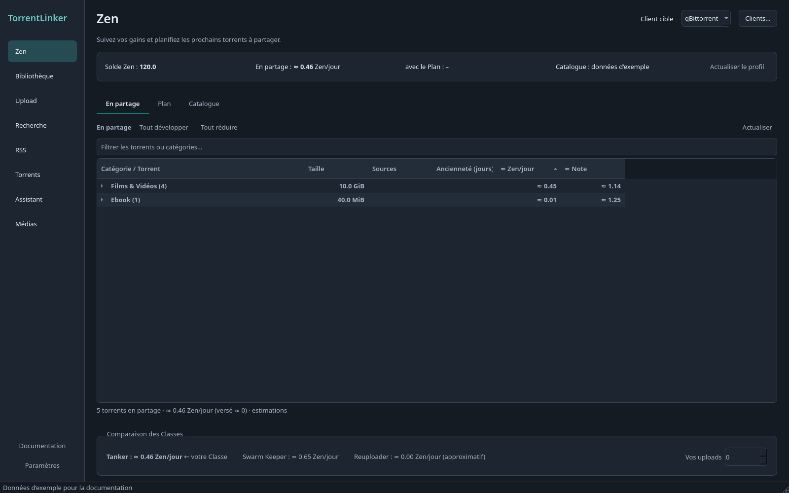

# TorrentLinker

Français · [English](README.en.md) · [Documentation](docs/README.md)

Retrouvez les torrents qui correspondent à vos fichiers et remettez-les en seed dans **qBittorrent, Deluge ou Transmission**, avec une prise en charge expérimentale de **µTorrent Classic**. TorrentLinker recherche les correspondances auprès d’un indexeur Torznab comme **c411**, puis fait vérifier les fichiers par le client torrent avant de lancer le partage.

*Interface en français, thème sombre, données d’exemple.*

## Ce que l’application permet

- **Bibliothèque** : repérer les fichiers qui ne sont plus partagés, rechercher et vérifier les correspondances, puis les remettre en seed.
- **Recherche** : filtrer les torrents, consulter leurs détails dans des onglets et préparer une file de téléchargement.
- **Zen** : suivre les gains estimés et les notes, puis préparer un Plan selon l’espace et le budget disponibles.
- **Torrents** : gérer les téléchargements et le partage, avec une arborescence par tracker et catégorie.
- **Upload** : préparer les fichiers, la description et le NFO d’un brouillon c411, à relire et publier sur le site.

Avec qBittorrent, Deluge et Transmission, les fichiers existants ne sont pas renommés sur le disque. Avec µTorrent Classic, un renommage sur le disque peut être nécessaire et demande une confirmation explicite. Les clés API et mots de passe sont conservés dans le trousseau système. L’interface est disponible en français et en anglais, avec un thème système, clair ou sombre.

## Télécharger la version 0.6.1

| Plateforme | Téléchargement |
| --- | --- |
| Windows x64 | [TorrentLinker.exe](https://github.com/Vietnoirien/TorrentLinker/releases/download/v0.6.1/TorrentLinker.exe) |
| Linux x86_64 | [TorrentLinker-x86_64.AppImage](https://github.com/Vietnoirien/TorrentLinker/releases/download/v0.6.1/TorrentLinker-x86_64.AppImage) |

Sous Linux, rendez l’AppImage exécutable avant de l’ouvrir. Consultez les [notes de version](https://github.com/Vietnoirien/TorrentLinker/releases/tag/v0.6.1) pour les changements.

## Premiers pas

1. Activez l’interface Web de votre client torrent.
2. Lancez TorrentLinker et renseignez sa connexion ainsi que la clé API de votre indexeur dans les Paramètres. Le premier démarrage vous guide vers cet écran.
3. Dans **Bibliothèque → Ajouter un dossier…**, sélectionnez vos fichiers existants. Pour de nouveaux téléchargements, ouvrez **Recherche** ou **Zen → Plan**.

Le [guide de démarrage illustré](docs/guide/fr/demarrage.md) détaille la configuration, y compris pour Docker et les NAS.

## Guides et aide

[Torrents et dossiers du client](docs/guide/fr/torrents.md) · [Bibliothèque](docs/guide/fr/bibliotheque.md) · [Recherche et téléchargements](docs/guide/fr/recherche.md) · [Zen et Plans](docs/guide/fr/zen.md) · [Uploads](docs/guide/fr/upload.md)

[Documentation complète](docs/README.md) · [Dépannage](docs/guide/fr/donnees.md) · [Signaler un problème](https://github.com/Vietnoirien/TorrentLinker/issues) · [Contribuer](docs/guide/fr/developpement.md)
