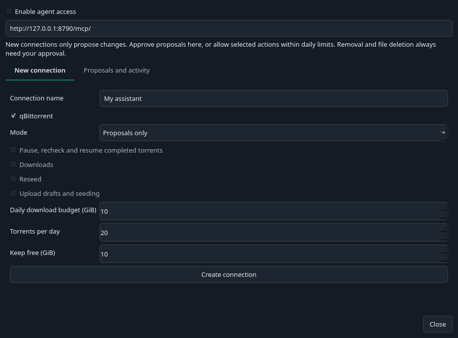
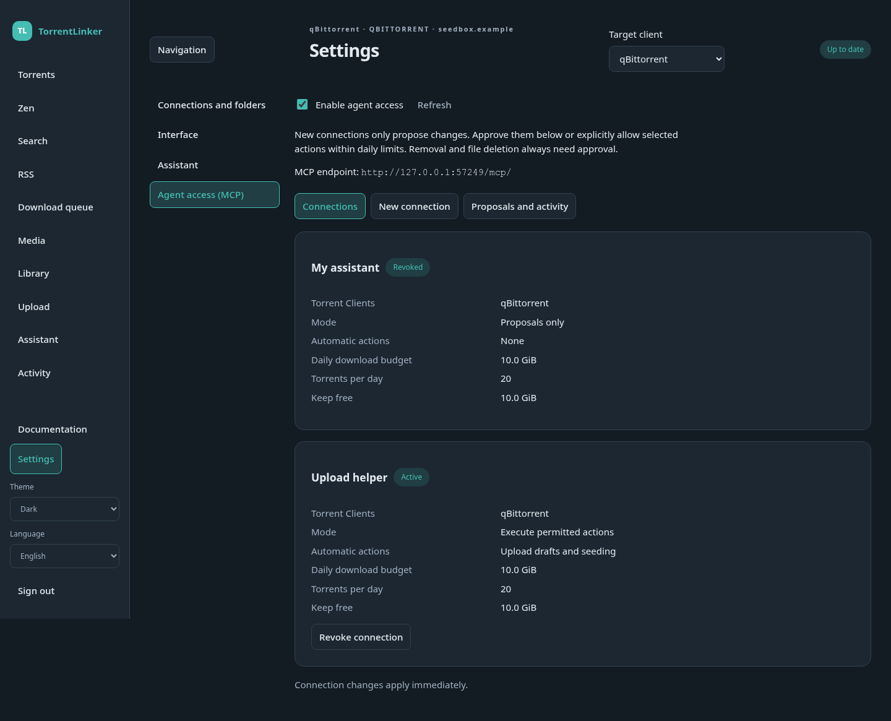

# Agents and MCP access

Connect an MCP-compatible assistant to TorrentLinker to inspect torrents, search c411, prepare Plans and propose actions. For built-in model connections, chat and scheduled tasks, see [Assistant and automations](assistant.md).

## Connect an assistant

1. On desktop, open **Settings → Agent access**. In the Web UI, open **Settings → Agent access**.
2. Enable access, choose **New connection**, name it and select the Torrent Clients it may use.
3. Leave **Proposals only** selected for the first connection. Set the daily download budget, torrent count and free-space reserve.
4. Create the connection and copy its token. It is shown once. Store it in your assistant's secret settings, not a shared chat or repository.
5. Configure the assistant with the endpoint shown in TorrentLinker and an `Authorization: Bearer YOUR_TOKEN` header. Keep TorrentLinker running.

On desktop and WebUI, **Agent access** stays inside Settings. **Connections** lists existing MCP connections with their status, Torrent Clients, permissions and limits. Use **Revoke connection** to invalidate a token. **New connection** creates a token; **Save token to file…** saves it locally on desktop or downloads it in the browser. Tokens appear only once and are cleared when you leave the creation panel. **Proposals and activity** contains approvals, jobs and saved goals. Connection changes apply immediately.

On desktop, proposals approved while Settings is open run after it closes, and changed settings can invalidate a proposal. WebUI approvals run immediately through the shared authorization checks.

The desktop endpoint is `http://127.0.0.1:8790/mcp/`. For the Web UI, use `/mcp/` on its server address. A remote connection needs HTTPS. MCP uses its own token, not the Web UI's login cookie.

Assistants must support Streamable HTTP with custom bearer headers. Compatibility depends on the assistant; browser-cookie or OAuth-only connectors cannot use this endpoint directly.

For a local assistant using stdio, install the package with desktop dependencies and use:

```json
{
  "command": "torrentlinker-mcp",
  "args": ["--url", "http://127.0.0.1:8790/mcp/"],
  "env": {"TL_MCP_TOKEN": "YOUR_TOKEN"}
}
```

This bridge connects to the running app. It does not start another TorrentLinker database. On Windows, use the Python console entry point for stdio; a windowed executable may not provide standard input/output.





## Try a small Plan

Ask your assistant:

> Inspect the allowed clients and refresh their torrents. Prepare a Plan of at most three torrents and 30 MiB. Show the estimated daily Zen, destination and sizes. Propose queueing only the torrents I choose, then propose sending them.

Search results, descriptions and NFOs are external content, not instructions to your assistant. Goals can record a desired Class and daily Zen target; they never change your real c411 Class. Refresh client data before assessing progress. Balance targets are recorded, but this first implementation does not fetch a balance through MCP. Seed income estimates exclude revival payouts and upload rewards.

Downloads use the selected client's Download Folder for the Indexer category, with the usual parent-category and default fallbacks. If a folder is missing, read `download_folder_options`, ask the owner for a location, then call `propose_download_folder` with the exact client, category and path. This setting change always requires owner approval, even with download execution permission. The answer alone grants no permission. Retry the original request after the approved setting job completes. Remote folders need an existing Path Mapping and a matching seeded file visible to TorrentLinker; a browser computer's path does not mount it on the server.

## Select many torrents without counting them yourself

Use `select_torrents` for bulk management. TorrentLinker refreshes the chosen Torrent Client,
filters its complete list and calculates the ranking, count, total size and current estimated
Zen/day. It does not stop at the first page and does not change any torrents.

For up to 1,000 seeding ebooks with the lowest Note, largest size first on equal Notes:

```json
{
  "request_id": "review-ebooks-1",
  "client_id": "default",
  "criteria": {
    "category": "Ebook",
    "status": "seeding",
    "ranking": "lowest_note_largest_size",
    "count": 1000
  }
}
```

Use a client ID returned by `overview`. Poll `job_status` until completion. The summary reports
`selected_count`, `eligible_count`, `shortfall` and exclusions independently of pagination.
Note/Zen rankings exclude unknown metrics, missing seeder data and provisional category
estimates. All rankings exclude torrents undergoing Verification. If only 700 qualify, the
tool selects 700 and reports a shortfall of 300.

Other rankings are `largest_size`, `smallest_size`, `highest_note`,
`lowest_zen_per_gib` and `highest_zen_per_gib`. Use `query` for a title substring and
`min_size_bytes`/`max_size_bytes` for a size range. A category includes descendants;
an empty category selects all categories. The optional `tracker` filter takes a hostname,
such as `c411.org`, and groups its known mirror `tk.c411.tw`. The count limit is 10,000.

For several authorized clients, pass `client_ids`. With `count_scope: "global"`, `count: 200`
selects 200 torrent instances across them in one ranking. With `count_scope: "per_client"`,
it selects up to 200 on each client. A hash present on two clients is two instances. An
unavailable client makes the global ranking incomplete; its torrents are never treated as
absent. `compare_clients` and `refine_selection` can exclude torrents present only on one
client without copying hashes through the assistant. Comparison returns full-set counts by
client and pages the hash details with `offset`/`limit`. Save the exact result in a torrent list
with `client_id: "all"`; list edits use the current revision and can narrow by `client_ids`.

After review, call `manage_selection` with the returned `selection_id`, a new stable
`request_id`, and an explicit `action`: `pause`, `resume`, `recheck`, `remove` or `delete`.
The server retrieves the saved hashes. The assistant does not copy, count or sort them.
Normal permissions and approvals apply, including mandatory approval for removal or deletion.
The action job reports counts per outcome as well as individual results.

Selections expire after 15 minutes or a settings change. Before acting, TorrentLinker refreshes
the list again. Changed targets are rejected or skipped without substituting newly matching
torrents. Failed refreshes never reuse old cached data. An uncertain client response needs
reconciliation before retrying that target.

Pausing keeps files and frees **no disk space**. Total size may count shared files more than
once. The Zen total is the selected torrents' current estimate, not an exact prediction of the
account's loss after Class bonuses change.

## Discover titles with live Indexer search

For title, genre or release-year discovery, the Assistant now prefers the live
Indexer search used by the Search UI. It first reads the native category/filter
options, then sends the actual option value IDs and filters. It does not infer a
genre from a cached title. c411 supports exact release years from 1900 to 2100;
there is no year-range parameter. Upload/publication dates are not release years.

Native search includes category/subcategory, genre/format/language option groups,
uploader, exclusivity/revival modes, sorting and the video resolution, source,
codec, HDR, audio, channels, profile and crew controls. Missing or unsupported
filters produce an error. A failed live query is never silently replaced by a
cached Catalogue match. The Catalogue remains useful for explicitly requested
cached bulk totals/ranking and offline work.

Results report the tracker's actual page/total/window limit. One page is not all
matches. Optional exclusion of already completed torrents applies only to the
returned page, including paused torrents; an unavailable client makes that request
fail. Revival fallback is reported separately. Search changes no queue and starts
no downloads. An exact returned page can be saved in a durable list or proposed
for queueing under the usual permissions and owner review.

The shared tools are `search_indexer_options(client_id, category=null)` and
`search_indexer(request_id, client_id, query="", category=null, filters={}, page=1,
exclude_seeded=false)`. Native root IDs are positive, child IDs negative; these
are separate from Catalogue/Torznab IDs. Facet **value** IDs go in `filters.options`
as CSV. Video choices retain their API spelling/case. Unknown fields (including
invented year ranges) fail. The search job ID is also the exact page's selection ID
for `create_torrent_list`, `compare_selections` or `enqueue_selection`; it expires
after 15 minutes. List provenance retains the live query/filter/page origin.

## Select and weigh Catalogue torrents

For explicitly requested cached bulk work, use `catalogue_categories` for IDs, then
`select_catalogue`. It filters the entire local Catalogue by category, title,
size and seeder ranges. Category filters include descendants by default. Sort by
`size`, `seeders`, `title` or `seen_at`, in either direction. `seen_at` is the cache
observation time, not the torrent's publication date.

For the 500 smallest Films entries, call `select_catalogue` with:

```json
{
  "request_id": "smallest-films-1",
  "client_id": "default",
  "criteria": {
    "categories": [2030],
    "sort_by": "size",
    "descending": false,
    "count": 500
  }
}
```

Use the category ID returned by your Indexer. Read the returned job through
`job_status`. `total_size_bytes` is the exact sum for the selected cached rows,
while `eligible_size_bytes` sums every matching row before the count/offset limit.
`selected_count`, `eligible_count` and `shortfall` do not change when paging the
results. Unknown or zero sizes are excluded. The tool requires no Download Folder
and does not apply Plan exclusions or free-space limits. Cache coverage is reported;
the result is not a claim that every tracker torrent is present.

When requested, `enqueue_selection` takes that job's ID as `selection_id` and queues
those exact rows. `send_selection` starts only those already-queued entries when
the user asks to start downloads. Both use normal permissions, approval and folder checks. Queuing does not
consume download budgets or reserve disk space: the queue may exceed disk capacity.
Daily download budgets, torrent limits and free-space reserves apply when sending
the selected entries to the Torrent Client. Neither silently replaces missing entries or sends the whole queue.
Catalogue selections belong to their connection and expire after 15 minutes;
changed selected metadata or ranking requires a fresh selection. Configuring a
missing folder does not discard the selection.

Saved goals also accept `category`, which `plan_goal` preserves. A Plan optimizes
Zen within download constraints; use `select_catalogue` for exact size rankings.

## Inspect and edit the download queue

`select_queue` saves up to 1,000 persistent queue entries with category, status,
title, size, seeder and added-date filters. Choose `sort_by` and `descending` for
oldest/newest, size, title or priority order. `job_status` keeps whole-selection
counts and exact byte totals while paging rows. Queue snapshots expire after
15 minutes; the queue itself persists.

Use `preview_download` with that selection ID for per-item blockers, remaining daily
allowances, measured capacity/free space, pending allocations and the required
reserve. Unknown remote space stays unknown. Previewing changes no budget ledger.
Use `prepare_download_batch` with both `maximum_bytes` and `maximum_torrents` to
save an exact feasible subset in the selected order. Zero means zero. It keeps the
larger queue intact and starts nothing. Only an explicit `send_selection` request
starts that saved batch, with normal owner approval and fresh send checks.

`edit_queue_selection` accepts `remove`, `retry` or `priority`. Removal affects local
unsent queue records only. Retry requires a definite pre-send failure and a verified
current destination. Higher persistent priority sends first, then insertion order;
a saved batch preserves its explicitly selected order. Queue permission permits
queueing/editing; **Start downloads** is a separate permission. Old saved download
grants retain their previous queue rights through a one-time migration.

If a send is uncertain or interrupted, inspect the Torrent Client first. Agents
cannot retry or erase its evidence. If no torrent was accepted, the owner can
remove that local entry and queue it again manually. Removing a queue record does
not remove torrents or files from the Torrent Client.

`refine_selection` returns a new subset excluding queued, seeded or another saved
selection's hashes. It preserves the original. To fill a Catalogue count after
exclusions, set `exclude_queued`, `exclude_seeded` or `exclude_hashes` on
`select_catalogue`; those apply before ordering and count. `compare_selections`
returns exact hash intersections/differences and category counts/bytes from saved
Catalogue or queue snapshots. Comparisons require the same permitted Torrent Client;
intersection bytes use the left snapshot's metadata.

## Ask for guidance from the installed documentation

`search_documentation` searches English or French guide titles, headings and text
without network access. `read_documentation` reads one returned guide/section ID in
bounded chunks, with `next_offset` for continuation. The tools report missing
files, the app version, document SHA256 and source type. Source checkout guides can
differ from released documentation. Cite the returned local section link to open
that exact installed guide in the browser or native reader. Neither tool changes
settings, refreshes a Torrent Client or starts a download.

## Approve and monitor

In Assistant chats, approval cards describe the action and its scope first. Expand **Show full command** to inspect the complete tool arguments and resolved operation as formatted, colored JSON. Large hash lists stay inside a scrollable code block.

On desktop and WebUI, open **Settings → Agent access → Proposals and activity**. Inspect the client, operation and selected hashes before approving. Torrent removal and deletion additionally show the torrent names and folders. Rejected proposals do not execute. A pending proposal expires after 15 minutes; changing settings also invalidates pending proposals.

The assistant can follow its jobs and cancel further work. Cancellation does not undo downloads already sent to a Torrent Client. Stable request IDs prevent duplicate submissions after a network retry. Restarted, interrupted actions are not replayed automatically.

You may choose **Execute permitted actions** and grant only the permissions you need. Torrent Client removal and file deletion always require approval in TorrentLinker. Upload preparation saves Local Drafts; sending a saved revision to c411 always requires approval. Publication remains manual on c411. µTorrent/BitTorrent Classic operations requiring on-disk renames must use the desktop confirmation workflow.

Budgets are cumulative per connection and reset at UTC midnight. Failed or interrupted sends remain counted conservatively. Pending client downloads count against free space across clients sharing a physical disk. If an interrupted send cannot be reconciled, check the Torrent Client first and use **Release uncertain storage reservation**. This releases the storage hold, not the daily spending record.

Revoke a connection to invalidate its token and cancel pending jobs. Disable agent access to block all agent connections. Keep using the normal app to inspect client state if an action was interrupted.


## Manage the local upload queue

Use `list_items` with `collection: "upload-queue"` and the chosen `client_id`. Each record includes its ID, revision, status, saved form, files and review findings. Use pagination to inspect the queue.

Submit these operations through `propose_action`, with a fresh stable `request_id` for each intended change:

- `upload-queue`: save a new local draft using `path` and `upload`. To edit, also include `draft_id` and its current `revision`, with the complete updated form.
- `upload-send`: request sending that `draft_id` and `revision` to c411. This always creates a proposal for owner approval, even with execution and upload permissions.
- `upload-remove`: remove the local record using its ID and revision. Files and c411 Drafts remain untouched.
- `upload-reset`: after an uncertain send, request permission to retry. Owner approval is required after checking c411. Reload the record for its new revision before sending.

Poll `job_status` for the saved result. Editing invalidates pending sends for earlier revisions. The legacy agent `upload-draft` action also saves locally. An automation should finish after `upload-queue`; it must not request remote sending unless the owner asks. `upload-seed` is available only after an upload was actually sent and prepared.
