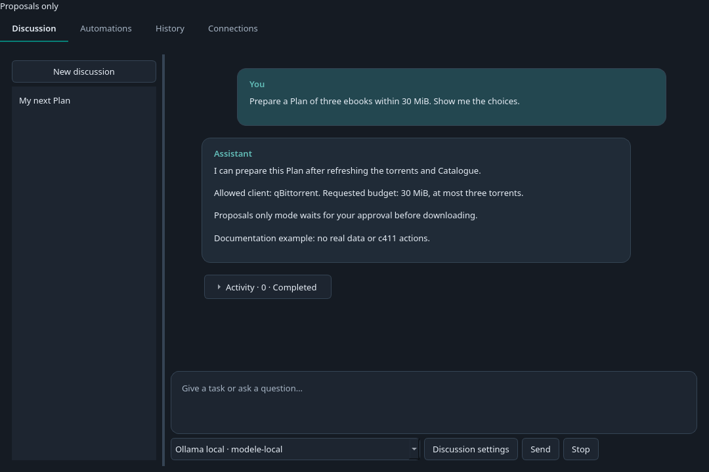
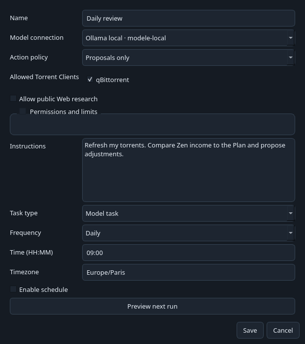

# Assistant and automations

The **Assistant** tab lets you chat with a model and schedule tasks on desktop or the Web UI. It uses the same tools, proposals and permission checks as MCP access. TorrentLinker does not bundle a model.

The screenshots below use fictional data.

## Connect a model

1. Open **Assistant → Connections → Add connection**.
2. Name the connection and choose a provider.
3. Check the address. For Ollama or LM Studio, first start its server and load a model that supports tool calls.
4. Enter the API key if required. Use **List models**, or type the exact model ID.
5. Save, select the connection and click **Test tools**. The test requests a harmless tool call and checks that the model can read its result.

| Provider | Protocol |
| --- | --- |
| Ollama, LM Studio | Chat Completions compatible API |
| OpenAI | Responses API |
| Anthropic | Messages API |
| Google Gemini | generateContent |
| Mistral, OpenRouter | Chat Completions compatible API |
| OpenAI compatible | Custom address, Chat Completions |

You can enter any model ID. A provider's model list may include models without tool support, so run the test. Providers may charge for requests, including connection tests.

Inside Docker, `localhost` means the TorrentLinker container. Use an address reachable from that container to connect to Ollama, LM Studio or another server. See [Web UI and Docker](web-docker.md).

Keys stay in TorrentLinker's secret store, using the system keyring on desktop. Configuration APIs never return them. Hosted providers receive messages and tool results, which may include torrent names and paths. Local connections never fall back to a hosted provider automatically.

## Start a discussion

Open **Discussion** and type your message. **New discussion** opens an empty chat immediately; its title comes from your first message. Choose the model beside the message box. Press **Enter** to send, or **Shift+Enter** for a new line.

**Discussion settings** lets you rename the chat and choose its clients, Web access, permissions and limits. Settings can change while the chat is idle, keeping its history and budget usage. Under **Connections → Chat defaults**, save the choices for future chats. These defaults do not change existing discussions or automations.

**Proposals only** is the initial default. The Assistant can read data and prepare a Plan, while download and management actions wait for your approval.

Try:

> Refresh my NAS client. Prepare a Plan of at most three ebooks, below 30 MiB. Show sizes, folders and estimated Zen income before proposing downloads.

Action links show parameters and results. **Review proposal** opens the approval dialog. Proposals can expire or become invalid after settings change; request a new proposal in that case.

**Execute within limits** allows the action types selected under **Permissions and limits**. You choose the clients, daily download size and count, and free-space reserve. Removing torrents and deleting files always require approval.

Download budgets belong to each discussion or task. They are not a global budget shared by every agent.

**Stop** interrupts the model loop and requests cancellation of submitted jobs. It cannot undo an action already performed. Check history and your torrent client before trying again.

## Schedule a task

Open **Automations → Create task** and enter the instruction, allowed clients and frequency. New schedules are disabled by default.

- **Every X minutes**: minimum interval of five minutes.
- **Daily**: time and timezone.
- **Weekly**: weekdays, time and timezone.

Use **Preview next run** before enabling the schedule. **Run now** provides a first trial. You can edit or pause the task from the list.

**Refresh torrents** and **Refresh Catalogue** call application tools directly without a model. They process the allowed clients. Choose **Model task** for analysis, comparisons or writing.

Keep the desktop app open or the Web server running. Missed intervals are combined into one run on return. A task does not overlap its own running actions or proposals awaiting review. After interruption, failure or cancellation, review history and use **Run now** to resume. Interrupted actions are not replayed automatically.

## Research and prepare an Upload

Public Web research is off by default for every discussion and task. Enable it when instructions need a synopsis, source or image.

Under **Connections → Web research**, configure a Brave Search API key or your SearXNG server URL. Reading a public URL and looking up books through Open Library need no search key. Movie and TV lookups use the TMDb key already configured in TorrentLinker.

The Assistant can search pages, extract text and image URLs, look up metadata and check that a URL returns an image. It has no signed-in browser or terminal. Pages are source material, never instructions. Web reading rejects private addresses and limits response sizes.

Try:

> Choose an unmatched film in my Library. Verify its identity and find a synopsis and image with sources. Prepare the description and save it in the local draft queue for my review. Do not send it to c411.

Open the local draft queue and review the sources, image, technical information and category rules. Save your corrections before sending. Scheduled upload tasks stop at this queue. Sending to c411 always requires your approval, even in execution mode. An external image's continued availability is not guaranteed. **Final publication remains on c411**, after you review the Draft.

## History and limits

History keeps messages, tool calls, proposals, jobs and errors. Connections and schedules survive restarts. Questions, action approvals and temporary settings waits are also saved. Answer or decide directly in the chat and the same run continues automatically. Waiting does not consume its duration limit. Interrupted work is never replayed automatically.

Interactive chats have no duration or model-call cutoff by default. You can set optional limits in Discussion settings; zero means no per-run limit. Stop remains available. Scheduled tasks retain defaults of five minutes and twelve calls. Cumulative token usage is displayed for information and does not stop the conversation. Each response requests at most 2,048 output tokens by default.

**Detect context automatically** is enabled for new connections. Before each task, TorrentLinker reads the selected model's reported limit. Use **Check context** in the connection editor to see the detected value without starting a chat. This does not load models or change server settings.

Detection supports the active configuration in [Ollama](https://docs.ollama.com/api/ps), [LM Studio](https://lmstudio.ai/docs/developer/rest/list), [llama.cpp](https://github.com/ggml-org/llama.cpp/blob/master/tools/server/README.md) and compatible servers that expose `max_model_len`, such as vLLM. OpenRouter and Gemini expose provider model limits. A model's advertised training capacity is not used as a substitute for its loaded configuration.

If the server is unavailable, the model is not loaded or metadata is missing, **Context window (tokens)** supplies the fallback, initially 32,768. Disable automatic detection to use that value manually. Existing custom values are kept as manual overrides. For example, a server configured for 262,144 tokens can report that capacity even if another model on the same server uses less.

TorrentLinker compacts the working context as it fills, keeping the current request and action receipts. Complete messages and tool results remain in History, and the assistant can retrieve archived details within the same discussion. Token usage depends on the provider's reporting and is not a billing cap.

Messages appear in separate cards. Expand **Activity** below an exchange to inspect tool receipts and usage. Errors, questions and action approvals stay visible when Activity is closed. Approval cards show the action details with **Approve once** and **Reject**. Approval applies only to that proposal and is checked against current settings, permissions and budgets before execution. Expired or changed proposals need a fresh decision.

For questions, select a suggested answer or type your own, then choose **Submit answer**. Selecting an option does not send it. An answer never grants action permission. Markdown tables render in chat; embedded HTML and external images are disabled.

Discussions and tasks share a limit of 200 calls per model connection per UTC day. Connection tests are separate from this counter. One Assistant run executes at a time; up to ten can be queued or active. Downloads remain TorrentLinker jobs and continue in your torrent client.

External assistants can still use [MCP access](agents.md). The built-in Assistant needs neither external MCP access enabled nor a copied token.

Use **Delete discussion** to remove a chat and its history after confirmation. Pending proposals are rejected; torrents and files are kept. Stop an active discussion and wait for submitted actions to finish before deleting it. Automated-task discussions cannot be deleted this way.
