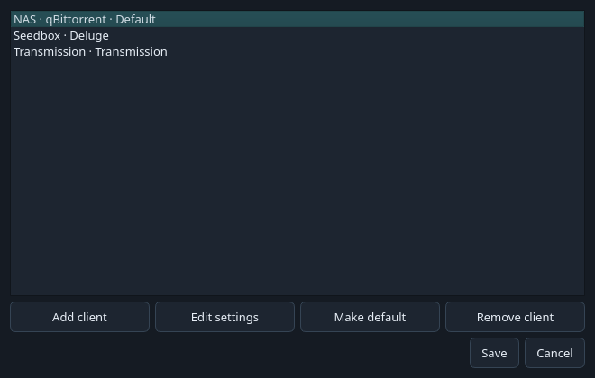
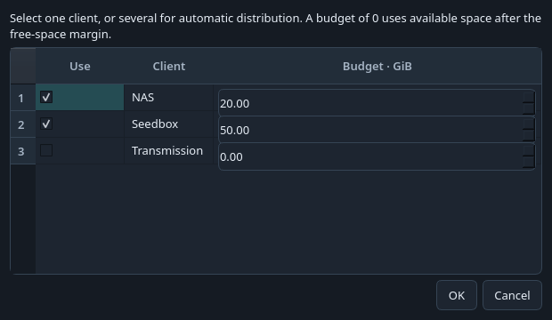
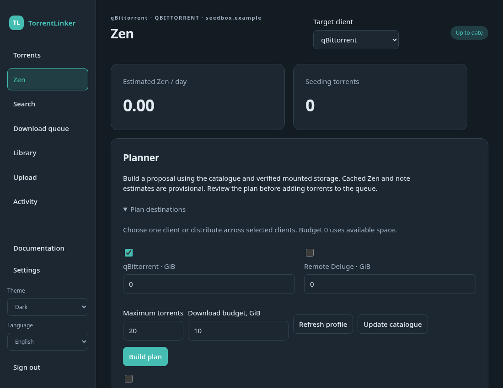

# Multiple Torrent Clients

Use **Clients…** beside the desktop's target selector to add a connection, edit its settings or choose the default. Give each connection a short name, such as NAS or Seedbox. Several qBittorrent instances and mixed qBittorrent, Deluge, Transmission, µTorrent Classic and BitTorrent Classic connections are supported.

Your existing connection is kept automatically. Each client has its own credentials, Download Folders and Path Mappings. Open **Edit settings**, test the connection, then configure its folders. Library Folders and the c411 account are shared by the application.

The **Target client** selector controls Library checks and Reseeds, Upload seeding, Search downloads and the selected client's queue. Queue entries show their client. Changing the default or renaming a profile does not redirect queued work.

In **Torrents**, select **All clients** for a combined view. Filter by name and use the context menu on selected rows to act on the corresponding clients. Removal keeps files; deletion asks before deleting torrent data. Combined Zen estimates count each torrent hash once.

## Plans

Open **Plan destinations…**. Select one client for a dedicated Plan, or several for automatic distribution. Set each client's budget in GiB. A value of zero uses available space after your free-space margin.

Review the Client and Download Folder columns before sending. Distributed Plans place each torrent on one selected client and share the free-space budget when clients use the same mounted disk. They use the existing Zen heuristic and do not promise a mathematically optimal placement.

An offline destination produces a visible failure. TorrentLinker does not substitute another client. Finish or remove pending queue entries, Plans and Verifications before replacing or removing their connection.

## Web interface

Use the target selector at the top of the page. Settings has **Add client**, **Make default** and **Remove client** controls, with a name field on the connection form. Folder setup applies to the selected client.

**All clients** shows a combined overview. Select a specific client before changing torrents or starting a queue. In the planner, expand **Plan destinations**, select clients and budgets, then review the result. Each row has a destination selector before it is queued. Switching that selector uses the new destination's configured Download Folder.

The server needs access to the files for scanning, Reseeds and Upload preparation. Web downloads still require a verified mounted Download Folder. API-only seedboxes can use torrent management.
