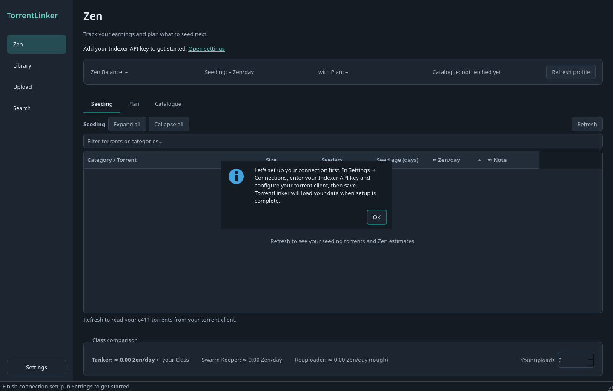
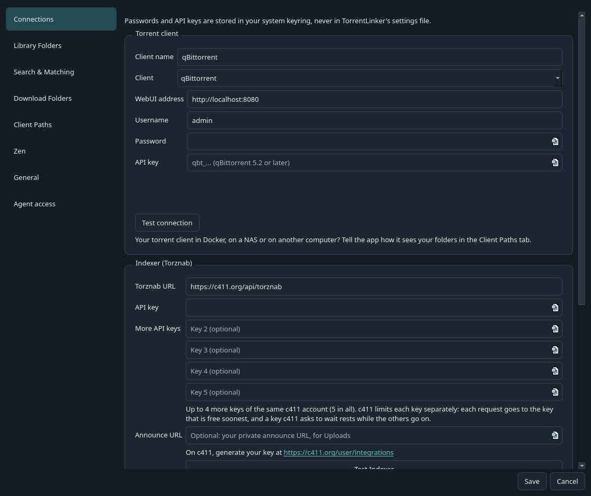
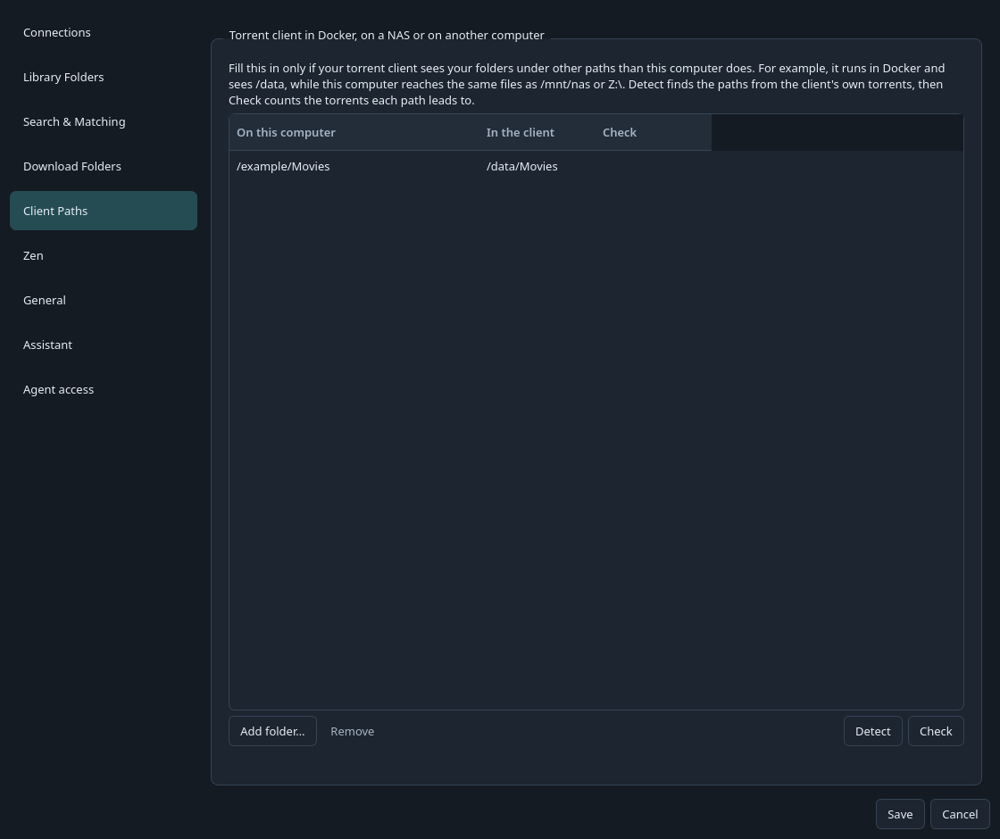
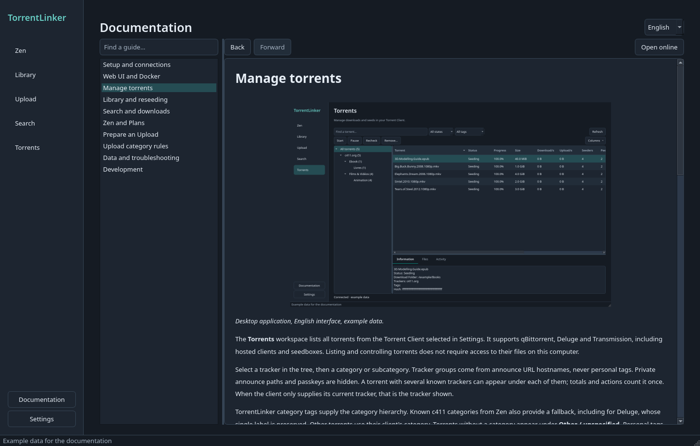

# Install and configure

[Documentation](../../README.md) · [Français](../fr/demarrage.md)

[Installation](#installation) · [Set up](#set-up) · [Your torrent client in Docker, on a NAS or on another computer](#your-torrent-client-in-docker-on-a-nas-or-on-another-computer) · [Proxy](#proxy) · [Finding your way around](#finding-your-way-around)

Start by connecting your Indexer and torrent client, then add folders and choose a workflow.

Screenshots use the English interface, dark theme and example data.

## Installation

Download the Windows or Linux file from the [latest release](https://github.com/Vietnoirien/TorrentLinker/releases/latest). On Windows, run `TorrentLinker.exe`. On Linux, allow execution in the AppImage file properties, then open it.



### AppImage GLX startup failure

On systems with newer Mesa drivers, older AppImages can bundle a `libstdc++.so.6` that is too old for the system drivers. Startup fails with `Could not initialize GLX`. On Ubuntu x86_64, this workaround uses the system libraries for one launch:

```sh
LD_PRELOAD=/usr/lib/x86_64-linux-gnu/libstdc++.so.6:/usr/lib/x86_64-linux-gnu/libgcc_s.so.1 ./TorrentLinker-x86_64.AppImage
```

Do not disable GLX with `QT_XCB_GL_INTEGRATION=none`: Qt may then fail to create the window. The fix removes these two libraries from future AppImages. The system libraries must be at least compatible with Ubuntu 22.04, the build system.

## Set up

On first launch, or when no Indexer API key is saved, a welcome message opens connection settings. Automatic loading waits for setup. Saving the key starts loading your data without a restart. Cancelling or saving without a key leaves the app idle with a link back to Settings.

1. Enable your torrent client's Web UI:
   - **qBittorrent**: **Tools → Options → Web UI**.
   - **Transmission** 4.x: turn on remote access in **Preferences → Remote**. Reseeds need **Append .part to incomplete files' names** off, or Transmission would rename your own files during a check: TorrentLinker offers to turn it off for you. Transmission renames file and folder names in place only, so a Match that needs other folders (a flattened folder, for example) cannot be Reseeded with it (see [ADR-0010](../../adr/0010-transmission-with-whole-file-names-and-in-place-renames.md)).
   - **Deluge** 2.x: run its Web UI (`deluge-web`, port 8112 by default) connected to its daemon, and turn on the **Label** plugin in **Preferences → Plugins**. TorrentLinker labels the torrents it adds (`torrentlinker`, `torrentlinker-verifying`, `torrentlinker-partial`, `torrentlinker-zen`) to follow their Verification, as it tags them in qBittorrent.
   - **µTorrent Classic / BitTorrent Classic**: enable **Preferences → Advanced → Web UI** and set a username and password. In Directories, choose a default download folder and enable **Don't start the download automatically**. Use the Web UI port shown in the client. TorrentLinker supports that folder and its subfolders. Full Reseeds and Upload seeding can require an explicit disk-rename confirmation; Partial Matches are unsupported. These options are experimental. BitTorrent Web is a different application and is not supported by this connection.
2. Open TorrentLinker's **Settings → Connections**, choose your **Client** and enter its connection, then the Indexer URL/API key (and your Announce URL, for Uploads). qBittorrent takes a username/password or a Web UI API key where available; Deluge takes its Web UI address and password; Transmission its remote address, and a username and password if you set them.
3. Register Library Folders to find files you can Reseed.
4. Set Download Folders for the categories you want to plan, or choose a default folder. Categories without a resolved folder are excluded.
5. If your torrent client runs in Docker, on a NAS or on another computer, set its paths in **Settings → Client Paths** (see below).



## Your torrent client in Docker, on a NAS or on another computer



The client then sees your folders under other paths than this computer does. For example, a Docker container sees `/data`, while this computer reaches the same files as `/mnt/nas` or `Z:\`. TorrentLinker needs to know the correspondence to find the client's torrents in your folders, to Reseed, and to send a Plan's downloads where the client can write them.

In **Settings → Client Paths**:

1. Fill in the client connection and your Library or Download Folders first.
2. Click **Detect**. TorrentLinker reads a few torrents of each folder the client uses and looks for their files, by name and size, in your folders and the folders above them. It adds the paths that lead there, for example `/mnt/nas` ↔ `/data`, and says how many torrents each one found.
3. **Check** counts, for each path, the client's torrents whose folder exists on this computer. It also warns about Download Folders that the client probably cannot reach.
4. Save.

You can also add a path by hand with **Add folder…**: choose the folder on this computer, then type how the client sees it. One path covers everything below it, and the longest matching path wins. Typical cases:

| Setup | On this computer | In the client |
| --- | --- | --- |
| Docker on this computer, volume `-v /srv/media:/data` | `/srv/media` | `/data` |
| Client on a NAS, share mounted on Linux | `/mnt/nas/media` | `/volume1/media` |
| Client on a NAS, share mapped as a Windows drive | `Z:\` | `/volume1/media` |
| Docker on a NAS, share mounted here | `/mnt/nas/media` | `/data` |

Detection and checks only talk to your torrent client.

On Windows, a mapped drive such as `Y:\` can appear in the queue as its full network path, such as `\\nas\share\`. If Transmission in Docker rejects a download with "download directory path is not absolute", compare the queue's Download Folder with **On this computer** in Client Paths. In versions through beta.27, use that same full network path on the local side. Keep the container's Linux path, such as `/downloads/complete`, on the client side. Listing existing torrents confirms the connection but does not prove that a new download's destination is translated correctly.

## Proxy

To reach the internet through a proxy, enter it in **Settings → Connections → Proxy**: `http://host:port`, `https://…`, `socks5://host:port`, or `socks5h://…` to resolve names through the proxy too, with a username and password if it needs them (the password stays in the system keyring). Every connection to c411, TMDb, the Zen Lab snapshot, images and the speed test then goes through it. Your torrent client is reached directly, as it usually runs on this computer or your network, unless you tick **Also for the torrent client**. **Test proxy** shows the address c411 sees. A new proxy applies as soon as you save.

## Finding your way around

On a small screen, resize the window to fit. The workspace scrolls when its contents no longer fit, while navigation stays visible. Use its scrollbars to reach controls on the right or at the bottom.

The 0.5.0 interface adds **Search** alongside **Zen**, **Library**, **Upload** and **Settings**. Zen separates **Seeding**, **Plan** and **Catalogue**; Upload separates preparing an Upload from reviewing your **Drafts**. **Settings → General → Theme** offers System, Light and Dark. System follows the desktop preference, including GNOME's explicit dark-mode setting; a saved theme change applies immediately.

Click a results table's column header to sort, then click again to reverse it. Drag the divider between column headers to resize a column, or double-click it to fit its contents. Sizes, seeder counts and Zen estimates sort numerically. The Library and Seeding lists also have text filters. Library actions stay above the Library, with **Rescan everything** in the **Scan** menu. Use **Ctrl+1/2/3/4** to switch workspaces, **Ctrl+F** to focus Search or the Library filter, and **Ctrl+,** to open Settings.


[Documentation](../../README.md) · [Français](../fr/demarrage.md)

## Read guides inside the app

Click **Documentation**, just above **Settings**. Find a guide in the list on the left and select it. Links between guides stay in the app; **Back** and **Forward** return to previous pages. The language selector offers French and English guides. **Open online** opens the repository version in your browser.



Guides and screenshots ship with the app. Reading them requires no API key or torrent client connection. To run the Web UI on a NAS or seedbox, follow the [Web and Docker guide](web-docker.md).
