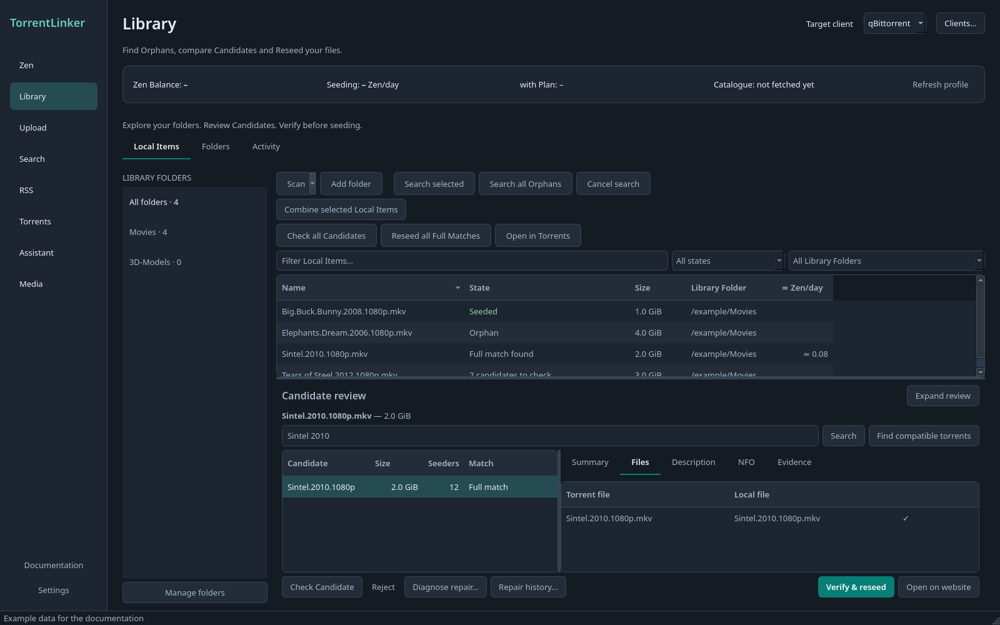
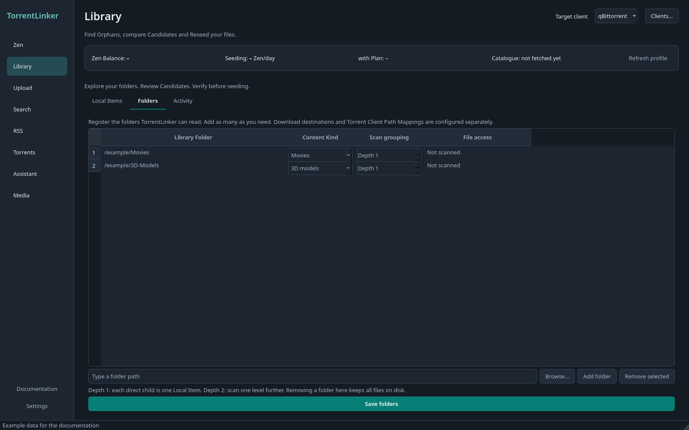

# Library and reseeding

## Folder explorer and Candidate review

Desktop and WebUI use the same Library layout: **Local Items**, **Folders**, and **Activity**. Choose a Library Folder in the left rail, filter the Local Items, then select an item to open its Candidate review below the table. **Expand review** gives the Candidates more room; **Back to Local Items** restores the table without losing the selected Candidate.

Review **Summary**, **Files**, **Description**, and **NFO** before acting. Files shows local counterparts, renamed paths and absent files. A Full Match compares file names and sizes; **Verify & reseed** still requires the Torrent Client's hash Verification. **Reject Candidate** remembers your decision for this Local Item. Searching, checking and rejecting never start a Reseed.

Use **Folders → Add folder** to register several folders and edit their Content Kind and scan grouping. Depth 1 treats each direct child as one Local Item. Removing a registration leaves files on disk. Settings opens the same folder editor. Download destinations and Path Mappings remain separate, per Torrent Client.

In the WebUI, Browse lists folders on the **TorrentLinker server**, within its configured storage roots. It cannot browse the computer running your browser. Registering a readable Library Folder does not require a Torrent Client mapping. If the client is unavailable, a scan can still list files with **Seeding status unknown**; they are not automatically classified as Orphans. The desktop also scans readable folders while the client is offline and labels their seeding status unknown. Unreadable paths retain their previous scanned items.

The WebUI now supports selected-item searches, remembered Candidate review, file comparison and rejection. **Activity** lists server jobs and allows cancelling active work. Archive Matches offer **Unpack and reseed…** in both interfaces. The WebUI previews the destination on the TorrentLinker server, unpacked size, file count, free space and any missing files. Confirm one Candidate at a time; closing or cancelling the preview writes nothing. Approval expires after five minutes and is checked again against the archive and configuration before extraction. Progress and cancellation are available in the dialog and **Activity**. Cancellation is available until Torrent Client submission begins. It stops the extractor and removes its partial output; completed files are kept if a later Reseed fails. The original archive is kept. µTorrent disk-rename approval still requires the desktop application's individual review.

Settings also lists the selected client's default and category Download Folders. Choose a category to see its effective destination. Saving a destination verifies an existing Path Mapping against a seeded file and preserves the other category rules.

[Documentation](../../README.md) · [Français](../fr/bibliotheque.md)

1. Click **Add folder…** and choose its content kind and scan depth.
2. After scanning, search a selected Orphan or all Orphans.
3. Check the Candidates. A size match must still pass the torrent client’s hash Verification.
4. Reseed Full Matches. The summary separates new additions from torrents already in the client.

Screenshots use the English interface, dark theme and example data.

## Add folders and use batch actions

The **≈ Zen/day** column shows the current estimate from Zen for torrents linked to Seeded or Partially Seeded Items. For Orphans, it shows the estimate for the best checked Match. Paused torrents contribute zero; unavailable estimates stay blank. If one torrent covers several Local Items, its estimate appears on each, so this column should not be summed as a library-wide total.

In the Library, **Add folder…** lets you choose a folder, its Content Kind and scan depth without opening Settings. Depth 1 treats each immediate file or folder as one Local Item. Saving scans the Library and selects the new folder in its filter; a folder already registered is not added twice.

In the Library, **Check all Candidates** checks every untested Candidate already found, including items hidden by filters, without repeating searches or successful checks. **Reseed all Full Matches** sends confirmed Full Matches through the usual hash Verification before seeding. Both actions run in the background with progress and **Cancel batch**; errors are collected so other Candidates can continue. Torrents already in the client are labelled and counted separately from new Reseeds.

If Full Matches are inside archives, a preflight lists their unpacked sizes. Choose **Unpack and reseed selected…** to review one archive’s destination and free space in the existing confirmation dialog, or **Reseed ready Matches** to process only files already on disk. Archives are never unpacked automatically by the batch.

## Reseed existing files

Scan the Library, then search the Orphans: Local Items that no c411 torrent in your torrent client covers. Files seeded only for other trackers are Orphans too, so you can cross-seed them on c411. A torrent counts as c411's by its tracker, by its infohash in the Catalogue (a torrent that has not announced yet may report none), or by TorrentLinker's tag; only these torrents' file lists are read. TorrentLinker compares each Candidate's file tree with the local files. Full Matches can be Reseeded without downloading their data. Partial Matches skip missing files and stay stopped after Verification.

Reseeds rename paths inside the torrent client, leaving local filenames and contents untouched. A hash check must pass before seeding starts. Verification failures remove the torrent from the client without deleting local files. Deluge resumes a stopped torrent while it checks it, so until a Reseed is started or its Verification ends TorrentLinker holds its download speed at 1 byte/s: nothing can be written into your files meanwhile (see [ADR-0009](../../adr/0009-deluge-through-its-web-ui-with-labels-and-a-speed-guard.md)). Previous searches and rejections are remembered across restarts.

### Archives

A Local Item that is a .zip, .rar or .7z archive is also compared by what it holds, since torrents usually share the same files unpacked. A Candidate matching the archive's contents shows as **Full match inside the archive**. **Unpack and Reseed…** then unpacks it into a new folder next to the archive, after showing the size and the free space, and Reseeds the torrent against the unpacked files with the usual Verification. Nothing is overwritten. Once the client has verified every unpacked file and the torrent seeds, the desktop offers to move the archive to the trash, or to keep it. The WebUI keeps the original archive. Plans never unpack archives.

Zip archives need nothing more. Rar and 7z archives need [7-Zip](https://www.7-zip.org/) (or unrar for rar); without it they are compared as plain files. For the WebUI, install the extractor on the TorrentLinker server or in its container.

[Documentation](../../README.md) · [Français](../fr/bibliotheque.md)

## Evidence and original names

Open **Evidence** in the Local Item inspector, then **Inspect metadata**. TorrentLinker compares the filename, embedded title and adjacent same-name NFO with MediaInfo. Each warning identifies its source and confidence. Cropped dimensions and multiple audio tracks are considered. A HandBrake tag is only a processing clue; these checks cannot certify a source or team.

**Import old torrents…** accepts up to 100 `.torrent` files per batch, at most 8 MiB each. Import runs offline: it does not announce, add torrents to a client or rename media. Exact sizes suggest associations; target piece hashes verify bytes. Ambiguous associations remain unresolved. Modified files invalidate saved verification. V2-only and hybrid torrents are not supported by this evidence workflow yet.

Upload preparation offers **Use a verified original name…** after an import verifies the Local Item. This changes the proposed release name only. Check the Files preview before saving a draft; nested filenames are not automatically restored. Current tracker rules and the uploader's review still apply.

## More torrents from existing files

**Find compatible torrents** also works for already seeded items. Series searches include series, season and episode scopes supported by the Indexer. A smaller episode can match files in a larger pack. Searches are bounded to 30 requests and 100 Candidates; a limit notice means the results are incomplete. Search counts and catalogue coverage are not guarantees of exhaustive results.

Select multiple Local Items of the same series and Content Kind, then **Combine selected Local Items** to search for a combined pack. This creates a virtual file list, without copying or linking media. Initial support requires qBittorrent and one consistent Path Mapping from the common parent. Each target file must be present, including sidecars, and the client's ordinary hash verification must succeed before seeding. Select the items again after restarting to restore the combined selection.

## Experimental repair on an independent copy

Select a Candidate for one local file and choose **Diagnose repair…**. Diagnosis reads target piece hashes without writing the original or contacting peers. Initial limits are a size difference of at most 1% and 50 MiB, at least 90% verified target bytes, at most 500 MiB missing and at least two advertised seeders. These are fixed conservative defaults in this version. Seeder counts and source/team claims do not guarantee availability or authenticity.

For an eligible result, choose a destination for an independent copy. WebUI destinations must be mounted under an allowed storage root on the server. TorrentLinker creates a new directory and keeps the original intact. It adds the target stopped in qBittorrent and requests verification. **Refresh verification**, then use **Confirm download into copy…** only after the result is ready. Other clients and multifile/v2 torrents are not supported by repair yet.

The missing-byte estimate describes useful content, not total network traffic. Repair history persists across restarts; restarting never starts a pending repair. Failed or uncertain operations remain for manual inspection in the Torrent Client. Incomplete copies are kept; removal of a torrent alone does not delete them. The original is always retained. Tests use synthetic data; repair success rates on real media collections are not established.
