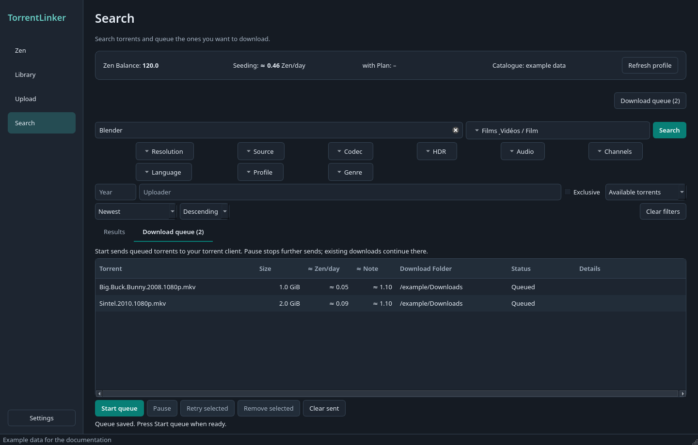
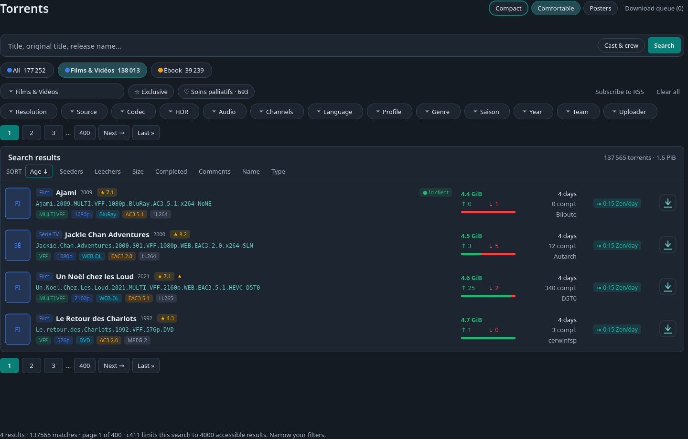

# Search and download

[Documentation](../../README.md) · [Français](../fr/recherche.md)

1. Enter a title, pick a category pill and adjust the filters. The page searches by itself a moment after each change.
2. Click a result's title to open its details in a tab.
3. Select results and add them to the queue, or use a row's download button.
4. ### Start and manage the queue

The queue also shows **≈ Zen/day** and **≈ Note** for each torrent. Click their headers to sort numerically. Estimates use the same calculation as search results and refresh when the Zen Profile or seeding torrents change. They remain available after restarting the app.

Open **Download queue** from the button at the top right of Search, then start it. **Download now** sends only the selected torrent immediately. **← Back to results** returns to the search.

Screenshots use the English interface, dark theme and example data.

## The Search page

The page follows c411's torrents page, with TorrentLinker's own colors and extras.

- **Header.** The **Compact / Comfortable** switch, **Posters**, and the **Download queue (N)** button. Your choices are remembered.
- **Search bar.** A large field for the title, original title or release name. On Films & Vidéos, **Cast & crew** also searches actors, directors and screenwriters.
- **Category pills.** *All* and one pill per category, with c411's own totals. A pill filters at once. The **Category** menu below picks a subcategory.
- **Filters.** Rounded buttons that open a searchable checklist (resolution, source, codec, HDR, audio, channels, language, profile, genre, season and so on), then **Year**, **Team** and **Uploader**. Team takes a team name or slug, as on c411. When four or more values are chosen they also show as chips you can remove one by one. **Exclusive** and the heart button for **soins palliatifs** sit next to the Category menu. **Subscribe to RSS** carries the query into a new subscription, and **Clear all** resets everything.
- **Automatic search.** Filters, toggles, pills, sort chips and page links search by themselves. Filter changes wait about a second so several clicks make one request. A half-typed year does not search. The Search button and Enter still work.
- **Results card.** The total number of matches and their size, a row of **sort chips** (Age, Seeders, Leechers, Size, Completed, Comments, Name, Type, and Relevance while a query is typed; click the active chip to flip the direction), and numbered page links above and below.

### Comfortable and Compact

**Comfortable** rows show the poster, the type, the title with year and rating, the release name, colored tags (language, resolution, source, audio, video codec, HDR), size, seeders and leechers with a balance bar, age, completed downloads, the uploader, the **≈ Zen/day** estimate and a download button. A ★ marks exclusives and a ♥ marks soins palliatifs. **In client** appears on torrents your torrent client already has, and **Queued** on those in the download queue; both come from what the app already knows and ask nothing of the client.

**Compact** follows c411's table: a colored **type** badge, the release name with its short tags under it (**EXCLU**, language and quality as c411 words them, ♥ for soins palliatifs), comments, age, size, completed downloads, seeders (green) and leechers (red), then **≈ Zen/day**, **≈ Note** and a download button. On c411 a column header sorts the whole search, not just the page. It shows the same In client and Queued marks.

**Posters** come from TMDB. The app fetches them a few at a time for the rows you see, keeps them on disk and sends no key or cookie with the request. Turn **Posters** off to stop all of it. In the web page the server fetches them, so your browser never contacts TMDB.

### Adding to the queue

Select rows (the selection bar appears at the bottom) and click **Add selected to queue**. Choose a Download Folder in the bar or leave it blank to use the category folders from Settings. **Open in tabs** and **Open on website** work on the selection. After adding on desktop, the queue opens with the number added and already listed. Folder errors stay visible beside the selection controls. A row's own download button queues just that torrent. In the web page, queueing keeps you on Search and the row shows **Queued**.

### Category filters

For c411, the category tree and available search options come from its native API. Select a category to see its filters. Films & Vidéos adds resolution, source, HDR, codec, audio, channels, language and profile; series also offer season and episode choices. Year, team, uploader, exclusivity and sorting apply across categories. Changing categories clears incompatible filters. Other Indexers keep their Torznab search: a category menu and pills, no native filters.

### Soins palliatifs

The heart button cycles through available torrents, inclusion of **soins palliatifs**, and soins palliatifs only. It shows c411's current count. Results identified by c411 as soins palliatifs carry a label; zero seeders alone does not establish that status. This is discovery support, not personal reward tracking. Page links keep the submitted search criteria. If c411 exposes only part of a large result set, the app shows its accessible limit and asks you to narrow the filters.

### Estimates and publication age

Search results include sortable **≈ Zen/day** and **≈ Note** previews for c411, also shown in torrent details. Note is the estimated contribution score for your Class, category, swarm and seed age. New torrents use your Zen Profile, planned seed hours and current seeding count, starting at zero seed age and including you in the swarm. Already seeded torrents keep their current estimate and seed age. Hover over the estimate to see its assumptions. Revival payouts remain separate.

The **Age** column shows time since publication, such as **2 hours** or **3 days**, and refreshes every minute while Search is visible. Hover to see the exact local date and time, using c411's creation date or Torznab's publication date. Missing dates display as **–**. The header sorts the current page by the underlying timestamp; use the **Age** sort chip to sort the search across pages.

### Torrent details

Click a result's title to open its page in a tab. It follows c411's torrent page: the type badge, flags (**Exclusive**, **Low bitrate**, tested or not), the open-on-website button, the release name, who sent it, their team and when, and a banner when the community has not tested it yet. Below are the size and the live swarm (seeders, leechers, completed, and **Seeds wanted** when nobody is seeding), your **≈ Zen/day** and Note, the hash and file count, and c411's facts as chips (language, quality, season, genre and so on). **Show the NFO** and **Show the files** open in place. A TMDB card gives the poster, title, year, type, genres, rating, runtime, director and cast with links to TMDB and IMDb, followed by **Community trust** (read-only: votes need a website session, so use **Vote on the website**) and the description. A bar at the bottom keeps the folder and the **Add to queue** and **Download now** buttons in view.

Details load only when opened; no `.torrent` is downloaded. The NFO is plain text, and images load through the configured proxy without Indexer credentials. Descriptions are centered, with explicit text alignment preserved. Images up to 32 MiB are decoded within a pixel limit and scaled for display. Failed images show compact links; **Retry images** retries them without reloading the torrent metadata and respects a host's rate-limit cooldown. Unsupported details and unavailable images can still be viewed on the website. c411's **Versions** list (the same content in several encodes) needs its grouped listing, so it is not shown here; use the website for it.

Each torrent tab also offers **Add to queue** and **Download now**, with an editable Download Folder. Download now sends only that torrent, leaving other queued items waiting. Both actions use the queue's duplicate and overwrite protections; a torrent already queued to a different folder must be removed before changing its destination.

### Manage tabs

Torrent tabs stay open while you run other searches. Opening the same torrent switches to its existing tab. Drag tabs to reorder them, use **Open tabs** to jump to one, or close them with the × button, middle-click, **Ctrl+W**, or the tab's right-click menu. **Ctrl+Tab** and **Ctrl+Shift+Tab** switch tabs; **Ctrl+F** returns to the search field. Closing a tab does not remove or stop a queued download.

Open the **Open tabs** menu at the right of the tab bar for **Queue all tabs**, which adds the open torrent tabs and opens the queue without starting downloads, and **Download all tabs**, which queues and starts that set in one click, leaving unrelated queued torrents waiting. The **Download queue** button above the tabs stays accessible while browsing torrent details. Each tab keeps its own Download Folder. All destinations are checked before queuing the batch; if one needs attention, that tab opens and an error appears above the tabs. Torrent tabs last for the current app session; the download queue persists across restarts.

Open **Download queue** and click **Start queue** to send the selected torrents to your torrent client in order. The queue respects the Indexer's download limits and waits when asked. **Pause** stops further sends after the current request; downloads already started continue in the torrent client. Queue entries and outcomes survive restarts, and the queue waits for Start after reopening. Failed entries can be retried; sent entries can be cleared without removing torrents from the client. Existing client torrents and files at the destination are protected against duplicate downloads or overwrites.

The **Download queue** count includes every row, including sent entries. The summary separates queued, sending, sent and entries needing attention. Right-click a queue row for actions, or use the buttons below the desktop table and above the WebUI table. **Retry selected** puts safe failures and skipped entries back in the waiting queue; press **Start queue** to send them. Uncertain sends must be checked in the Torrent Client first. **Remove selected** and **Clear sent** only remove queue records, leaving client torrents and files untouched.

### Unavailable torrents

When c411 explicitly reports that a torrent is unavailable for download, TorrentLinker removes it from the local Catalogue and remembers its hash across restarts. Catalogue refreshes and snapshot imports cannot add it back, so future Plans stop proposing it. Authentication errors, rate limits and server errors do not remove torrents.

[Documentation](../../README.md) · [Français](../fr/recherche.md)
