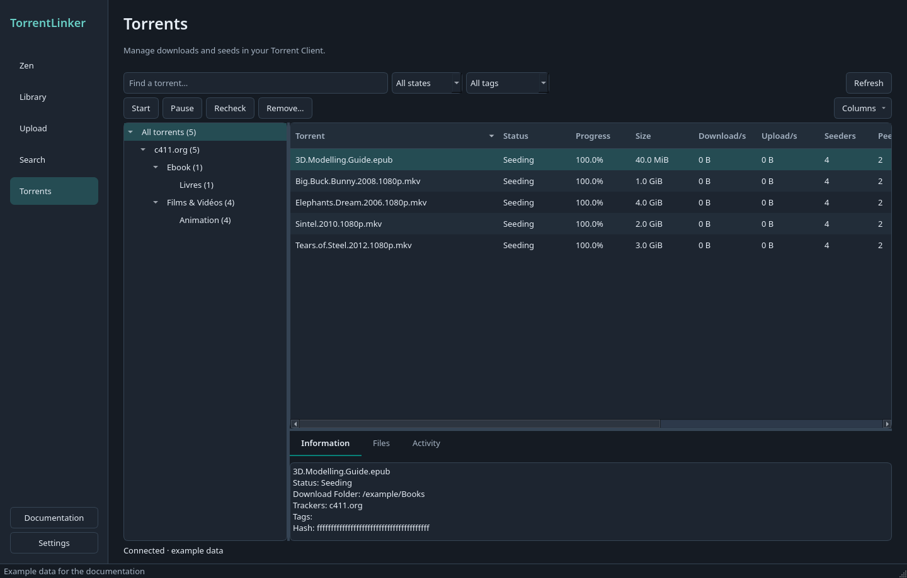

# Manage torrents

*Desktop application, English interface, example data.*

The **Torrents** workspace lists all torrents from the Torrent Client selected in Settings. It supports qBittorrent, Deluge and Transmission, including hosted clients and seedboxes. Listing and controlling torrents does not require access to their files on this computer.

Select a tracker in the tree, then a category or subcategory. Tracker groups come from announce URL hostnames, never personal tags. Private announce paths and passkeys are hidden. A torrent with several known trackers can appear under each of them; totals and actions count it once. When the client only supplies its current tracker, that is the tracker shown.

TorrentLinker category tags supply the category hierarchy. Known c411 categories from Zen also provide a fallback, including for Deluge, whose single label is preserved. Other torrents use their client's category. Torrents without a category appear under **Other / unspecified**. Personal tags remain separate filters.

Search names, filter by state or tag, and click column headers to sort. Drag header borders to resize columns. **Columns** lets you show additional fields or hide the tracker tree on a small screen. Zen/day and note are optional columns, populated from the latest Zen view where available; blank values mean unknown.

Select one or more torrents to **Start**, **Pause**, **Recheck** or **Remove** them. Removing asks for confirmation and keeps the downloaded files. Torrents undergoing TorrentLinker's Reseed verification are skipped so their verification can finish. The **Activity** panel reports each command's outcome; the table shows the actual state received from the client.

To delete the downloaded files too, right-click the selected torrents and choose **Delete torrent and files…**. Review the torrent names and folders in the confirmation dialog before confirming. The client deletes files on its own machine, including a remote server or seedbox. Shared files may also be used by other torrents, and TorrentLinker cannot undo the deletion. Cancel is selected by default.

Select one torrent to read its information. The **Files** panel loads on demand and lets you choose files to download or skip. It does not rename or move files. The list refreshes every five seconds while this workspace is visible and slows down after a connection error. Hidden workspaces do not poll.

Use **Open in Torrents** from the Search queue or Library to follow downloads and reseeds. In Search, selecting one queue entry opens that torrent when its hash is known.

## Reuse the client's folders

In **Settings → Download Folders**, choose **Import folders from Torrent Client…**. The app reads the client selected in Connections, including connection details you have just entered.

- **qBittorrent:** the default download folder and category folders, including nested categories.
- **Deluge:** the download folder, the completed-download folder when enabled, and completed-download folders configured by the standard Label plugin when enabled. Label is optional for this import.
- **Transmission:** the default download folder. Its incomplete-download folder is shown for reference when enabled; Transmission has no category-folder settings to import.

The preview shows both client paths and TorrentLinker paths after your current Path Mappings. Choose a default or category destination for each folder you want to use. Existing values are kept unless you select their replacements. Enabled temporary folders are informational and cannot be selected as final destinations. For a seedbox, paths may remain remote; importing does not require a local mount and does not create one. Local file scanning still requires access to those files.

Choose **Use selected folders**, then **Save** Settings. Importing copies paths only. It does not move files, assign client categories or labels, or change the client's settings or move-completed rules.

## µTorrent Classic: experimental support

Choose **µTorrent Classic** in Settings → Connections. This targets Classic's WebUI, not the separate µTorrent Web product. Enable the WebUI under Preferences → Advanced → Web UI, set a username and password, and enter its address in TorrentLinker. The `/gui/` suffix is accepted or added automatically. Passwords are stored in the system keyring.

The adapter was tested locally with Classic 3.6.0 build 47390 under Wine 10.0. It supports listing torrents, tracker grouping, file priorities, start/stop, recheck, removal without deleting files, and importing default/completed-download folders. The client's single personal label is preserved; TorrentLinker does not synchronize category tags to it.

New downloads require **Don't start the download automatically** in µTorrent and an explicit default folder under Preferences → Directories. TorrentLinker can send downloads to that folder or its subfolders, checks the returned path while the torrent is stopped, then starts it. Path Mappings apply normally. A destination outside that tree is refused. The app does not change µTorrent's global preferences.

Full Reseeds and Upload seeding add the torrent stopped, request a hash check and start it only after every file is verified. They use the same default-folder restriction. Disable µTorrent's incomplete-file suffix, completed-download moves, label-based folder suffix and Run Program commands first. TorrentLinker refuses those settings rather than changing them.

**When names differ, µTorrent requires renaming the files on disk.** A confirmation lists every current and new path, warns that other torrents or applications using the old paths can break, and defaults to Cancel. Approval applies only to that torrent, including in batches and Plans. TorrentLinker checks the local data against the torrent before renaming, never overwrites a destination, and then requests µTorrent's own verification. File contents are unchanged. On failure or interruption, a recovery journal restores original names if the files are unchanged and the old names remain available. Conflicts stop recovery and keep the journal. qBittorrent, Transmission and Deluge continue to rename inside the torrent instead.

Partial Matches, including matches missing ignored files, remain unsupported because this WebUI does not expose verified pieces. Zen seeding-age estimates cannot use a client-reported seeding duration from this adapter yet.

For development, `tests/test_utorrent_integration.py` runs only when `TL_UTORRENT_CONNECTION` names a JSON file with `url`, `username` and `password`, and `TL_UTORRENT_DATA` names the local view of the default download folder. Use an empty, dedicated test instance. Tests create unique disposable files, exercise the API, remove their own torrent jobs, and verify the files keep their bytes.
