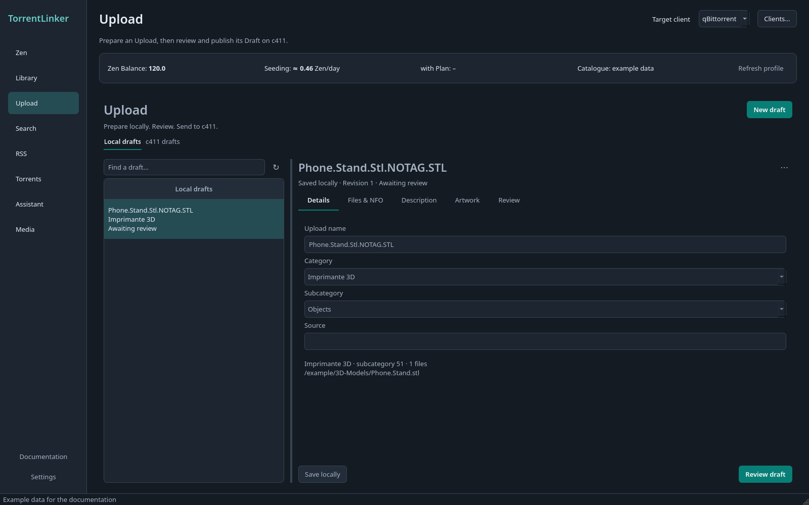

# Prepare a c411 upload

[Documentation](../../README.md) · [Français](../fr/upload.md)

1. Search the Library item for matches. Orphans with no results appear in **Upload**.
2. Select the item and category. Review refusals, warnings, name, files, NFO and description.
3. Add the direct URL of your hosted image.
4. Prepare the Draft, then review and publish it on c411. The app does not publish automatically.

Screenshots use the English interface, dark theme and example data.

## Prepare a c411 Draft

The **Upload** tab lists Orphans from every Library Folder that a search found no Match for: c411 may not have them yet. Each is made for one c411 **category**, picked in the form: the Library Folder's Content Kind proposes it (3D models → Imprimante 3D; movies and series, ebooks, music and games propose theirs), and an item of kind *Other* asks you to choose. **Imprimante 3D**, **Ebook**, **Audio**, **Films & Vidéos**, **GPS**, **Emulation**, **Applications** and **Jeux Vidéo** can be uploaded so far; the other categories show "not supported yet" until their rules are added. Changing the category redoes the checks, subcategory, name, NFO and description. Enter your **Announce URL** (from your c411 profile) in **Settings → Connections**, and use a main API key with the **Brouillons d'upload** (`drafts:rw`) scope.

Use the search bar above the Upload list to filter Local Items by filename. It works alongside the Content Kind and **Show all** filters.

Selecting an item also searches c411 for what it **already has** of it (the item's title words, within its category) and lists the releases found, with size, seeders and a link, in a collapsible **Already on c411** box; "Nothing found on c411" when there are none. It is information only: Team Pending refuses duplicates, and the app does not decide them. Each item is searched once per session, only when you select it, through the same key budget as every search.

For the chosen item, TorrentLinker checks c411's 3D rules: those a program can check (accepted formats, no archives) are red **Refusals** that stop the Draft, while those only you can judge (no files from independent creators who live off them, one coherent theme for a pack) are amber **Warnings** that leave the Draft available. It suggests a release name such as `Petit.Etau.De.Bureau.NOTAG.3MF` (dots between words, no accents, `NOTAG` when the source is unknown), makes a private torrent with c411's piece size and `source = C411` tag so its info-hash stays the same when published and an NFO listing every file, and saves them as a Draft on c411. The torrent then joins your torrent client against your own files, renamed inside the client as a Reseed is, so your files keep their names; it seeds once Verification passes.

Below the subcategory, click **Options** to show the choices c411 asks for: language, genre, format and so on. This section starts collapsed to leave more space for the description and NFO. Collapsing it keeps your choices; its open or closed state is retained during the session, including when options are refreshed. Loading errors, the retry button and missing required options remain visible while the section is collapsed. Selectors use checkboxes for multiple values and a drop-down for one; required options carry an asterisk. TorrentLinker reads them from c411 the first time a subcategory needs them, keeps them for a week (**Refresh options** reads them again), and a category's rules can pre-fill them; what you choose wins. A required option left empty blocks the Draft, and Imprimante 3D has none. Open c411's upload page, load the Draft, add the image the rules ask for (see below), and publish it there. See [ADR-0011](../../adr/0011-uploads-start-as-c411-drafts.md) and the [rules summary](../../research/upload-rules.md).

### The image for the description

c411's image upload only accepts a logged-in browser, so TorrentLinker renders the model itself. The **3D view** page of the Upload tab shows the chosen item's model (STL, binary or ASCII; OBJ; 3MF) at an isometric angle, framed on its bounding box: drag to rotate, scroll to zoom, double-click or **Reset the view** to start over. A folder with several models offers each in a list. Big meshes are read off the interface thread and thinned for display only.

- **Capture** saves the current view as a PNG at least 1000 px wide.
- For a **Pack**, **Capture the Pack sheet** saves a grid of up to 9 models, each seen from the isometric angle with its file name below.
- **Open the folder** shows the images, which are in `uploads/<release name>/` (never in your Library). Add the one you choose on c411's upload page while reviewing the Draft; the description keeps an `[img]…[/img]` placeholder for it.

If you host the image elsewhere, paste its direct URL into **Image URL**. **Host image…** opens Postimages. The image is included in the Draft description even after you edit the text; changing the URL updates the image without resetting your presentation.

STEP, GCODE, BLEND, F3D, SLDPRT and FCStd items show no preview and say so: make that image yourself. Rendering needs OpenGL; without it the view and captures are unavailable and the message says why.

## Rules for each category

See [category rules](upload-categories.md) for formats, naming, checks and metadata for ebooks, audio, video, GPS, emulation, applications and games.

[Documentation](../../README.md) · [Français](../fr/upload.md)
