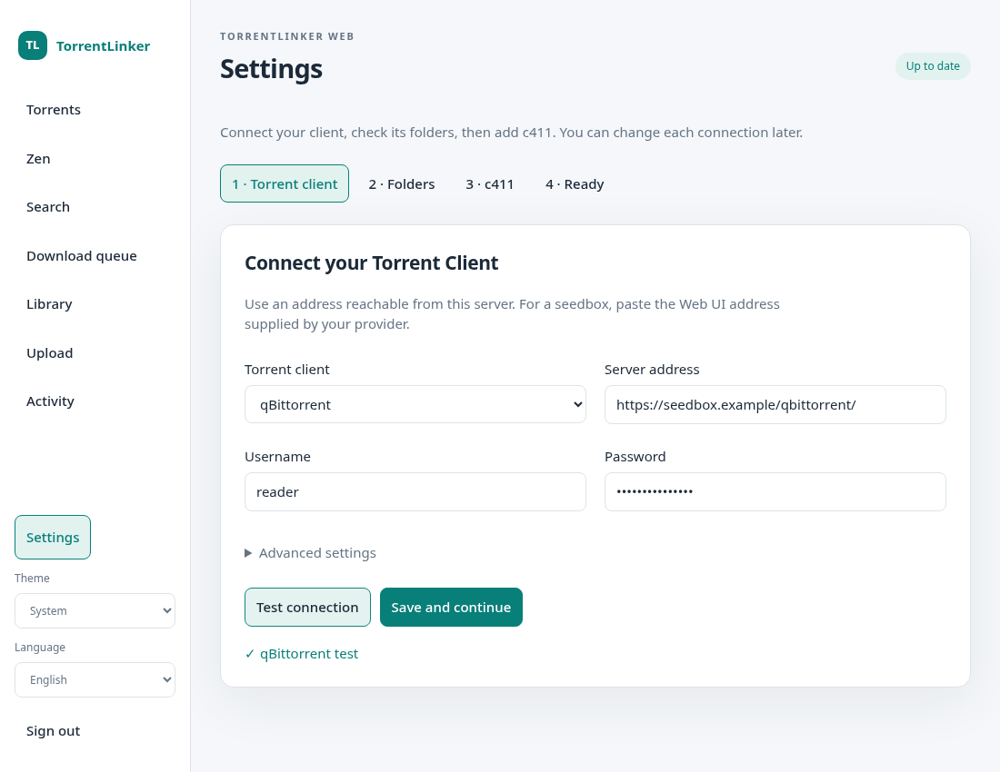

# Web UI and Docker

The Web UI is in development for 0.7.0. The README still links to the latest published desktop release. Build the Docker image from source; no published image is required.

## Start the server

From the repository root, create a private password file. Use at least 12 characters:

```bash
python3 - <<'PY'
import getpass, os
password = getpass.getpass('Web UI password: ')
if len(password) < 12:
    raise SystemExit('Use at least 12 characters.')
fd = os.open('deploy/web-password.txt', os.O_WRONLY | os.O_CREAT | os.O_EXCL, 0o600)
with os.fdopen(fd, 'w') as output:
    output.write(password)
PY
docker compose up -d --build
```

Open `http://localhost:8787` and sign in. The default port binding is host-only. Set `TL_BIND_ADDRESS` to your host's LAN address for LAN access. For remote access, use an HTTPS reverse proxy and `TL_SECURE_COOKIE=1`. Do not expose the plain HTTP port directly to the Internet.

The image runs as UID/GID 1000. Set `TL_UID` and `TL_GID` before building if needed, and adjust ownership of an existing configuration volume accordingly.

## Guided setup



1. Choose qBittorrent, Deluge, Transmission or µTorrent. Test its address and credentials, then save. Deluge uses its Web UI password.
2. Review folders reported by the client. API-only seedbox users can continue without mounted files.
3. Add your c411 key, or do this later. Search needs `torznab:read`; the Zen profile needs `profile:read`.
4. Review available features and open Torrents. Each connection remains editable in Settings.

Testing does not replace saved settings. Blank password fields retain the saved value. Credentials supplied through secret files must be edited in those files. Advanced settings include a proxy for Internet services, optionally also used for the Torrent Client.

## Mounted NAS or seedbox storage

```bash
TL_MEDIA_PATH=/srv/media docker compose \
  -f compose.yaml -f deploy/compose.storage.yaml up -d --build
```

The host directory must already exist. TorrentLinker sees it as `/data`; your client may see the same files as `/downloads`. Use **Detect matching folders** for suggestions, or enter both paths. The check verifies a client's existing file against the mounted copy by name and size. Downloads and planning require a verified sample for the destination.

The example mount is read-only. New downloads are written by the Torrent Client through its own filesystem. Explicit deletion of torrent files also happens in the Torrent Client, so TorrentLinker's read-only mount does not prevent it.

The folder browser lists server directories within configured storage roots. Web scans reject symbolic links in scanned trees; choose the real directory directly.

For a hosted seedbox, use the provider's HTTPS URL, including any URL prefix. Without a mount, management, Zen and Search remain available. Scan, comparison, Upload preparation, safe downloads and planning require access to the seedbox's actual files. Mount its storage on the host first, then use the same Compose override. TorrentLinker does not mount SSHFS/NFS/SMB shares automatically.

Entering a path does not provide access. Missing storage is never treated as empty, and container free space is never substituted for seedbox capacity.

## Client addresses

Containers on one Docker network can use service names, such as `http://qbittorrent:8080`. Docker Desktop provides `host.docker.internal` for host services. Native Linux Docker Engine may need `extra_hosts: ["host.docker.internal:host-gateway"]`. The service must listen on a reachable interface and its firewall must allow the connection. `localhost` always means the TorrentLinker container in this deployment.

## Persistence and recovery

The `torrentlinker_config` volume holds configuration, catalogue, queue, job history and Verification records. Jobs survive browser disconnects. Activity shows progress and cancellation; an in-flight client command finishes before cancellation takes effect.

After an abrupt restart, unfinished jobs are marked interrupted and are not replayed. Check the Torrent Client before retrying. Persisted Reseed Verification is monitored again. A queue entry with an uncertain send remains visible and is not automatically sent a second time.

UI-entered credentials are encrypted in `credentials.enc`. Back up it and `credentials.key` together and protect the configuration volume. Someone who can read both files can decrypt the credentials. Desktop credentials still use the operating system keyring.

Secret-file overrides: `TL_INDEXER_API_KEY_FILE`, `TL_QBIT_PASSWORD_FILE`, `TL_QBIT_API_KEY_FILE`, `TL_DELUGE_PASSWORD_FILE`, `TL_TRANSMISSION_PASSWORD_FILE`, `TL_UTORRENT_PASSWORD_FILE`, `TL_ANNOUNCE_URL_FILE`. Credentials never appear in setup API responses.

## Run without Docker

```bash
pip install '.[web]'
torrentlinker serve --config ./torrentlinker-data \
  --password-file ./deploy/web-password.txt --root /path/to/media
```

The server targets Linux and Linux NAS systems. Install the desktop from source with `pip install '.[desktop]'`. Only one server process may use a configuration directory. For a reverse proxy under `/torrentlinker`, set `TL_ROOT_PATH=/torrentlinker`, strip that prefix upstream, and open the URL with its trailing slash.

## Initial interface limits

Archive extraction and µTorrent disk-renaming confirmations remain in the desktop application. Web Uploads support category rules, hosted images, descriptions, NFO, options and Draft creation. The desktop retains the 3D renderer. Publish Drafts on c411 after review. A prepared Upload can be seeded during the same server session; after a restart, inspect the Draft and use the desktop workflow if needed.

Run API tests with `pytest tests/test_web_setup.py tests/test_web_jobs.py`. For the real browser flow, install `.[browser-test]`, run `playwright install chromium`, then `TL_WEB_BROWSER=1 pytest tests/test_web_browser.py`. Tests use fake clients and temporary media.
