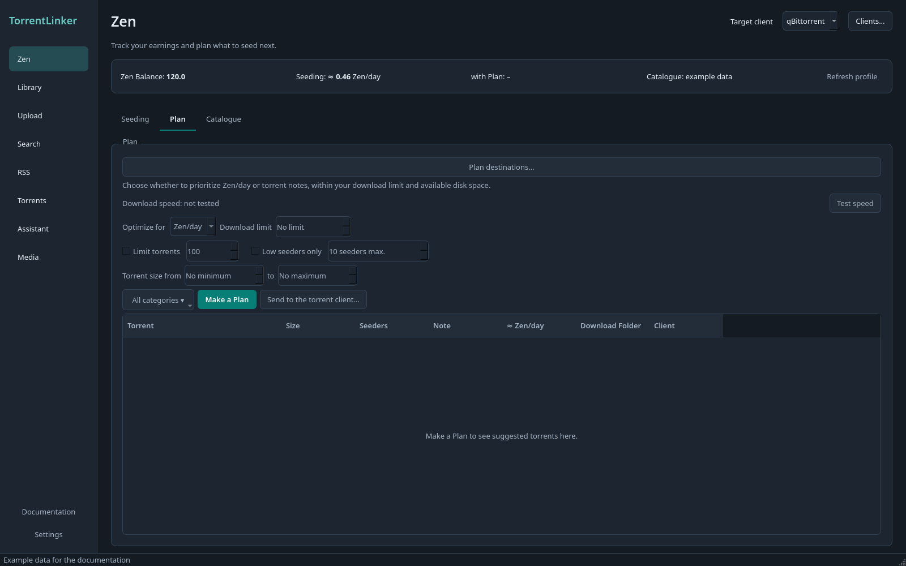

# Track Zen and make a Plan

[Documentation](../../README.md) · [Français](../fr/zen.md)

In **Zen → Seeding**, expand categories to compare torrents. Category notes average all available torrent notes, including descendants. Use **Plan** to prepare new downloads.

Categories start collapsed. Your expanded and collapsed branches are remembered across refreshes and app restarts, including **Expand all** and **Collapse all**. Filtering temporarily opens matching branches; clearing the filter restores your saved layout.

Screenshots use the English interface, dark theme and example data.

## Zen integration

The Zen tab brings together c411's reported balance and TorrentLinker's earnings estimates:

- Read your Zen Balance, Class, unlocked progression-tree bonus, and download eligibility from your c411 profile. The Indexer API key needs the `profile:read` scope for this, in addition to catalog/download access.
- Estimate Zen/day for each torrent currently seeding in your torrent client and for Matches found in the Library, using size, seeders, seed age, category, Class bonuses, and the configured seed hours per day.
- Compare Tanker, Swarm Keeper, and Reuploader. Reuploader estimates use the upload count entered in the Zen tab and are approximate.
- Set Class, unlocked tree bonus, seed hours per day, and an overall torrent cap in **Settings → Zen**. Values supplied by c411 fill the Class and tree bonus automatically when profile access is available.

Without profile permission, you can enter the Zen Profile by hand and use estimates and planning. The displayed balance comes from c411; projected earnings and payback are local estimates. The client's seed age is a lower bound when a torrent has been removed and added again.

### Browse seeding torrents by category

**Zen → Seeding** groups torrents under their Catalogue category and subcategory. Expand a branch to see its torrents, size, estimated Zen/day and **≈ Note**. Categories show the arithmetic mean of the notes of all their torrents, including subcategories; unavailable notes are excluded. Search matches both torrent names and category names. Sorting, resized columns, selection and collapsed branches survive refreshes. Torrents without a known category appear under **Unknown category**; broad snapshot categories stay at the parent level until confirmed.

On desktop, each Seeding refresh also synchronizes category tags in qBittorrent and labels in Transmission, for example `torrentlinker:category:Books / Comics`. It adds missing tags and replaces only older tags in that namespace, preserving personal tags, Verification tags, download folders and the client's native category. Unknown category names are left untagged. Deluge's single label is preserved because it carries Verification state; its torrents still appear in the category tree. The Seeding view reports tag updates and failures.

The web interface also has **Zen → Seeding**, separate from **Plan**, with category groups, filtering, sorting, seed age, Zen/day, Note and Class comparison. Expand categories to load their torrents, in pages of 100. Filtering changes the displayed groups without changing the overall Zen totals. **All clients** counts each hash once and prefers a seeding copy; unreachable clients are flagged and their last observations may be incomplete. The web refresh reads the torrent clients without changing category tags or calling c411 per torrent. Class comparison uses the configured upload count.

## Make a Zen Plan

Choose categories, then configure the Plan:

| Control | Effect |
| --- | --- |
| Optimize for **Zen/day** | Tries several greedy orderings and keeps the Plan with the largest estimated Zen gain. |
| Optimize for **Note** | Selects the highest-note torrents first for your Class. |
| Download limit | Maximum total download size in decimal GB. Zero means no additional size limit. |
| Limit torrents | Optional maximum number of torrents added by this Plan. |
| Low seeders only | Optional maximum current seeder count, initially 10, before you join the swarm. |
| Torrent size from … to | Optional minimum and maximum size of each torrent, in decimal GB. Zero leaves that side open. Applies to downloads and Reseeds. |

Reseeds come first. They count toward the torrent limit and consume no download budget. The overall torrent cap and disk-space reserve also apply. The results show each torrent's note, the size-weighted average note, estimated Zen gain and payback, and free disk space before and after the Plan. Download Folders sharing a physical disk are counted once. Plan options are saved across restarts.

A Plan leaves out every torrent already in your torrent client, whatever its tracker or state. It also leaves out Catalogue torrents that seem to be in your Library or in the Plan's Download Folders already, such as files kept after their torrent left the client: a Local Item, or one of its files, of the torrent's size (or up to 64 KiB smaller, for an .nfo or cover) whose name shares most of its significant words, with no other volume number. The Plan says how many it left out; hover over its summary to see them. No request is made for this, so only a search in the Library confirms a Match, which you can then Reseed instead of downloading.

Each Plan shows two estimated times. **Sending** to the client follows c411's limit on `.torrent` downloads: 30 a minute per API key, and about 280 in 20 minutes, so more keys send faster (1,000 torrents take about an hour with one key, 7 minutes with five). **Downloading** the data is the Plan's size divided by your download speed. **Test speed** measures that speed for about 8 seconds with Cloudflare's public speed test, anonymously, and remembers it. The download time is a lower bound: torrents with few seeders download slower than your connection. Run the test while your torrent client is idle.

Sending a Plan downloads each `.torrent` directly from c411 and adds it to its Download Folder. TorrentLinker refuses downloads that would overwrite existing files. Normal Reseeds still go through hash Verification.

A progress bar shows how many torrents have been sent, added, refused, or failed, with an estimate of the time left. **Stop sending** ends after the current torrent. If c411 refuses downloads (HTTP 429), sending waits and retries the same torrent, waiting longer each time up to 15 minutes, and shows the next try time.

The Plan and each torrent's result are saved as sending goes. After you stop sending, close the app, or after a crash, the Plan comes back with only the torrents left to send; failed ones are tried again. Click **Send to the torrent client** to continue. Making a new Plan or changing its options replaces the saved one. Reseeds are not saved, but sending always starts with them.

An empty Plan states the observed blocker and what to change: total torrent cap, filters, missing folders, existing torrents, no seeders, Zen profile or insufficient budget. Catalogue exclusions include counts. The total cap in **Settings → Zen** is separate from the Plan's torrent limit.

### Catalog updates and provisional estimates

The first Plan imports Zen Lab's public metadata snapshot anonymously. Your c411 API key and all `.torrent` requests go directly to c411.

c411 allows your account 1,200 searches and Catalogue requests an hour, whatever the key, and limits each key's `.torrent` downloads to 30 a minute. TorrentLinker keeps the two apart: searches go up to two a second while the hour's budget lasts, then slow down, even while a Plan is being sent; each key's downloads keep to 30 a minute and about 280 in 20 minutes. Your own searches, file checks and Reseeds always go before a Plan being sent or a Catalogue update. If c411 asks every key to wait more than half a minute, they stop at once and tell you when to try again, instead of hanging. You can add up to 4 more keys of the same c411 account in **Settings → Connections → More API keys**: each adds its own download allowance, and requests go to whichever is free soonest (see [ADR-0008](../../adr/0008-several-c411-keys-each-within-its-own-limits.md)). See [the measurements](../../research/rate-limits.md).

Planning and startup refresh c411 newest-first, stopping at the previous successful update's checkpoint, or an already known page on the first update. Historical scans and their saved page positions are reserved for the explicit Catalogue fetch action. Interrupted updates retain their checkpoint and check for new arrivals when resumed.

A paging-limit warning means the Indexer stopped exposing older pages. Cached torrents remain available for Plans; repeating the fetch does not remove the server limit. A paused fetch is different: it has unfinished work that can be resumed.

Plans use cached metadata and show provisional estimates. There are no per-torrent c411 metadata checks before planning or sending. The torrent client is read every 30 seconds to update Seeding estimates as tracker responses arrive. Its known swarm counts also update the local Catalogue for future Plans; unknown counts retain the cached estimate.

If another Catalogue refresh is running, the Plan waits for it and then refreshes its selected categories. If a refresh fails while the Catalogue already contains torrents, the desktop Plan uses the cached data and shows a separate notice. Without any cached data, the error stops Plan creation. You can stop fetching and make a Plan from the data already available.

The snapshot has coarse categories and unknown upstream age. Broad entries are excluded from narrower subcategory selections until the local Catalogue has a specific category from c411. Selecting the parent category allows the broader set. Seeder updates from the client preserve that category uncertainty. c411's paging limits and the snapshot do not establish complete tracker coverage, and the app reports known limits. Zen values remain estimates.

See [CONTEXT.md](../../../CONTEXT.md) for the vocabulary and [docs/adr](../../adr) for the design decisions.

[Documentation](../../README.md) · [Français](../fr/zen.md)

### Web planner controls

The web interface has separate **Seeding**, **Plan** and **Catalogue** tabs. Plan uses the desktop selection and sending engines. Select multiple categories or subcategories, optimize for Zen/day or Note, set optional torrent and seeder limits, and distribute downloads across clients with separate budgets. Web size inputs are labelled GiB; desktop inputs use decimal GB. Zero adds no budget or maximum-size limit. Categories and planning limits survive restart.

For a single destination with no per-client budget, checked Library Full Matches join the Plan as zero-download Reseeds. As on desktop, distributed Plans contain downloads only. Size, seeder and torrent limits apply to both downloads and Reseeds. Files already in the Library or Download Folders are excluded and listed for review.

Review total size, added Zen/day, payback, the size-weighted average Note, and disk reservations. Folders on the same physical disk share one capacity calculation. Sort and select across pages, then choose **Send selected to clients…** or **Queue selected downloads**. Direct sending asks for confirmation. Reseeds go through hash verification; µTorrent disk renames require an additional review of every old and new path. **Stop after current torrent** retains unsent downloads, which also survive a server restart. Session-only Reseeds must be rebuilt after restarting the server. Failed rows remain available to retry; refused rows and successful sends leave the Plan.

Use **Category folders…** to browse the TorrentLinker host and verify destinations. These are server paths, not paths on the browser's computer. **Zen profile, disk reserve & exclusions** holds the planning settings. You can enter a download rate or test the server connection; that estimate may differ from a remote torrent client's connection. The sending estimate uses the configured API key count. Additional keys are stored privately under **Settings → c411 → Advanced settings**; saved key values are never returned to the browser.

Changing planning inputs requires a new Plan before sending. You can stop Catalogue fetching and build from the cache. A failed refresh uses an existing cache with a visible notice; an empty cache leaves the error visible.

The Catalogue tab shows cache age and coverage, including paging limits and imported snapshot metadata. Its history fetch can be paused after the current page and resumed. Updating it does not send any downloads. In **Seeding**, the upload count used for Class comparison is editable and saved.
