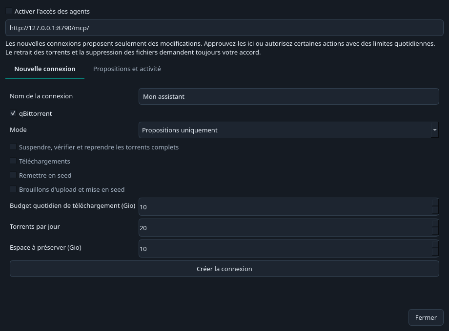
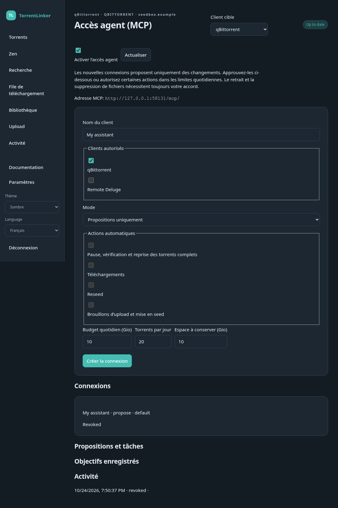

# Agents et accès MCP

Connectez un assistant compatible MCP à TorrentLinker pour consulter vos torrents, rechercher sur c411, préparer des Plans et proposer des actions. TorrentLinker ne contient pas de modèle d'IA et ne lance pas d'agent programmé.

## Connecter un assistant

1. Sur le bureau, ouvrez **Paramètres → Accès des agents (MCP) → Ouvrir l'accès des agents**. Sur le web, ouvrez **Paramètres → Accès des agents**.
2. Activez l'accès, nommez la connexion et sélectionnez les clients torrent autorisés.
3. Gardez **Propositions uniquement** pour commencer. Réglez le budget quotidien, le nombre de torrents et l'espace disque à préserver.
4. Créez la connexion et copiez son jeton. Il n'est affiché qu'une fois. Enregistrez-le dans les secrets de votre assistant, jamais dans une discussion partagée ou un dépôt.
5. Configurez l'assistant avec l'adresse affichée et l'en-tête `Authorization: Bearer VOTRE_JETON`. Laissez TorrentLinker ouvert.

Sur le bureau, l'adresse est `http://127.0.0.1:8790/mcp/`. Sur le web, utilisez `/mcp/` à l'adresse du serveur. Une connexion distante nécessite HTTPS. Le jeton MCP est distinct de la session de connexion au site web.

L'assistant doit accepter Streamable HTTP avec un en-tête Bearer personnalisé. Les connecteurs qui exigent OAuth ou une session de navigateur ne sont pas directement compatibles.

Pour un assistant local utilisant stdio, installez le paquet Python avec ses dépendances de bureau puis utilisez :

```json
{
  "command": "torrentlinker-mcp",
  "args": ["--url", "http://127.0.0.1:8790/mcp/"],
  "env": {"TL_MCP_TOKEN": "VOTRE_JETON"}
}
```

Ce relais se connecte à l'application ouverte, sans créer une deuxième base TorrentLinker. Sous Windows, utilisez la commande console du paquet Python pour stdio ; l'exécutable graphique peut ne pas disposer d'entrée et de sortie standard.





## Essayer un petit Plan

Vous pouvez demander à votre assistant :

> Consulte les clients autorisés et actualise leurs torrents. Prépare un Plan de trois torrents et 30 Mio au maximum. Présente les gains Zen estimés, les tailles et le dossier de destination. Propose de mettre en file uniquement les torrents que je choisis, puis propose leur envoi.

Les descriptions, NFO et résultats de recherche sont du contenu externe, pas des instructions pour l'assistant. Un objectif peut enregistrer une Classe souhaitée et un revenu quotidien visé, sans modifier votre Classe sur c411. Actualisez les données avant d'évaluer la progression. Un objectif de solde peut être enregistré, mais cette première version ne récupère pas le solde par MCP. Les estimations de seed n'incluent pas les primes de revival ni les récompenses d'upload.

Chaque cible MCP doit actuellement avoir un Dossier de téléchargement par défaut, même si des dossiers par catégorie existent. Un dossier distant nécessite la correspondance de chemins et la vérification habituelles. La première version MCP utilise ce dossier par défaut pour les téléchargements mis en file.

## Approuver et suivre les actions

Ouvrez **Propositions et activité** sur le bureau ou **Accès des agents** sur le web. Vérifiez le client, l'opération et les torrents avant d'approuver. Le retrait et la suppression affichent aussi les noms et les dossiers. Une proposition refusée n'est pas exécutée. Une proposition en attente expire après 15 minutes ; une modification des paramètres l'invalide également.

L'assistant peut suivre ses tâches et annuler la suite du travail. L'annulation ne retire pas les téléchargements déjà envoyés au client torrent. Un identifiant de requête stable évite de soumettre deux fois la même action après une coupure. Les tâches interrompues au redémarrage ne sont pas relancées automatiquement.

Vous pouvez choisir **Exécuter les actions autorisées** et limiter les permissions. Le retrait d'un torrent et la suppression de ses fichiers demandent toujours votre approbation dans TorrentLinker. Les uploads créent des brouillons ; leur publication reste manuelle sur c411. Les opérations µTorrent/BitTorrent Classic nécessitant un renommage sur disque passent par la confirmation de l'application de bureau.

Les budgets se cumulent par connexion et repartent à zéro à minuit UTC. Les envois échoués ou interrompus restent comptés par prudence. Les téléchargements incomplets réduisent l'espace disponible, y compris entre clients partageant un disque. Si un envoi interrompu reste incertain, vérifiez d'abord le client torrent puis utilisez **Libérer la réserve disque incertaine**. Le budget quotidien reste débité.

Révoquez une connexion pour invalider son jeton et annuler ses tâches en attente. Désactivez l'accès pour bloquer toutes les connexions d'agents. En cas d'interruption, vérifiez aussi l'état dans le client torrent.
