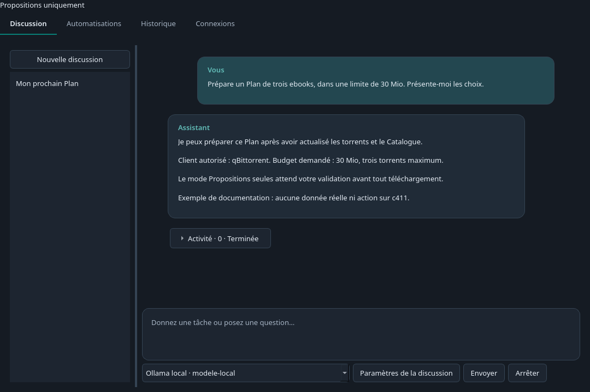
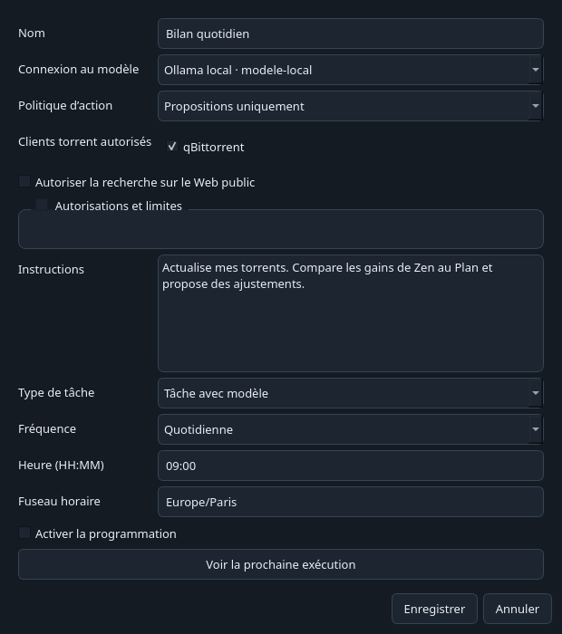

# Assistant et automatisations

L'onglet **Assistant** permet de discuter avec un modèle et de programmer des tâches sur le bureau ou dans l'interface Web. Il utilise les mêmes outils, propositions et limites que l'accès MCP. Aucun modèle n'est fourni avec TorrentLinker.

Les captures ci-dessous utilisent des données fictives.

## Connecter un modèle

1. Ouvrez **Assistant → Connexions → Ajouter une connexion**.
2. Donnez un nom à la connexion, puis choisissez le fournisseur.
3. Vérifiez l'adresse. Avec Ollama ou LM Studio, démarrez d'abord leur serveur et chargez un modèle prenant en charge les appels d'outils.
4. Renseignez la clé API si le fournisseur en demande une. Cliquez sur **Lister les modèles**, ou saisissez l'identifiant exact du modèle.
5. Enregistrez, sélectionnez la connexion, puis cliquez sur **Tester les outils**. Ce test demande un appel d'outil inoffensif et vérifie que le modèle sait en lire le résultat.

| Fournisseur | Protocole utilisé |
| --- | --- |
| Ollama, LM Studio | API compatible Chat Completions |
| OpenAI | Responses API |
| Anthropic | Messages API |
| Google Gemini | generateContent |
| Mistral, OpenRouter | API compatible Chat Completions |
| Compatible OpenAI | Adresse personnalisée, Chat Completions |

L'identifiant du modèle reste libre. La liste peut contenir des modèles sans appels d'outils : le test est donc nécessaire. Certains fournisseurs facturent les requêtes, y compris le test.

Dans Docker, `localhost` désigne le conteneur TorrentLinker. Utilisez l'adresse accessible depuis ce conteneur pour joindre Ollama, LM Studio ou un autre serveur. Consultez le [guide Web et Docker](web-docker.md) pour les connexions.

Les clés sont conservées dans le coffre de secrets utilisé par TorrentLinker, le trousseau système sur le bureau. Elles ne sont pas retournées par l'API de configuration. Un fournisseur distant reçoit vos messages et les résultats des outils, qui peuvent contenir des noms de torrents et des chemins. Une connexion locale ne bascule jamais automatiquement vers un fournisseur distant.

## Commencer une discussion

Ouvrez **Discussion** et écrivez votre message. **Nouvelle discussion** ouvre directement une conversation vide, nommée à partir de votre premier message. Choisissez le modèle près du champ de saisie. **Entrée** envoie le message ; **Maj+Entrée** ajoute une ligne.

**Paramètres de la discussion** permet de renommer la conversation et de choisir les clients, l’accès au Web, les autorisations et les limites. Ces réglages sont modifiables hors exécution, sans perdre l’historique ni la consommation du budget. Dans **Connexions → Paramètres des nouvelles discussions**, enregistrez les choix à réutiliser pour les prochaines conversations. Ils ne modifient ni les discussions existantes ni les automatisations.

Le mode **Propositions uniquement** est sélectionné au départ. L'Assistant peut consulter les données et préparer un Plan, mais ses actions de téléchargement ou de gestion attendent votre validation.

Exemple de première demande :

> Actualise mon client NAS. Prépare un Plan de trois ebooks au maximum, pour moins de 30 Mio. Présente les tailles, les dossiers et le gain de Zen estimé avant de proposer le téléchargement.

Les liens vers les actions permettent de consulter les paramètres et les résultats. **Examiner la proposition** ouvre la validation. Une proposition peut expirer ou devenir invalide après un changement de paramètres : demandez alors une nouvelle proposition.

Le mode **Exécuter dans les limites** autorise les types d'actions cochés dans **Autorisations et limites**. Vous gardez le choix des clients, du volume et du nombre de téléchargements par jour, ainsi que de l'espace à conserver libre. Le retrait d'un torrent et la suppression de ses fichiers demandent toujours une validation.

Les limites de téléchargement appartiennent à chaque discussion ou tâche. Ne les considérez pas comme un budget global partagé par tous les agents.

**Arrêter** interrompt la boucle du modèle et demande l'annulation des tâches soumises. Une action déjà exécutée n'est pas annulée rétroactivement. Consultez l'historique et le client torrent avant de recommencer.

## Programmer une tâche

Dans **Automatisations → Créer une tâche**, saisissez la consigne, les clients autorisés et la fréquence. Les tâches sont désactivées au départ.

- **Toutes les X minutes** : intervalle minimal de cinq minutes.
- **Quotidienne** : heure et fuseau horaire.
- **Hebdomadaire** : jours de la semaine, heure et fuseau horaire.

Cliquez sur **Voir la prochaine exécution** avant d'activer la programmation. **Exécuter maintenant** permet un premier essai. Vous pouvez modifier ou suspendre une tâche depuis la liste.

Les tâches **Actualiser les torrents** et **Actualiser le Catalogue** utilisent directement les outils de l'application, sans modèle. Elles parcourent les clients autorisés. Pour analyser, comparer ou rédiger, choisissez **Tâche avec modèle**.

TorrentLinker doit rester ouvert, ou son serveur Web doit tourner. Les intervalles manqués sont regroupés en une seule exécution au retour. Une tâche n'est pas relancée tant que ses actions sont en cours ou que ses propositions attendent une validation. Après une interruption, une erreur ou une annulation, consultez l'historique puis utilisez **Exécuter maintenant** pour reprendre. Les actions interrompues ne sont pas rejouées automatiquement.

## Rechercher des informations et préparer un Upload

La recherche Web est désactivée par défaut pour chaque discussion et tâche. Activez-la si la consigne nécessite un synopsis, une source ou une image.

Dans **Connexions → Recherche Web**, configurez une clé Brave Search API ou l'adresse de votre serveur SearXNG. La lecture d'une URL publique et la recherche de livres via Open Library ne nécessitent pas de clé de recherche. La recherche de films et séries utilise la clé TMDb déjà configurée dans TorrentLinker.

L'Assistant peut rechercher des pages, extraire leur texte et leurs liens d'images, consulter des métadonnées et vérifier qu'une URL renvoie une image. Il ne dispose pas d'un navigateur connecté à vos comptes ni d'un terminal. Les pages sont des sources de données, pas des consignes. La lecture Web refuse les adresses privées et limite la taille des réponses.

Exemple :

> Choisis un film sans correspondance dans ma Bibliothèque. Vérifie son identité, trouve un synopsis et une image avec leurs sources. Prépare la description et enregistre-la dans la file de brouillons locaux pour ma relecture. Ne l’envoie pas à c411.

Vérifiez les sources, l'image, les informations techniques et les règles de catégorie. La disponibilité durable d'une image externe n'est pas garantie. **La publication finale reste à faire sur c411**, après votre revue du Draft.

## Historique et limites

L'historique conserve les messages, appels d'outils, propositions, tâches et erreurs. Les connexions et programmations persistent après un redémarrage.

Chaque exécution dispose de limites de durée et d'appels au modèle : cinq minutes et douze appels par défaut. Le cumul de tokens reste affiché à titre informatif et n'arrête plus la discussion. Chaque réponse demande au plus 2 048 tokens de sortie par défaut.

**Détecter automatiquement le contexte** est activé pour les nouvelles connexions. Avant chaque tâche, TorrentLinker lit la limite communiquée pour le modèle sélectionné. Cliquez sur **Vérifier le contexte** dans la connexion pour voir la valeur détectée sans lancer de discussion. Cette vérification ne charge pas de modèle et ne modifie pas le serveur.

La détection reconnaît la configuration active d'[Ollama](https://docs.ollama.com/api/ps), [LM Studio](https://lmstudio.ai/docs/developer/rest/list), [llama.cpp](https://github.com/ggml-org/llama.cpp/blob/master/tools/server/README.md) et des serveurs compatibles qui exposent `max_model_len`, comme vLLM. OpenRouter et Gemini communiquent les limites de leurs modèles. La capacité théorique d'entraînement ne remplace pas la configuration du modèle chargé.

Si le serveur est indisponible, le modèle non chargé ou les métadonnées absentes, **Fenêtre de contexte (tokens)** fournit la valeur de repli, initialement 32 768. Désactivez la détection pour utiliser cette valeur manuellement. Les anciennes valeurs personnalisées sont conservées comme réglages manuels.

TorrentLinker compacte le contexte de travail lorsqu'il se remplit, en conservant la demande courante et les reçus d'actions. Les messages et résultats complets restent dans l'Historique ; l'assistant peut relire les détails archivés de la même discussion. Le compteur dépend des données d'usage du fournisseur et ne constitue pas un plafond de facturation.

Les messages sont présentés dans des cartes séparées. Dépliez **Activité** sous un échange pour consulter les reçus des outils et la consommation. Les erreurs et les demandes de validation restent visibles quand l'activité est repliée.

Les discussions et tâches partagent une limite de 200 appels par connexion de modèle et par jour UTC. Les tests de connexion sont distincts de ce compteur. Un seul travail de l'Assistant s'exécute à la fois ; jusqu'à dix peuvent être en attente ou en cours. Les téléchargements restent des tâches de TorrentLinker et continuent dans votre client torrent.

Les assistants externes restent accessibles via le [guide MCP](agents.md). L'Assistant intégré ne nécessite pas d'activer l'accès MCP externe ni de copier un jeton.

## Relecture des uploads automatisés

Demandez par exemple : « Choisis un film sans correspondance, vérifie son identité, trouve un synopsis et une image avec leurs sources, puis enregistre la présentation dans la file de brouillons locaux pour ma relecture. Ne l’envoie pas à c411. »

Les tâches automatisées s’arrêtent à la file locale. Ouvrez-la depuis Upload, corrigez la présentation et enregistrez-la. L’envoi à c411 nécessite toujours votre approbation, même en mode exécution. La publication finale reste manuelle sur le site.
