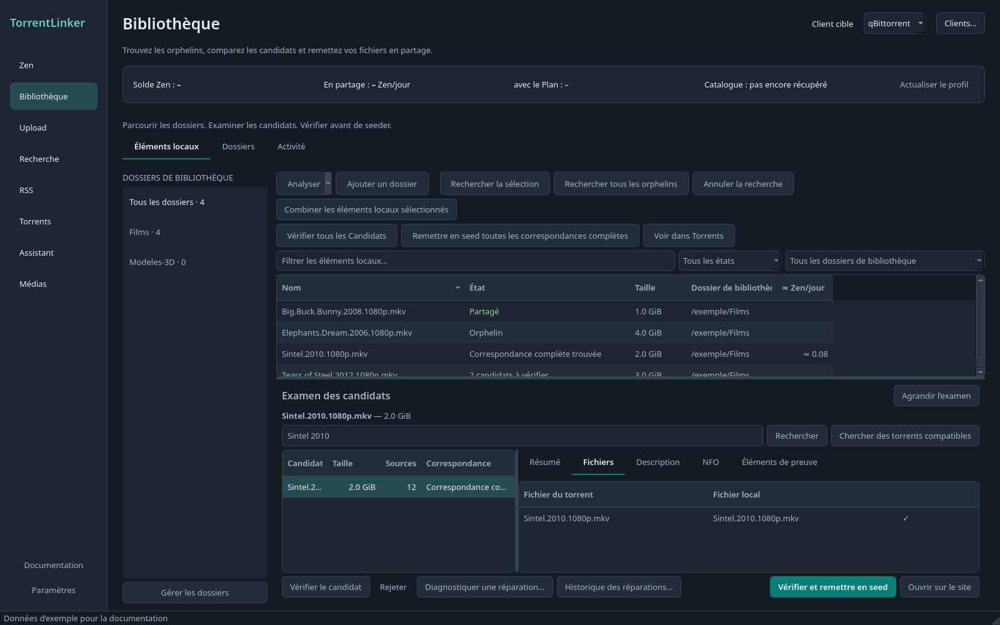
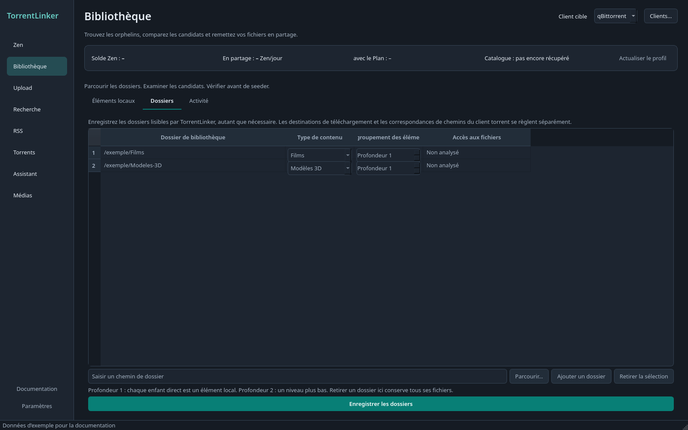
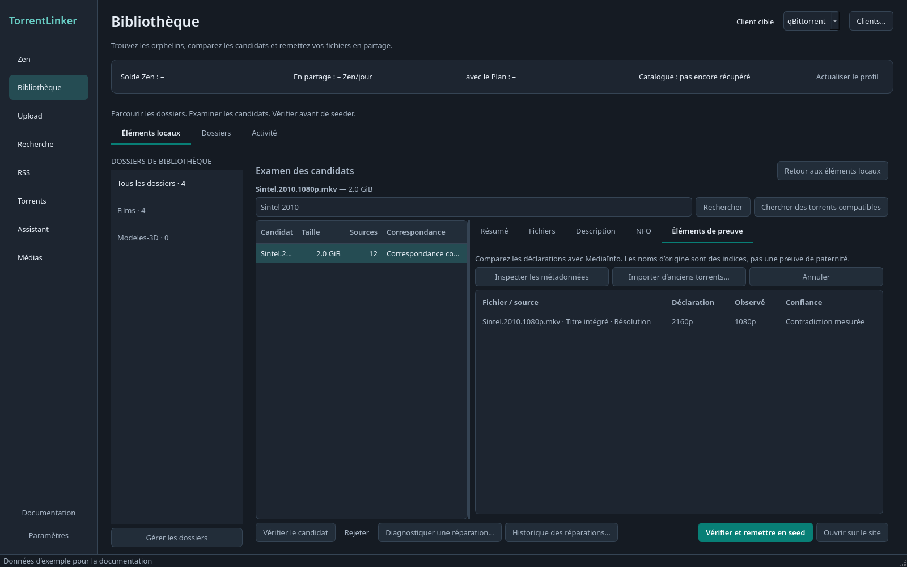
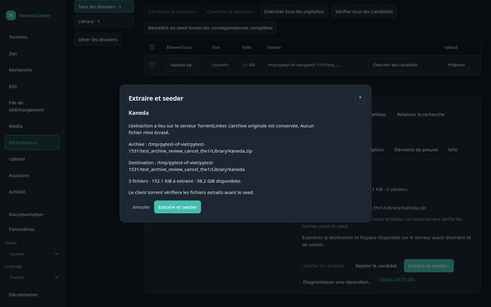

# Bibliothèque et remise en seed

## Explorateur de dossiers et examen des candidats

L’application de bureau et l’interface web partagent trois sections : **Local Items**, **Folders** et **Activity**. Sélectionnez un dossier dans la colonne de gauche, puis un élément local pour examiner ses candidats sous le tableau. **Expand review** agrandit cet espace ; le retour conserve le candidat sélectionné.

Les onglets **Summary**, **Files**, **Description** et **NFO** permettent de consulter les détails. Files montre les fichiers correspondants, renommés ou absents. Une correspondance complète compare les noms et tailles ; le client torrent doit encore vérifier les hashes avant le seed. Le rejet d’un candidat est mémorisé pour cet élément local. Chercher, vérifier les fichiers ou rejeter un candidat ne lance pas de reseed.

**Folders** permet d’ajouter plusieurs dossiers et de modifier leur type de contenu et leur profondeur. La profondeur 1 considère chaque enfant direct comme un élément local. Retirer un dossier de la bibliothèque conserve ses fichiers. Les paramètres donnent accès au même éditeur ; les destinations de téléchargement et les correspondances de chemins restent propres au client torrent.

Dans l’interface web, le navigateur de dossiers montre les fichiers du **serveur TorrentLinker**, dans les racines configurées, et non ceux de l’ordinateur du navigateur. Un dossier lisible peut être enregistré sans correspondance de chemins. Si le client torrent est indisponible, l’analyse indique un état de seed inconnu. Les dossiers inaccessibles conservent les éléments de leur dernière analyse.

L’interface web permet de chercher les éléments sélectionnés, revoir les candidats mémorisés, comparer les fichiers et rejeter un candidat. **Activity** permet d’annuler les tâches en cours. Les correspondances dans une archive proposent **Extraire et seeder…** dans les deux interfaces. Le WebUI affiche la destination sur le serveur TorrentLinker, la taille décompressée, le nombre de fichiers, l’espace libre et les fichiers manquants. Confirmez un candidat à la fois ; fermer ou annuler cet aperçu n’écrit rien. L’approbation expire après cinq minutes et l’archive ainsi que sa configuration sont revérifiées avant l’extraction. La boîte de dialogue et **Activity** affichent la progression et permettent l’annulation. L’annulation est disponible jusqu’au début de l’envoi au client torrent. Elle arrête l’outil et supprime sa sortie partielle ; les fichiers complets sont conservés si le reseed échoue ensuite. L’archive originale est conservée. L’approbation des renommages sur disque pour µTorrent nécessite encore l’application de bureau. Pour les archives RAR et 7z, installez 7-Zip sur le serveur TorrentLinker ou dans son conteneur.

Les paramètres affichent les destinations de téléchargement par défaut et par catégorie du client sélectionné. La destination effective tient compte de l’héritage. Enregistrer une destination vérifie sa correspondance avec un fichier seedé et conserve les autres règles.

[Documentation](../../README.md) · [English](../en/library.md)

1. Cliquez sur **Ajouter un dossier…** et choisissez son type de contenu et sa profondeur d’analyse.
2. Après l’analyse, sélectionnez un Orphelin et lancez sa recherche, ou recherchez tous les Orphelins.
3. Vérifiez les Candidats trouvés. Une correspondance par taille doit encore passer la vérification par hash du client.
4. Lancez la remise en seed des correspondances complètes. Le bilan distingue les nouveaux ajouts des torrents déjà présents.

Captures de l’interface française en thème sombre, avec des données d’exemple.

## Ajouter des dossiers et utiliser les actions par lot

La colonne **≈ Zen/jour** affiche l'estimation actuelle de Zen pour les torrents associés aux éléments en seed ou partiellement en seed. Pour les orphelins, elle indique l'estimation du meilleur candidat vérifié. Les torrents en pause comptent pour zéro ; les estimations indisponibles restent vides. Si un torrent couvre plusieurs éléments locaux, son estimation apparaît sur chacun : il ne faut donc pas additionner cette colonne pour calculer le total de la bibliothèque.

Dans la Bibliothèque, **Ajouter un dossier…** permet de choisir un dossier, son **Type de contenu** et sa **Profondeur d’analyse**, sans ouvrir les Paramètres. La profondeur 1 considère chaque fichier ou dossier directement contenu comme un Élément local. Après enregistrement, la Bibliothèque est analysée et filtrée sur le nouveau dossier. Un dossier déjà enregistré n’est pas ajouté une seconde fois.

**Vérifier tous les Candidats** examine les Candidats encore non vérifiés, y compris ceux masqués par les filtres, sans relancer les recherches ni les vérifications réussies. **Remettre en seed toutes les correspondances complètes** ajoute les correspondances confirmées au client torrent, puis lance la vérification par hash avant le seed. Ces actions s’exécutent en arrière-plan, avec une progression et un bouton d’annulation. Les erreurs sont regroupées pour permettre au traitement de continuer. Les torrents déjà présents dans le client sont signalés et comptés séparément des nouvelles remises en seed.

Si des correspondances complètes se trouvent dans des archives, une fenêtre indique leur taille après décompression. Choisissez **Décompresser et remettre en seed la sélection…** pour vérifier la destination et l’espace disponible d’une archive, ou l’action de remise en seed des correspondances prêtes pour ne traiter que les fichiers déjà décompressés. Le traitement par lot ne décompresse jamais les archives automatiquement.

## Remettre des fichiers existants en seed

Analysez la Bibliothèque, puis recherchez les Orphelins : les Éléments locaux qu’aucun torrent c411 présent dans votre client ne couvre. Les fichiers partagés uniquement sur d’autres trackers restent des Orphelins et peuvent donc être proposés pour du cross-seed sur c411. Un torrent est reconnu comme appartenant à c411 par son tracker, son hash dans le Catalogue ou un tag TorrentLinker. Le hash aide notamment lorsqu’un torrent n’a pas encore annoncé et n’indique aucun tracker. Seules les listes de fichiers de ces torrents sont lues.

TorrentLinker compare l’arborescence de chaque Candidat aux fichiers locaux. Les correspondances complètes peuvent être remises en seed sans retélécharger leurs données. Les correspondances partielles ignorent les fichiers absents et restent arrêtées après vérification.

Les chemins sont renommés à l’intérieur du client torrent : les noms et le contenu de vos fichiers sur le disque restent intacts. Une vérification par hash doit réussir avant le démarrage du seed. En cas d’échec, le torrent est retiré du client sans supprimer les fichiers locaux. Deluge reprend un torrent arrêté pendant sa vérification ; TorrentLinker limite donc sa vitesse de téléchargement à 1 octet/s jusqu’à la fin de la vérification ou au démarrage de la remise en seed, pour protéger les fichiers. Voir [ADR-0009](../../adr/0009-deluge-through-its-web-ui-with-labels-and-a-speed-guard.md). Les recherches précédentes et les rejets sont conservés après redémarrage.

### Archives

Un Élément local au format `.zip`, `.rar` ou `.7z` est aussi comparé par son contenu, car les torrents partagent généralement les fichiers décompressés. Une correspondance affiche alors **Correspondance complète dans l’archive**. **Décompresser et repartager…** extrait les fichiers dans un nouveau dossier à côté de l’archive, après avoir indiqué la taille et l’espace libre, puis lance la remise en seed avec la vérification habituelle. Aucun fichier n’est écrasé. Une fois les fichiers vérifiés et le seed démarré, l’application de bureau propose de mettre l’archive à la corbeille ou de la conserver. Le WebUI conserve l’archive originale. Les Plans ne décompressent jamais d’archives.

Les archives ZIP ne demandent aucun outil supplémentaire. Les archives RAR et 7z nécessitent [7-Zip](https://www.7-zip.org/), ou unrar pour RAR ; sans cet outil, elles sont comparées comme de simples fichiers.

[Documentation](../../README.md) · [English](../en/library.md)

## Éléments de preuve et noms d’origine

Dans l’inspecteur d’un élément local, ouvrez **Éléments de preuve**, puis **Inspecter les métadonnées**. TorrentLinker compare le nom du fichier, son titre intégré et le NFO adjacent de même nom avec MediaInfo. Chaque avertissement indique sa source et son niveau de confiance. Les dimensions recadrées et les pistes audio multiples sont prises en compte. HandBrake est un simple indice de traitement ; ces contrôles ne certifient ni la source ni la team.

**Importer d’anciens torrents…** accepte jusqu’à 100 fichiers `.torrent` par lot, de 8 Mio maximum chacun. L’import est hors ligne : aucune annonce au tracker, aucun ajout au client et aucun renommage des médias. La taille exacte suggère une association ; les hashes du torrent vérifient les octets. Les associations ambiguës restent non résolues. Une modification du fichier invalide sa vérification enregistrée. Les torrents v2 et hybrides ne sont pas encore pris en charge par ce parcours.

La préparation d’upload propose **Utiliser un nom d’origine vérifié…** après vérification d’un ancien torrent. Cette action change uniquement le nom de release proposé. Examinez la liste des fichiers avant d’enregistrer le brouillon ; les noms internes d’un pack ne sont pas restaurés automatiquement. Les règles actuelles du tracker et la revue de l’uploader restent nécessaires.

## Trouver d’autres torrents pour les mêmes fichiers

**Chercher des torrents compatibles** fonctionne aussi pour les éléments déjà en seed. La recherche couvre les séries, saisons et épisodes selon les capacités de l’indexeur. Un épisode peut correspondre à un sous-ensemble d’une intégrale plus volumineuse. La recherche est limitée à 30 requêtes et 100 candidats ; un avertissement indique si cette limite rend les résultats incomplets. Les résultats ne garantissent pas une couverture exhaustive du tracker.

Sélectionnez plusieurs éléments locaux de la même série et du même type de contenu, puis **Combiner les éléments locaux sélectionnés** pour chercher un pack. Cette opération construit une liste virtuelle, sans copier les médias ni créer de liens. Elle nécessite actuellement qBittorrent et une correspondance de chemins cohérente depuis le dossier parent commun. Tous les fichiers du torrent cible doivent être présents, y compris les fichiers annexes. La vérification habituelle du client doit réussir avant le seed. Après un redémarrage, sélectionnez à nouveau les éléments pour recréer la sélection combinée.

## Réparation expérimentale sur une copie indépendante

Sélectionnez un candidat pour un fichier local unique, puis **Diagnostiquer une réparation…**. Le diagnostic lit les hashes sans modifier l’original ni contacter de pairs. Les limites initiales sont un écart de taille inférieur ou égal à 1 % et 50 Mio, au moins 90 % des octets cibles vérifiés, au plus 500 Mio manquants et au moins deux seeders annoncés. Ces valeurs prudentes sont fixes dans cette version. Les seeders annoncés et les déclarations de source/team ne garantissent ni disponibilité ni authenticité.

Pour un résultat admissible, choisissez la destination d’une copie indépendante. Dans le WebUI, ce dossier doit être monté sous une racine de stockage autorisée du serveur. TorrentLinker crée un nouveau dossier et conserve l’original intact. Il ajoute le torrent arrêté dans qBittorrent et demande une vérification. Utilisez **Actualiser la vérification**, puis **Confirmer le téléchargement dans la copie…** uniquement quand le résultat est prêt. Les autres clients et les torrents multifichiers/v2 ne sont pas encore pris en charge par la réparation.

L’estimation concerne le contenu utile manquant, pas le trafic réseau total. L’historique persiste après redémarrage ; aucune réparation en attente ne démarre automatiquement. Les opérations échouées ou incertaines nécessitent une inspection du client torrent. Les copies incomplètes sont conservées ; retirer un torrent seul ne les supprime pas. L’original reste disponible. Les tests utilisent des données synthétiques ; le taux de réussite sur des vidéothèques réelles reste à mesurer.

Avant de préparer une copie, activez explicitement la réparation expérimentale. Les essais sur des bibliothèques réelles restent à mener ; le diagnostic reste disponible sans activer les téléchargements.

## Captures des nouveaux outils

