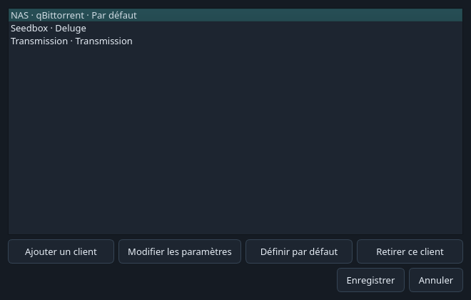
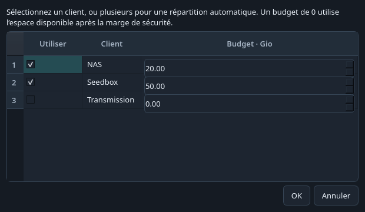
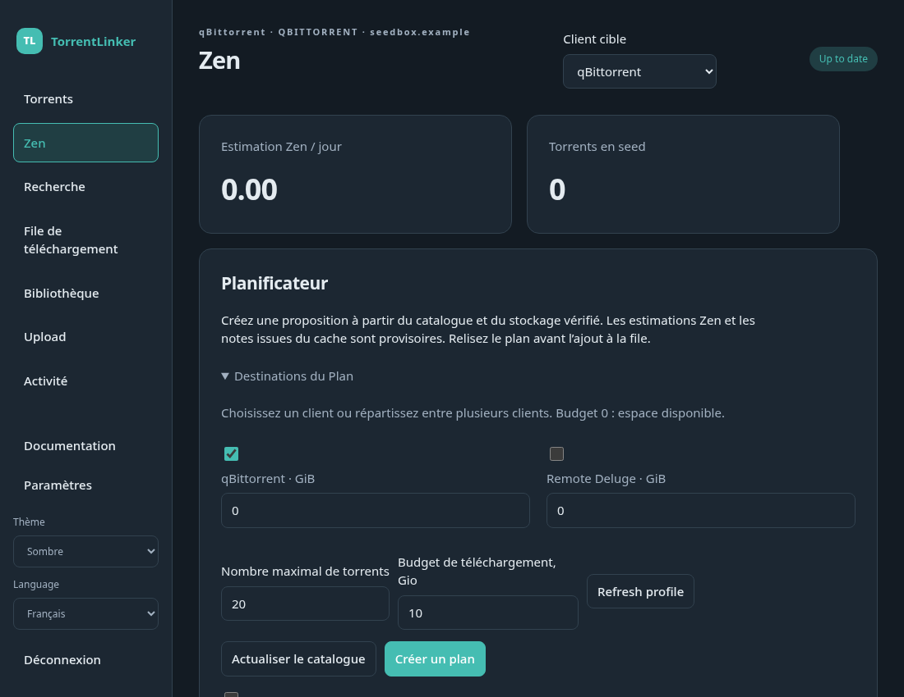

# Plusieurs clients torrent

Cliquez sur **Clients…**, à côté du sélecteur de client cible de l'application, pour ajouter une connexion, modifier ses paramètres ou choisir le client par défaut. Donnez un nom court à chaque connexion, par exemple NAS ou Seedbox. Vous pouvez utiliser plusieurs instances de qBittorrent ou mélanger qBittorrent, Deluge, Transmission et µTorrent.

Votre connexion actuelle est conservée automatiquement. Chaque client possède ses propres identifiants, dossiers de téléchargement et correspondances de chemins. Ouvrez **Modifier les paramètres**, testez la connexion, puis configurez ses dossiers. Les dossiers de bibliothèque et le compte c411 sont communs à l'application.

Le sélecteur **Client cible** concerne les vérifications et reseeds de la bibliothèque, le seed des uploads, les téléchargements de la recherche et la file du client sélectionné. La file indique le client de chaque torrent. Renommer un profil ou changer le client par défaut ne redirige pas les opérations en attente.

Dans **Torrents**, cochez **Tous les clients** pour afficher une vue commune. Filtrez par nom et utilisez le menu contextuel sur les lignes sélectionnées pour agir sur les clients correspondants. Retirer un torrent conserve les fichiers ; leur suppression demande une confirmation. L'estimation Zen globale ne compte chaque hash qu'une fois.

## Plans

Ouvrez **Destinations du Plan…**. Sélectionnez un seul client pour lui réserver le Plan, ou plusieurs pour une répartition automatique. Indiquez le budget de chaque client en Gio. La valeur zéro utilise l'espace disponible après votre marge de sécurité.

Vérifiez les colonnes Client et Dossier de téléchargement avant l'envoi. Un Plan réparti affecte chaque torrent à un seul client et partage le budget d'espace libre lorsque plusieurs clients utilisent le même disque monté. Le calcul utilise l'heuristique Zen existante et ne garantit pas une répartition mathématiquement optimale.

Une destination indisponible produit un échec visible. TorrentLinker ne la remplace pas par un autre client. Terminez ou retirez les éléments de file, Plans et vérifications en attente avant de remplacer ou retirer leur connexion.

## Interface web

Utilisez le sélecteur en haut de la page. Les paramètres proposent **Ajouter un client**, **Définir par défaut** et **Retirer ce client**, avec un champ de nom dans le formulaire de connexion. La configuration des dossiers s'applique au client sélectionné.

**Tous les clients** affiche une vue commune. Sélectionnez un client précis pour modifier ses torrents ou démarrer sa file. Dans le planificateur, ouvrez **Destinations du Plan**, sélectionnez les clients et leurs budgets, puis examinez le résultat. Chaque ligne permet de choisir sa destination avant la mise en file. Changer cette destination utilise le dossier de téléchargement configuré pour le nouveau client.

Le serveur doit accéder aux fichiers pour l'analyse, le reseed et la préparation d'uploads. Les téléchargements web nécessitent toujours un dossier monté et vérifié. Une seedbox accessible uniquement par son API permet la gestion des torrents.

