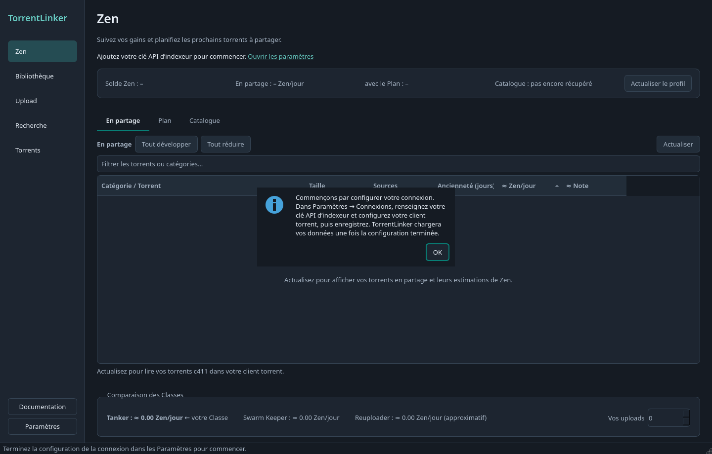
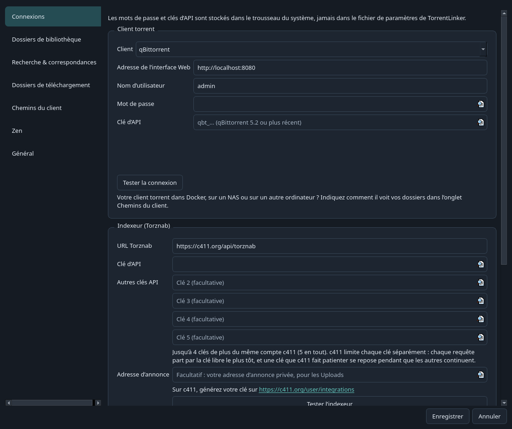
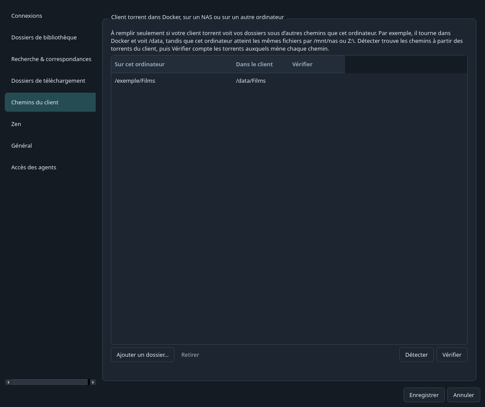
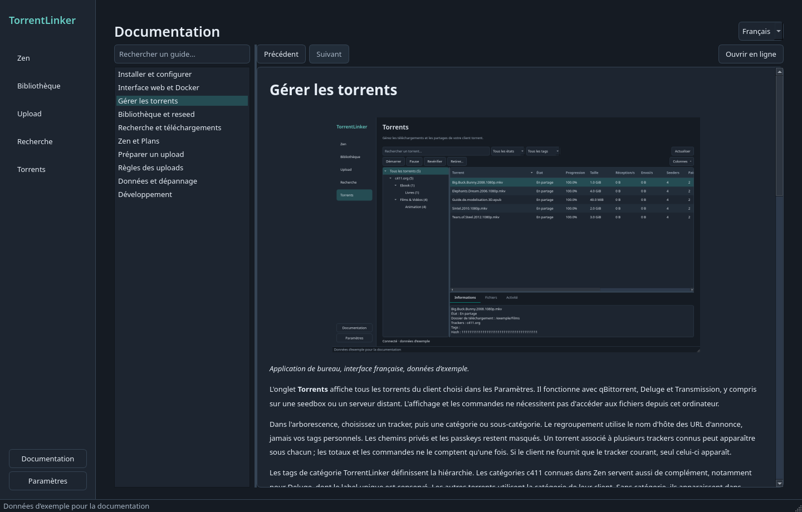

# Installer et configurer

[Documentation](../../README.md) · [English](../en/getting-started.md)

[Installation](#installation) · [Configuration initiale](#configuration-initiale) · [Client torrent dans Docker, sur un NAS ou sur un autre ordinateur](#client-torrent-dans-docker-sur-un-nas-ou-sur-un-autre-ordinateur) · [Proxy](#proxy) · [Se repérer dans l’interface](#se-repérer-dans-linterface)

Commencez par connecter votre indexeur et votre client torrent. Vous pourrez ensuite ajouter vos dossiers et choisir les fonctions qui vous intéressent.

Captures de l’interface française en thème sombre, avec des données d’exemple.

## Installation

Téléchargez le fichier Windows ou Linux depuis la [dernière version](https://github.com/Vietnoirien/TorrentLinker/releases/latest). Sous Windows, lancez `TorrentLinker.exe`. Sous Linux, rendez l’AppImage exécutable dans les propriétés du fichier, puis ouvrez-la.

## Configuration initiale

Au premier lancement, ou si aucune clé API d’indexeur n’est enregistrée, un message de bienvenue ouvre les Paramètres de connexion. Les chargements automatiques attendent la configuration. Après enregistrement de la clé, l’application charge vos données sans redémarrage. Si vous annulez ou enregistrez sans clé, elle reste en attente avec un lien vers les Paramètres.

1. Activez l’interface Web de votre client torrent :
   - **qBittorrent** : **Outils → Options → Interface Web**.
   - **Transmission** 4.x : activez l’accès distant dans **Préférences → Distant**. L’ajout de `.part` aux noms des fichiers incomplets doit être désactivé pour les remises en seed, sinon Transmission renommerait vos fichiers pendant la vérification. TorrentLinker propose de désactiver cette option. Transmission ne sait renommer les fichiers et dossiers que sur place : une correspondance nécessitant une autre organisation des dossiers ne peut pas être remise en seed avec ce client. Voir [ADR-0010](../../adr/0010-transmission-with-whole-file-names-and-in-place-renames.md).
   - **Deluge** 2.x : lancez son interface Web (`deluge-web`, port 8112 par défaut), connectez-la à son daemon et activez le plugin **Label** dans **Préférences → Plugins**. TorrentLinker utilise les labels `torrentlinker`, `torrentlinker-verifying`, `torrentlinker-partial` et `torrentlinker-zen` pour suivre ses torrents, comme il utilise les tags de qBittorrent.
2. Ouvrez **Paramètres → Connexions**, choisissez votre **Client** et renseignez sa connexion, puis l’URL et la clé API de l’indexeur. Ajoutez votre URL d’annonce pour les uploads. qBittorrent accepte un nom d’utilisateur et un mot de passe, ou une clé API d’interface Web lorsqu’elle est disponible. Deluge utilise l’adresse et le mot de passe de son interface Web. Transmission utilise son adresse distante et, si vous en avez défini, ses identifiants.
3. Ajoutez vos dossiers depuis **Bibliothèque → Ajouter un dossier…**, ou dans les Paramètres, pour trouver les fichiers à remettre en seed.
4. Définissez les dossiers de téléchargement des catégories à inclure dans les Plans, ou un dossier par défaut. Les catégories sans dossier résolu sont exclues.
5. Si votre client fonctionne dans Docker, sur un NAS ou sur un autre ordinateur, configurez **Paramètres → Chemins du client**, comme expliqué dans la section suivante.

## Client torrent dans Docker, sur un NAS ou sur un autre ordinateur

Le client voit alors vos dossiers sous des chemins différents. Par exemple, un conteneur Docker voit `/data`, alors que cet ordinateur accède aux mêmes fichiers par `/mnt/nas` ou `Z:\`. TorrentLinker doit connaître cette correspondance pour reconnaître les torrents existants, remettre les fichiers en seed et envoyer les téléchargements vers un dossier accessible au client.

Dans **Paramètres → Chemins du client** :

1. Renseignez d’abord la connexion au client et vos dossiers de Bibliothèque ou de téléchargement.
2. Cliquez sur **Détecter**. TorrentLinker lit quelques torrents de chaque dossier utilisé par le client et recherche leurs fichiers par nom et taille dans vos dossiers et leurs dossiers parents. Il ajoute les correspondances trouvées, par exemple `/mnt/nas` ↔ `/data`, avec le nombre de torrents reconnus.
3. **Vérifier** compte les torrents dont le dossier existe sur cet ordinateur pour chaque correspondance. L’application signale aussi les dossiers de téléchargement probablement inaccessibles au client.
4. Enregistrez.

Vous pouvez ajouter une correspondance manuellement avec **Ajouter un dossier…** : choisissez le dossier sur cet ordinateur, puis indiquez son chemin tel que le client le voit. Une correspondance couvre tous les sous-dossiers ; si plusieurs correspondent, la plus précise s’applique.

| Installation | Sur cet ordinateur | Dans le client |
| --- | --- | --- |
| Docker local, volume `-v /srv/media:/data` | `/srv/media` | `/data` |
| Client sur NAS, partage monté sous Linux | `/mnt/nas/media` | `/volume1/media` |
| Client sur NAS, partage monté comme lecteur Windows | `Z:\` | `/volume1/media` |
| Docker sur NAS, partage monté ici | `/mnt/nas/media` | `/data` |

La détection et les vérifications communiquent uniquement avec votre client torrent.

## Proxy

Pour accéder à Internet par un proxy, renseignez **Paramètres → Connexions → Proxy** : `http://host:port`, `https://…`, `socks5://host:port` ou `socks5h://…` pour résoudre aussi les noms de domaine via le proxy. Ajoutez ses identifiants si nécessaire ; le mot de passe reste dans le trousseau système. Les connexions à c411, TMDb, au catalogue Zen Lab, aux images et au test de débit passent alors par ce proxy. Le client torrent est contacté directement, car il se trouve généralement sur cet ordinateur ou sur le réseau local, sauf si vous cochez l’option qui lui applique également le proxy. **Tester le proxy** affiche l’adresse vue par c411. Le proxy s’applique dès l’enregistrement.

## Se repérer dans l’interface

Sur un petit écran, vous pouvez réduire la fenêtre : la zone de travail devient défilante si son contenu ne tient plus. La navigation reste visible. Utilisez les barres de défilement pour atteindre les commandes à droite ou en bas.

Depuis la version 0.5.0, **Recherche** rejoint les espaces **Zen**, **Bibliothèque**, **Upload** et **Paramètres**. Zen sépare **En partage**, **Plan** et **Catalogue** ; Upload sépare la préparation d’un upload et les **Brouillons**. Dans **Paramètres → Général → Thème**, choisissez Système, Clair ou Sombre. Le mode Système suit les préférences du bureau, y compris le mode sombre explicite de GNOME. Le changement de thème s’applique dès l’enregistrement.

Cliquez sur l’en-tête d’une colonne pour trier, puis une seconde fois pour inverser l’ordre. Faites glisser la séparation entre deux en-têtes pour redimensionner une colonne, ou double-cliquez pour l’ajuster au contenu. Les tailles, nombres de seeders et estimations de Zen se trient numériquement. La Bibliothèque et la liste des torrents en partage disposent aussi d’un filtre textuel. Les actions de la Bibliothèque restent au-dessus de la liste ; le menu **Analyser** contient l’analyse complète qui ignore le cache. **Ctrl+1/2/3/4** change d’espace, **Ctrl+F** place le curseur dans la recherche ou le filtre de la Bibliothèque, et **Ctrl+,** ouvre les Paramètres.

[Documentation](../../README.md) · [English](../en/getting-started.md)

## Consulter les guides dans l’application

Cliquez sur **Documentation**, juste au-dessus des **Paramètres**. Recherchez un guide dans la liste de gauche, puis choisissez un chapitre. Les liens entre guides restent dans l’application ; **Précédent** et **Suivant** retrouvent vos lectures. Le sélecteur propose les guides français et anglais. **Ouvrir en ligne** ouvre la version du dépôt dans votre navigateur.

Les guides et leurs captures sont fournis avec l’application. Aucune clé API ni connexion à un client torrent n’est nécessaire pour les lire. Pour installer l’interface web sur un NAS ou une seedbox, suivez le [guide Web et Docker](web-docker.md).
