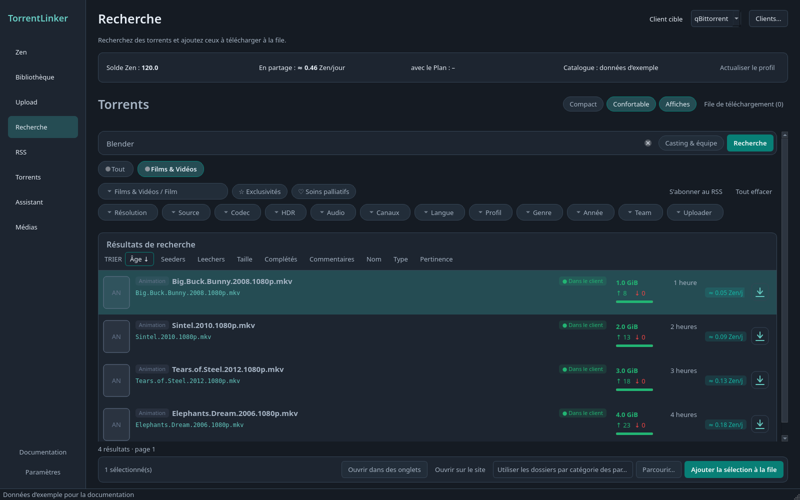
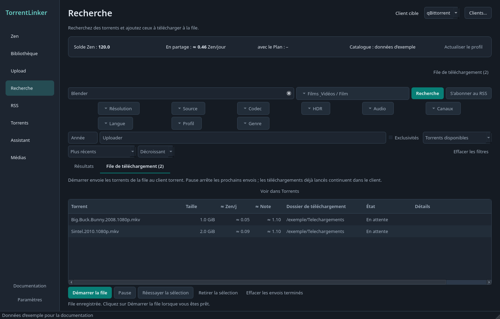

# Rechercher et télécharger

[Documentation](../../README.md) · [English](../en/search.md)

1. Saisissez un titre, choisissez une pastille de catégorie et ajustez les filtres. La page lance la recherche toute seule peu après chaque changement.
2. Cliquez sur le titre d’un résultat pour consulter ses détails dans un onglet.
3. Sélectionnez des résultats et ajoutez-les à la file, ou utilisez le bouton de téléchargement d’une ligne.
4. Ouvrez **File de téléchargement** avec le bouton en haut à droite de Recherche, puis démarrez la file. **Télécharger maintenant** envoie directement le torrent sélectionné. **← Retour aux résultats** revient à la recherche.

Captures de l’interface française en thème sombre, avec des données d’exemple.

## La page Recherche

La page reprend la structure de la page torrents de c411, avec les couleurs et les extras de TorrentLinker.

- **En-tête.** Le choix **Compact / Confortable**, **Affiches** et le bouton **File de téléchargement (N)**. Vos choix sont mémorisés.
- **Barre de recherche.** Un grand champ pour le titre, le titre original ou le nom de release. Dans Films & Vidéos, **Casting & équipe** cherche aussi parmi les acteurs, réalisateurs et scénaristes.
- **Pastilles de catégorie.** *Tout* et une pastille par catégorie, avec les totaux de c411. Une pastille filtre aussitôt. Le menu **Catégorie** en dessous choisit une sous-catégorie.
- **Filtres.** Des boutons arrondis qui ouvrent une liste à cocher avec recherche (résolution, source, codec, HDR, audio, canaux, langue, profil, genre, saison, etc.), puis **Année**, **Team** et **Uploader**. Team accepte un nom ou un slug de team, comme sur c411. À partir de quatre valeurs choisies, elles apparaissent aussi en pastilles que l’on retire une à une. **Exclusivités** et le bouton cœur des **soins palliatifs** sont à côté du menu Catégorie. **S’abonner au RSS** reprend la requête dans un nouvel abonnement, et **Tout effacer** remet tout à zéro.
- **Recherche automatique.** Les filtres, les boutons, les pastilles, les puces de tri et les liens de pages relancent la recherche. Pour les filtres, une pause d’environ une seconde regroupe plusieurs clics en une requête. Une année à moitié saisie ne lance rien. Le bouton Recherche et Entrée fonctionnent toujours.
- **Carte des résultats.** Le nombre total de résultats et leur taille, une rangée de **puces de tri** (Âge, Seeders, Leechers, Taille, Complétés, Commentaires, Nom, Type, et Pertinence pendant une saisie ; cliquez sur la puce active pour inverser l’ordre), et des liens de pages numérotées au-dessus et en dessous.

### Confortable et Compact

Les lignes **Confortables** montrent l’affiche, le type, le titre avec l’année et la note, le nom de release, des étiquettes colorées (langue, résolution, source, audio, codec vidéo, HDR), la taille, les seeders et leechers avec une barre d’équilibre, l’âge, les téléchargements terminés, l’uploader, l’estimation **≈ Zen/j** et un bouton de téléchargement. Une ★ signale les exclusivités et un ♥ les soins palliatifs. **Dans le client** apparaît sur les torrents que votre client possède déjà, et **En file** sur ceux de la file de téléchargement ; les deux viennent de ce que l’application sait déjà et ne demandent rien au client.

Le mode **Compact** suit le tableau de c411 : une pastille de **type** colorée, le nom de la release avec ses étiquettes courtes dessous (**EXCLU**, langue et qualité dans les termes de c411, ♥ pour les soins palliatifs), les commentaires, l’âge, la taille, les téléchargements terminés, les seeders (en vert) et les leechers (en rouge), puis **≈ Zen/j**, **≈ Note** et un bouton de téléchargement. Sur c411, un en-tête de colonne trie toute la recherche, pas seulement la page. Il montre les mêmes indications Dans le client et En file.

Les **Affiches** viennent de TMDB. L’application les récupère quelques-unes à la fois pour les lignes visibles, les garde sur le disque et n’envoie ni clé ni cookie. Désactivez **Affiches** pour tout arrêter. Dans la page web, c’est le serveur qui les récupère : votre navigateur ne contacte jamais TMDB.

### Ajouter à la file

Sélectionnez des lignes (la barre de sélection apparaît en bas) puis cliquez sur **Ajouter la sélection à la file**. Choisissez un dossier de téléchargement dans la barre ou laissez-le vide pour utiliser les dossiers par catégorie des Paramètres. **Ouvrir dans des onglets** et **Ouvrir sur le site** agissent sur la sélection. Le bouton de téléchargement d’une ligne ajoute uniquement ce torrent. Dans la page web, l’ajout vous laisse sur Recherche et la ligne affiche **En file**.

### Filtres par catégorie

Pour c411, les catégories et les options de recherche proviennent de son API native. Sélectionnez une catégorie pour afficher ses filtres. Films & Vidéos propose résolution, source, HDR, codec, audio, canaux, langue et profil ; les séries proposent aussi saison et épisode. L’année, la team, l’uploader, l’exclusivité et le tri sont disponibles dans toutes les catégories. Changer de catégorie retire les filtres incompatibles. Les autres indexeurs conservent leur recherche Torznab : un menu de catégories et des pastilles, sans filtres natifs.

### Soins palliatifs

Le bouton cœur alterne entre les torrents disponibles, l’inclusion des **soins palliatifs** et les soins palliatifs seuls. Il affiche le total actuel de c411. Les torrents que c411 identifie comme soins palliatifs portent une indication ; l’absence de seeders ne suffit pas à établir ce statut. Cette fonction aide à les trouver, mais ne suit pas vos récompenses personnelles de réanimation. Les liens de pages conservent les critères soumis. Si c411 ne donne accès qu’à une partie d’un grand ensemble de résultats, l’application indique cette limite et invite à affiner les filtres.

### Comprendre les estimations et l’âge

Les résultats c411 affichent les colonnes triables **≈ Zen/jour** et **≈ Note**, également présentes dans les détails d’un torrent. La Note est le score de contribution estimé selon votre Classe, la catégorie, le nombre de seeders et la durée de seed. Pour un nouveau torrent, le calcul utilise votre Profil Zen, vos heures de seed prévues et votre nombre actuel de torrents en partage, avec une durée de seed initiale de zéro et votre présence dans le groupe de seeders. Les torrents déjà en partage conservent leur estimation et leur durée de seed actuelles. Survolez l’estimation pour en connaître les hypothèses. Les récompenses de réanimation restent distinctes.

La colonne **Âge** indique le temps écoulé depuis la publication, par exemple **2 heures** ou **3 jours**, et s’actualise chaque minute lorsque Recherche est visible. Survolez-la pour voir la date et l’heure locales exactes, issues de la date de création c411 ou de publication Torznab. Les dates absentes sont indiquées par **–**. L’en-tête trie la page courante selon l’horodatage réel ; utilisez la puce de tri **Âge** pour trier la recherche sur l’ensemble des pages.

### Consulter les détails

Cliquez sur le titre d’un résultat pour ouvrir sa page dans un onglet. Elle suit la page torrent de c411 : la pastille de type, les indicateurs (**Exclusivité**, **Bitrate faible**, testé ou non), le bouton d’ouverture sur le site, le nom de la release, l’expéditeur, sa team et la date, et un bandeau quand la communauté ne l’a pas encore testé. Viennent ensuite la taille et l’état réel du partage (seeders, leechers, complétés, et **Demande de seeds** quand personne ne partage), votre **≈ Zen/jour** et votre Note, le hash et le nombre de fichiers, puis les informations de c411 en pastilles (langue, qualité, saison, genre, etc.). **Afficher le NFO** et **Afficher les fichiers** se déplient sur place. Une carte TMDB donne l’affiche, le titre, l’année, le type, les genres, la note, la durée, le réalisateur et la distribution, avec des liens vers TMDB et IMDb ; puis **Confiance communautaire** (en lecture seule : les votes demandent une session sur le site, utilisez **Voter sur le site**) et la description. Une barre en bas garde le dossier et les boutons **Ajouter à la file** et **Télécharger maintenant** à portée.

Les détails ne sont chargés qu’à l’ouverture, sans téléchargement du `.torrent`. Le NFO est affiché en texte brut ; les images passent par le proxy configuré, sans identifiants de l’indexeur. Les descriptions sont centrées, tout en conservant les alignements explicitement définis. Les images jusqu’à 32 Mio sont décodées dans une limite de pixels et redimensionnées pour l’affichage. Les images indisponibles laissent place à des liens ; l’action de nouvelle tentative respecte le délai imposé par l’hébergeur et ne recharge pas les métadonnées du torrent. Les détails non pris en charge et les images manquantes restent consultables sur le site. La liste **Versions** de c411 (le même contenu en plusieurs encodages) dépend de son affichage groupé : elle n’est pas reprise ici, consultez le site.

Chaque onglet de torrent propose aussi **Ajouter à la file** et **Télécharger maintenant**, avec un dossier de téléchargement modifiable. Télécharger maintenant envoie uniquement ce torrent au client et laisse les autres éléments de la file en attente. Les deux actions protègent contre les doublons et l’écrasement de fichiers. Pour changer la destination d’un torrent déjà dans la file, retirez-le d’abord de celle-ci.

### Gérer les onglets

Les onglets restent ouverts pendant vos recherches. Ouvrir à nouveau le même torrent sélectionne son onglet existant. Faites glisser les onglets pour les réordonner, utilisez la liste des onglets ouverts pour accéder à l’un d’eux, ou fermez-les avec ×, le clic du milieu, **Ctrl+W** ou leur menu contextuel. **Ctrl+Tab** et **Ctrl+Maj+Tab** passent d’un onglet à l’autre ; **Ctrl+F** revient au champ de recherche. Fermer un onglet ne retire ni n’arrête un téléchargement dans la file.

Le menu **Onglets ouverts**, à droite de la barre d’onglets, propose **Ajouter tous les onglets à la file**, qui ajoute les torrents ouverts et affiche la file sans démarrer les téléchargements, et **Télécharger tous les onglets**, qui ajoute et lance cet ensemble en un clic, en laissant les autres éléments de la file en attente. Le bouton **File de téléchargement** reste accessible au-dessus des onglets. Chaque onglet conserve son dossier de téléchargement. Toutes les destinations sont vérifiées avant l’ajout du lot ; en cas de problème, l’onglet concerné s’ouvre et un message apparaît au-dessus des onglets. Les onglets durent le temps de la session ; la file est conservée après redémarrage.

### Démarrer et gérer la file

La file affiche aussi **≈ Zen/jour** et **≈ Note** pour chaque torrent. Cliquez sur leurs en-têtes pour trier numériquement. Les estimations utilisent le même calcul que les résultats de recherche et sont actualisées lorsque le Profil Zen ou les torrents en partage changent. Elles restent disponibles après redémarrage de l’application.

Dans **File de téléchargement**, cliquez sur **Démarrer la file** pour envoyer les torrents au client dans l’ordre. La file respecte les limites de téléchargement de l’indexeur et attend lorsqu’il le demande. **Pause** interrompt les prochains envois après la requête en cours ; les téléchargements déjà lancés continuent dans le client torrent. La file et les résultats sont conservés après redémarrage, mais l’envoi attend votre action pour reprendre. Les échecs peuvent être retentés ; les éléments envoyés peuvent être retirés de la liste sans supprimer les torrents du client. Les torrents déjà présents et les fichiers à destination sont protégés contre les doublons et l’écrasement.

Le compteur **File de téléchargement** inclut toutes les lignes, y compris les éléments envoyés. Le résumé distingue les éléments en attente, en cours d’envoi, envoyés et à vérifier. Sur le bureau, l’ajout ouvre la file avec le nombre d’éléments ajoutés ou déjà présents ; les erreurs de dossier restent visibles près de la sélection. Un clic droit sur une ligne ouvre les actions de la file, également accessibles par les boutons. **Réessayer la sélection** remet en attente les échecs pouvant être retentés sans risque et les éléments ignorés ; utilisez ensuite **Démarrer la file**. Vérifiez d’abord les envois incertains dans le client torrent. **Retirer la sélection** et **Retirer les envoyés** suppriment uniquement les entrées de la file, sans toucher aux torrents du client ni aux fichiers.

### Torrents indisponibles

Lorsque c411 indique explicitement qu’un torrent n’est pas disponible au téléchargement, TorrentLinker le retire du Catalogue local et mémorise son hash. Les actualisations et imports du Catalogue ne le réintroduisent pas, même après redémarrage : les prochains Plans ne le proposent plus. Les erreurs d’authentification, les limites de requêtes et les erreurs du serveur ne retirent aucun torrent.

[Documentation](../../README.md) · [English](../en/search.md)
