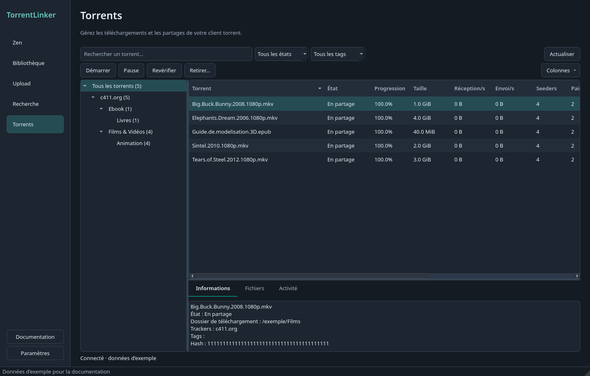

# Gérer les torrents

*Application de bureau, interface française, données d’exemple.*

L'onglet **Torrents** affiche tous les torrents du client choisi dans les Paramètres. Il fonctionne avec qBittorrent, Deluge et Transmission, y compris sur une seedbox ou un serveur distant. L'affichage et les commandes ne nécessitent pas d'accéder aux fichiers depuis cet ordinateur.

Dans l'arborescence, choisissez un tracker, puis une catégorie ou sous-catégorie. Le regroupement utilise le nom d'hôte des URL d'annonce, jamais vos tags personnels. Les chemins privés et les passkeys restent masqués. Un torrent associé à plusieurs trackers connus peut apparaître sous chacun ; les totaux et les commandes ne le comptent qu'une fois. Si le client ne fournit que le tracker courant, seul celui-ci apparaît.

Les tags de catégorie TorrentLinker définissent la hiérarchie. Les catégories c411 connues dans Zen servent aussi de complément, notamment pour Deluge, dont le label unique est conservé. Les autres torrents utilisent la catégorie de leur client. Sans catégorie, ils apparaissent dans **Autres / non précisés**. Les tags personnels restent des filtres distincts.

Recherchez un nom, filtrez par état ou tag et cliquez sur les en-têtes pour trier. Faites glisser leur bordure pour redimensionner les colonnes. Le bouton **Colonnes** permet d'afficher d'autres informations ou de masquer l'arborescence sur un petit écran. Les colonnes Zen/jour et note utilisent les données de la dernière vue Zen lorsqu'elles sont connues ; une valeur vide signifie qu'elle est inconnue.

Les colonnes **Seeders** et **Pairs** affichent le nombre de connexions, puis le total de l'essaim entre parenthèses. Par exemple, `0 (42)` signifie aucun seeder connecté et 42 annoncés dans l'essaim. `?` indique que le client ne dispose pas du nombre, tandis que `0` est une valeur connue. Le tri numérique utilise le total lorsqu'il est connu, sinon le nombre de connexions. Cet affichage s'applique aussi à la vue de tous les clients et à l'interface web.

Sélectionnez un ou plusieurs torrents pour les **Démarrer**, les mettre en **Pause**, les **Revérifier** ou les **Retirer**. Le retrait demande confirmation et conserve les fichiers téléchargés. Les torrents en cours de vérification de remise en partage par TorrentLinker sont ignorés pour laisser cette vérification se terminer. Le panneau **Activité** indique le résultat de chaque commande ; le tableau affiche l'état réel reçu du client.

Pour supprimer aussi les fichiers téléchargés, faites un clic droit sur les torrents sélectionnés et choisissez **Supprimer le torrent et les fichiers…**. Vérifiez les noms et les dossiers dans la boîte de confirmation. Le client supprime les fichiers sur sa propre machine, y compris sur un serveur distant ou une seedbox. Des fichiers partagés peuvent servir à d'autres torrents, et TorrentLinker ne peut pas annuler la suppression. Le bouton Annuler est sélectionné par défaut.

Sélectionnez un seul torrent pour consulter ses informations. Le panneau **Fichiers** se charge à la demande et permet de choisir les fichiers à télécharger ou à ignorer. Il ne renomme et ne déplace aucun fichier. La liste s'actualise toutes les cinq secondes lorsque l'onglet est visible, puis moins souvent en cas d'erreur de connexion. Un onglet masqué ne lance pas d'actualisation périodique.

Depuis la file de Recherche ou la Bibliothèque, **Voir dans Torrents** permet de suivre les téléchargements et les remises en partage. Dans Recherche, sélectionner une seule entrée ouvre ce torrent si son hash est connu.

## Reprendre les dossiers du client

Dans **Paramètres → Dossiers de téléchargement**, cliquez sur **Importer les dossiers du client torrent…**. L’application interroge le client choisi dans Connexions, avec les informations de connexion que vous venez de saisir.

- **qBittorrent** : dossier par défaut et dossiers des catégories, y compris les sous-catégories.
- **Deluge** : dossier de téléchargement, dossier des téléchargements terminés si activé, et dossiers de fin de téléchargement configurés par le plugin standard Label si activé. Label est facultatif pour cet import.
- **Transmission** : dossier de téléchargement par défaut. Le dossier des téléchargements incomplets est affiché à titre indicatif si activé. Transmission ne propose pas de dossiers par catégorie à importer.

L’aperçu affiche les chemins côté client et côté TorrentLinker, après application des correspondances de chemins actuelles. Pour chaque dossier à reprendre, choisissez la destination par défaut ou une catégorie. Les valeurs existantes sont conservées sauf si vous choisissez de les remplacer. Les dossiers temporaires activés sont affichés à titre indicatif et ne peuvent pas servir de destination finale. Sur une seedbox, les chemins peuvent rester distants ; l’import ne nécessite ni ne crée de montage local. Le scan des fichiers locaux nécessite toujours un accès aux fichiers.

Cliquez sur **Utiliser les dossiers sélectionnés**, puis enregistrez les paramètres. L’import copie uniquement les chemins. Il ne déplace aucun fichier, n’attribue aucune catégorie ou étiquette et ne modifie ni les réglages du client ni ses règles de déplacement en fin de téléchargement.

## µTorrent Classic : prise en charge expérimentale

Choisissez **µTorrent Classic** dans Paramètres → Connexions. Il s’agit de la WebUI de Classic, pas du produit distinct µTorrent Web. Activez cette interface dans Préférences → Avancé → Interface Web, définissez un identifiant et un mot de passe, puis saisissez son adresse dans TorrentLinker. Le suffixe `/gui/` est accepté ou ajouté automatiquement. Les mots de passe restent dans le trousseau du système.

L’adaptateur a été testé localement avec Classic 3.6.0 build 47390 sous Wine 10.0. Il permet de lister les torrents, de les regrouper par tracker, de modifier les priorités des fichiers, de démarrer, arrêter, revérifier et retirer les torrents sans supprimer les données. Il peut importer les dossiers par défaut et de fin de téléchargement. L’étiquette personnelle du client est conservée ; TorrentLinker n’y synchronise pas ses tags de catégorie.

Les nouveaux téléchargements nécessitent l’option **Ne pas démarrer le téléchargement automatiquement** de µTorrent et un dossier par défaut explicite dans Préférences → Dossiers. TorrentLinker peut utiliser ce dossier ou ses sous-dossiers. Il vérifie le chemin retourné pendant que le torrent est arrêté, puis le démarre. Les correspondances de chemins s’appliquent normalement. Une destination extérieure à cette arborescence est refusée. L’application ne change pas les préférences globales de µTorrent.

Les remises en partage complètes et le partage des uploads ajoutent le torrent arrêté, demandent une vérification et le démarrent uniquement lorsque tous les fichiers sont vérifiés. La même restriction de dossier s’applique. Désactivez d’abord le suffixe des fichiers incomplets, le déplacement des téléchargements terminés, l’ajout du label au dossier et les commandes d’exécution de programmes dans µTorrent. TorrentLinker refuse ces réglages sans les modifier.

**Lorsque les noms diffèrent, µTorrent nécessite de renommer les fichiers sur le disque.** Une confirmation affiche chaque chemin actuel et son nouveau chemin, prévient que cela peut casser d’autres torrents ou applications utilisant les anciens chemins, et sélectionne Annuler par défaut. L’accord concerne uniquement ce torrent, y compris pour les lots et les Plans. TorrentLinker vérifie le contenu avant le renommage, n’écrase jamais une destination existante, puis demande la vérification de µTorrent. Le contenu des fichiers reste inchangé. En cas d’échec ou d’interruption, un journal permet de restaurer les noms d’origine si les fichiers n’ont pas changé et si les anciens noms sont libres. Un conflit arrête la restauration et conserve le journal. qBittorrent, Transmission et Deluge continuent à renommer dans le torrent.

Les correspondances partielles, y compris celles auxquelles il manque des fichiers ignorés, restent indisponibles car cette WebUI ne fournit pas les pièces vérifiées. Cet adaptateur ne fournit pas encore de durée de partage pour les estimations Zen.

Pour le développement, `tests/test_utorrent_integration.py` s’exécute uniquement si `TL_UTORRENT_CONNECTION` désigne un fichier JSON contenant `url`, `username` et `password`, et si `TL_UTORRENT_DATA` désigne le chemin local du dossier de téléchargement par défaut. Utilisez une instance de test vide et dédiée. Les tests créent des fichiers jetables uniques, exercent l’API, retirent leurs propres torrents et vérifient que les fichiers sont intacts.
