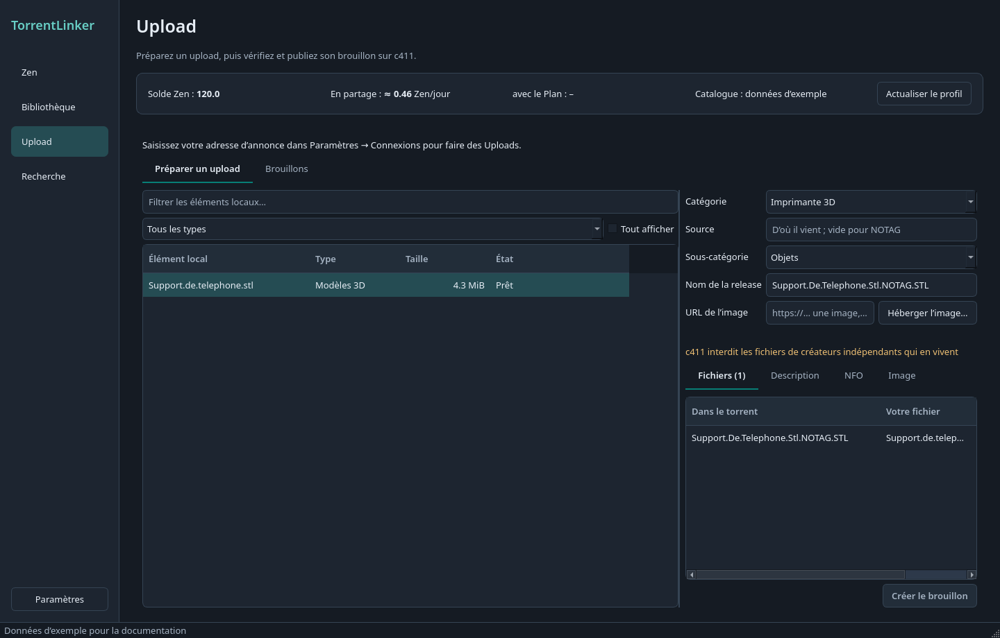

# Préparer un upload c411

[Documentation](../../README.md) · [English](../en/upload.md)

1. Dans la Bibliothèque, recherchez les correspondances de votre élément. Les Orphelins sans résultat apparaissent dans **Upload**.
2. Choisissez l’élément et sa catégorie. Relisez les refus et avertissements, le nom, les fichiers, le NFO et la description.
3. Ajoutez l’URL directe de votre image hébergée.
4. Préparez le brouillon, puis ouvrez-le sur c411 pour le relire et le publier. L’application ne publie pas automatiquement.

Captures de l’interface française en thème sombre, avec des données d’exemple.

## Préparer des uploads et brouillons c411

L’onglet **Upload** affiche les Orphelins pour lesquels une recherche n’a trouvé aucune correspondance, dans tous vos dossiers de Bibliothèque. Ces contenus peuvent être absents de c411. Chaque upload appartient à une **catégorie** c411 choisie dans le formulaire. Le Type de contenu du dossier propose une catégorie : Modèles 3D → Imprimante 3D, Films et Séries → Films & Vidéos, etc. Pour le type Autre, choisissez-la vous-même. Les catégories **Imprimante 3D**, **Ebook**, **Audio**, **Films & Vidéos**, **GPS**, **Emulation**, **Applications** et **Jeux Vidéo** sont prises en charge. Les autres indiquent qu’elles ne le sont pas encore. Changer de catégorie recalcule les contrôles, la sous-catégorie, le nom, le NFO et la description.

Renseignez votre **URL d’annonce**, issue de votre profil c411, dans **Paramètres → Connexions**, et utilisez une clé API principale autorisée à gérer les **Brouillons d’upload** (`drafts:rw`). La barre de recherche au-dessus de la liste filtre les Éléments locaux par nom de fichier, en complément du Type de contenu et de **Tout afficher**.

Sélectionner un élément recherche aussi les releases que c411 possède déjà, à partir des mots de son titre et dans sa catégorie. Le bloc repliable **Déjà sur c411** affiche les résultats avec taille, seeders et lien, ou indique qu’aucun résultat n’a été trouvé. Ce résultat est informatif : Team Pending décide des doublons, pas l’application. Chaque élément n’est recherché qu’une fois par session, au moment de sa sélection, avec le même budget de requêtes que les autres recherches.

Pour la 3D, les règles vérifiables automatiquement, comme les formats acceptés et l’interdiction des archives, produisent des **Refus** rouges qui bloquent le brouillon. Les règles qui demandent votre jugement, comme l’interdiction des fichiers de créateurs indépendants qui en vivent ou la cohérence d’un pack, produisent des **Avertissements** orange sans bloquer le brouillon.

L’application propose un nom comme `Petit.Etau.De.Bureau.NOTAG.3MF`, avec des points entre les mots, sans accents et avec `NOTAG` si la source est inconnue. Elle crée un torrent privé avec la taille de pièces attendue par c411 et le champ `source = C411`, afin de conserver le même info-hash après publication, ainsi qu’un NFO listant les fichiers. Le tout est enregistré comme brouillon sur c411. Le torrent est ajouté au client avec des chemins adaptés à vos fichiers, comme pour une remise en seed, et démarre une fois la vérification réussie.

Sous la sous-catégorie, cliquez sur **Options** pour afficher les choix demandés par c411 : langue, genre, format, etc. Cette section est repliée au départ pour laisser davantage de place à la description et au NFO. Vous pouvez la replier sans perdre vos choix ; elle conserve son état ouvert ou fermé pendant la session, même après une actualisation des options. Les erreurs de chargement, le bouton de nouvelle tentative et les options obligatoires manquantes restent signalés lorsque la section est repliée. Les options obligatoires portent un astérisque. Elles sont chargées au premier usage de la sous-catégorie et conservées une semaine ; l’action d’actualisation les recharge. Les règles peuvent préremplir certaines valeurs, mais votre choix reste prioritaire. Une option obligatoire vide bloque le brouillon. Imprimante 3D n’en demande aucune.

Ouvrez la page d’upload de c411, chargez le brouillon, ajoutez l’image demandée et publiez-le sur le site. Voir [ADR-0011](../../adr/0011-uploads-start-as-c411-drafts.md) et le [résumé des règles](../../research/upload-rules.md).

### Image de présentation

L’upload d’image de c411 nécessite une session de navigateur connectée. TorrentLinker peut produire l’image de vos modèles : la page **Vue 3D** affiche le modèle sélectionné, STL binaire ou ASCII, OBJ ou 3MF, sous un angle isométrique et cadré sur ses dimensions. Faites glisser pour tourner, utilisez la molette pour zoomer, puis double-cliquez ou réinitialisez la vue pour revenir au départ. Un dossier contenant plusieurs modèles propose une liste. Les gros maillages sont chargés en arrière-plan et simplifiés uniquement pour l’affichage.

- **Capturer** enregistre la vue courante en PNG, avec une largeur d’au moins 1 000 pixels.
- Pour un **Pack**, la capture de planche produit une grille d’au plus neuf modèles, chacun en vue isométrique avec son nom de fichier.
- **Ouvrir le dossier** affiche ces images, rangées dans `uploads/<release name>/`, jamais dans la Bibliothèque. Ajoutez celle de votre choix sur c411 en relisant le brouillon ; la description conserve un emplacement `[img]…[/img]`.

Si vous hébergez l’image ailleurs, collez son lien direct dans **URL de l’image**. Le bouton d’hébergement ouvre Postimages. L’image est incluse dans la description du brouillon même après modification du texte ; changer l’URL remplace l’image sans réinitialiser la présentation.

STEP, GCODE, BLEND, F3D, SLDPRT et FCStd n’ont pas d’aperçu : préparez leur image vous-même. Le rendu nécessite OpenGL ; s’il est indisponible, la vue et les captures affichent la raison de leur indisponibilité.

## Règles selon la catégorie

Consultez les [règles par catégorie](upload-categories.md) pour les formats, noms, contrôles et métadonnées des livres numériques, de l’audio, des vidéos, du GPS, de l’émulation, des applications et des jeux.

[Documentation](../../README.md) · [English](../en/upload.md)
