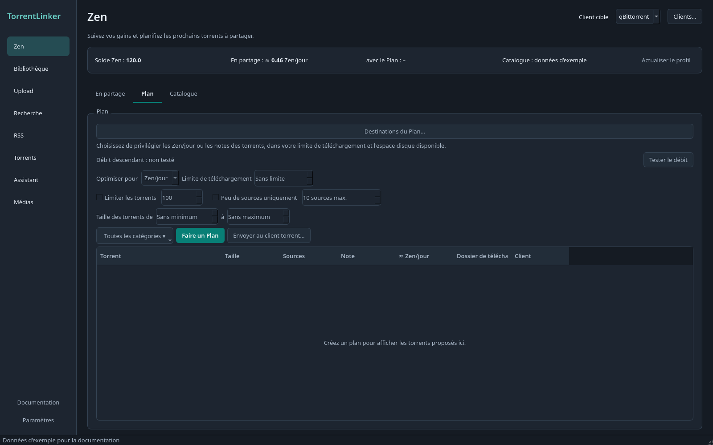

# Suivre le Zen et préparer un Plan

[Documentation](../../README.md) · [English](../en/zen.md)

Dans **Zen → En partage**, dépliez les catégories pour comparer vos torrents. La Note d’une catégorie est la moyenne des notes disponibles de tous ses torrents, sous-catégories comprises. Pour préparer de nouveaux téléchargements, utilisez **Plan**.

Les catégories sont repliées au premier affichage. L’application mémorise les branches ouvertes et fermées après actualisation et redémarrage, y compris **Tout déplier** et **Tout replier**. Un filtre ouvre temporairement les branches correspondantes ; effacer le filtre restaure votre disposition.

Captures de l’interface française en thème sombre, avec des données d’exemple.

## Profil et extension navigateur

**Profil** est le premier onglet Zen sur le bureau et le WebUI. Il affiche le compte
API, la date d’inscription, la Classe, le niveau, les quêtes, le Solde Zen et les
transferts. Les données sont actualisées automatiquement toutes les deux minutes
tant que l’application bureau tourne ou que l’onglet Profil du WebUI est visible.
**Actualiser le profil** permet une vérification immédiate. Les erreurs apparaissent
à côté des dernières valeurs connues.

L’extension facultative pour Chrome, Brave ou Edge ajoute les seeds actifs, les
uploads validés, la durée totale de seed et les transferts depuis votre session c411.

1. Dans **Zen → Profil**, téléchargez le ZIP, extrayez-le et chargez le dossier depuis
   **Mode développeur → Charger l’extension non empaquetée** sur la page Extensions.
   Dans Brave, ouvrez **brave://extensions**. Remplacez l’ancienne extension manuelle.
2. Cliquez sur **Connecter l’extension** dans TorrentLinker. Ce clic autorise la connexion
   et les mises à jour automatiques. L’application ouvre le navigateur et transmet
   directement les informations à l’extension installée. Aucun code à copier,
   aperçu à confirmer ou bouton d’envoi.
3. Gardez un onglet c411 connecté au même compte que votre clé API. L’extension ouvre
   c411 lors de la connexion si nécessaire, puis actualise et envoie les statistiques
   toutes les deux minutes, même si son propre onglet est fermé.

La connexion est conservée après redémarrage de l’application et du navigateur.
Si le navigateur est fermé, si c411 est déconnecté ou si un autre compte est actif,
les dernières données restent affichées avec leur date. Après cinq minutes, elles
sont signalées comme en attente du navigateur. Les mises à jour reprennent
automatiquement quand un onglet connecté au bon compte est disponible.

Pour un WebUI distant, utilisez HTTPS et installez le ZIP téléchargé depuis **ce
serveur**. L’accès de connexion est limité à ce serveur, avec son éventuel préfixe
de reverse proxy. Le ZIP de la release fonctionne avec le récepteur bureau et un
WebUI sur localhost. Sur le bureau, la page s’ouvre dans le navigateur par défaut ;
installez l’extension dans celui-ci. Si vous devez l’installer, revenez dans
l’application et cliquez sur Connecter ensuite.

L’extension ne transmet ni cookies de connexion, ni clés API, ni noms ou hashes de
torrents. Les statistiques ne remplacent ni les données API ni les réglages du Plan.
Le jeton est conservé dans le stockage local de l’extension ; l’application conserve
uniquement son empreinte dans son cache privé. **Pause automatic sync** dans
l’extension suspend les mises à jour. **Déconnecter et effacer** dans TorrentLinker
révoque l’accès et efface les données enregistrées. Changer l’adresse de l’Indexeur
ou la clé API efface la connexion et le cache du compte. Il faut alors cliquer à
nouveau sur Connecter.

## Intégration Zen

L’onglet Zen réunit le solde fourni par c411 et les estimations de TorrentLinker :

- Lecture du Solde Zen, de la Classe, du bonus de progression débloqué et de l’autorisation de télécharger depuis votre profil c411. La clé API demande le droit `profile:read`, en plus des accès au catalogue et au téléchargement.
- Estimation du Zen/jour pour chaque torrent en partage et pour les correspondances de la Bibliothèque, selon taille, seeders, durée de seed, catégorie, bonus de Classe et heures de seed quotidiennes configurées.
- Comparaison entre Tanker, Swarm Keeper et Reuploader. Pour Reuploader, le calcul approximatif utilise le nombre d’uploads saisi dans l’onglet Zen.
- Réglage de la Classe, du bonus de progression débloqué, des heures de seed et du plafond global de torrents dans **Paramètres → Zen**. La Classe et le bonus sont remplis depuis c411 lorsque le profil est accessible.

Sans accès au profil, vous pouvez renseigner le Profil Zen manuellement et utiliser les estimations et Plans. Le solde affiché vient de c411 ; les gains prévus et le délai de rentabilisation sont des estimations locales. La durée de seed connue du client peut être inférieure à celle de c411 après suppression puis réajout d’un torrent.

### Torrents en partage par catégorie

**Zen → En partage** regroupe les torrents selon leur catégorie et sous-catégorie du Catalogue. Dépliez une branche pour voir les torrents, leur taille, leur estimation de Zen/jour et leur **≈ Note**. Les catégories affichent la moyenne arithmétique des Notes de tous leurs torrents, sous-catégories comprises ; les Notes indisponibles sont exclues. La recherche porte sur les noms de torrents et de catégories. Le tri, la largeur des colonnes, la sélection et les branches repliées sont conservés à l’actualisation. Les torrents sans catégorie connue apparaissent sous **Catégorie inconnue** ; les catégories générales issues du catalogue tiers restent au niveau parent tant qu’une sous-catégorie n’est pas confirmée.

Sur le bureau, chaque actualisation synchronise aussi les tags de catégorie dans qBittorrent et les labels dans Transmission, par exemple `torrentlinker:category:Books / Comics`. L’application ajoute les tags manquants et remplace uniquement les anciens tags de ce préfixe, sans modifier les tags personnels, ceux de vérification, les dossiers de téléchargement ni la catégorie native du client. Les catégories inconnues ne reçoivent pas de tag. Le label unique de Deluge est conservé, car il sert à suivre la vérification ; ses torrents figurent néanmoins dans l’arborescence. La vue indique les mises à jour et leurs éventuels échecs.

L’interface web propose aussi **Zen → En partage**, séparé de **Plan**, avec les catégories, la recherche, le tri, l’âge du seed, les Zen/jour, la Note et la comparaison des Classes. Dépliez une catégorie pour charger ses torrents, par pages de 100. Le filtre change les groupes affichés sans modifier les totaux Zen globaux. **Tous les clients** compte chaque hash une seule fois, en privilégiant une copie en partage ; les clients indisponibles sont signalés et leurs dernières observations peuvent être incomplètes. L’actualisation web lit les clients sans modifier les tags ni interroger c411 pour chaque torrent. La comparaison des Classes utilise le nombre d’uploads configuré.

## Préparer un Plan Zen

Choisissez les catégories, puis réglez le Plan :

| Réglage | Effet |
| --- | --- |
| Optimiser pour **Zen/jour** | Essaie plusieurs ordres de sélection gloutonne et garde le Plan au gain de Zen estimé le plus élevé. |
| Optimiser pour **Note** | Sélectionne d’abord les torrents aux meilleures Notes pour votre Classe. |
| Limite de téléchargement | Taille totale maximale en Go décimaux. Zéro n’ajoute aucune limite. |
| Limite de torrents | Nombre maximal facultatif de torrents ajoutés par ce Plan. |
| Peu de seeders uniquement | Nombre maximal de seeders actuels, initialement 10, avant votre arrivée. |
| Taille des torrents de… à… | Taille minimale et maximale par torrent, en Go décimaux. Zéro laisse la borne ouverte. S’applique aux téléchargements et remises en seed. |

Les remises en seed sont prioritaires. Elles comptent dans la limite de torrents mais ne consomment pas de budget de téléchargement. Le plafond global et la réserve d’espace disque s’appliquent aussi. Les résultats indiquent la Note de chaque torrent, la Note moyenne pondérée par la taille, le gain de Zen estimé, le délai de rentabilisation et l’espace libre avant et après le Plan. Les dossiers situés sur un même disque physique sont comptés ensemble. Les options sont conservées après redémarrage.

Le Plan exclut tout torrent déjà présent dans le client, quel que soit son tracker ou son état. Il exclut aussi les torrents du Catalogue dont les fichiers semblent déjà présents dans la Bibliothèque ou les dossiers de téléchargement, par exemple après suppression du torrent sans ses données. L’identification compare un Élément local ou l’un de ses fichiers à la taille du torrent, avec jusqu’à 64 Kio de moins pour un NFO ou une couverture, et exige une majorité de mots significatifs communs sans numéro de volume différent. Le résumé indique le nombre d’exclusions ; survolez-le pour les consulter. Cette étape n’effectue aucune requête. Seule une recherche dans la Bibliothèque confirme une correspondance à remettre en seed.

Chaque Plan affiche deux durées estimées. L’**envoi** au client suit les limites c411 des `.torrent` : 30 par minute et par clé API, et environ 280 sur 20 minutes. Avec davantage de clés, l’envoi accélère : environ une heure pour 1 000 torrents avec une clé, sept minutes avec cinq. Le **téléchargement** des données est estimé en divisant la taille du Plan par votre débit. **Tester le débit** utilise anonymement le test public Cloudflare pendant environ huit secondes et mémorise le résultat. Cette durée est un minimum : les torrents peu seedés peuvent être plus lents. Lancez le test lorsque votre client torrent est au repos.

L’envoi télécharge chaque `.torrent` directement depuis c411 et l’ajoute au dossier de téléchargement prévu. TorrentLinker refuse les téléchargements qui écraseraient des fichiers existants. Les remises en seed passent toujours par une vérification par hash.

Une barre de progression indique les envois, ajouts, refus et échecs, avec le temps restant estimé. **Arrêter l’envoi** s’arrête après le torrent en cours. Si c411 limite les téléchargements avec une erreur HTTP 429, l’application attend puis retente le même torrent, avec un délai croissant jusqu’à 15 minutes, et affiche l’heure de la prochaine tentative.

Le Plan et les résultats sont enregistrés au fil de l’envoi. Après un arrêt, une fermeture ou un plantage, seuls les torrents restant à envoyer reviennent ; les échecs sont retentés. Cliquez sur **Envoyer au client torrent** pour reprendre. Créer un nouveau Plan ou changer ses options remplace le Plan enregistré. Les remises en seed ne sont pas sauvegardées dans le Plan, mais passent toujours avant les téléchargements lors de l’envoi.

Un Plan vide indique la cause constatée et l’action utile : plafond total atteint, filtres trop stricts, dossier manquant, torrents déjà présents, absence de sources, profil Zen ou budget insuffisant. Le nombre de torrents exclus accompagne les causes liées au Catalogue. Le plafond total de **Paramètres → Zen** est distinct de la limite de torrents du Plan.

### Actualisation du Catalogue et estimations provisoires

Le premier Plan importe anonymement le catalogue public de métadonnées Zen Lab. Votre clé API et toutes les demandes de `.torrent` sont envoyées directement à c411.

c411 autorise 1 200 recherches et requêtes de Catalogue par heure et par compte, toutes clés confondues, et limite les téléchargements de `.torrent` à 30 par minute et par clé. TorrentLinker sépare ces budgets : les recherches vont jusqu’à deux par seconde tant que le budget horaire le permet, puis ralentissent, même pendant l’envoi d’un Plan. Chaque clé reste limitée à 30 téléchargements par minute et environ 280 sur 20 minutes. Vos recherches, vérifications de fichiers et remises en seed passent avant les Plans et actualisations du Catalogue. Si c411 impose à toutes les clés une attente supérieure à une demi-minute, les actions interactives s’arrêtent et indiquent quand réessayer.

Vous pouvez ajouter jusqu’à quatre clés du même compte dans **Paramètres → Connexions**, dans la section des clés API supplémentaires. Chacune apporte son quota de téléchargement ; les requêtes utilisent celle disponible le plus tôt. Voir [ADR-0008](../../adr/0008-several-c411-keys-each-within-its-own-limits.md) et les [mesures de limites](../../research/rate-limits.md).

Au démarrage et lors de la préparation d’un Plan, c411 est parcouru du plus récent au plus ancien, jusqu’au repère de la dernière actualisation réussie, ou jusqu’à une page connue lors de la première actualisation. Le parcours historique et sa pagination mémorisée sont réservés à l’action explicite de récupération du Catalogue. Les actualisations interrompues conservent leur repère et recherchent les nouveautés à la reprise.

Un avertissement de limite de pagination signifie que l’Indexeur ne fournit plus les pages anciennes. Les torrents en cache restent disponibles pour les Plans ; relancer la récupération ne supprime pas cette limite du serveur. Une récupération en pause est différente : il reste du travail à reprendre.

Les Plans utilisent les métadonnées en cache et affichent des estimations provisoires. Aucun contrôle de métadonnées torrent par torrent n’est effectué auprès de c411 avant la préparation ou l’envoi. Le client torrent est interrogé toutes les 30 secondes pour actualiser la vue En partage à mesure que les trackers répondent. Les nombres de seeders connus mettent aussi à jour le Catalogue ; les valeurs inconnues conservent l’estimation en cache.

Si une actualisation est déjà en cours, le Plan l’attend puis actualise ses catégories. Si l’actualisation échoue et que le Catalogue contient déjà des torrents, le Plan utilise ces données en cache et le signale séparément. Sans aucune donnée en cache, l’erreur arrête la création du Plan. Vous pouvez interrompre la récupération et créer un Plan avec les données déjà disponibles.

Le catalogue tiers fournit des catégories générales et sa fraîcheur en amont est inconnue. Ses entrées générales sont exclues d’une sélection de sous-catégorie tant que c411 n’a pas fourni une catégorie précise. Sélectionner la catégorie parente les inclut. L’actualisation des seeders ne lève pas cette incertitude. Ni les limites de pagination c411 ni ce catalogue tiers ne garantissent une couverture complète du tracker ; l’application indique les limites connues. Les valeurs de Zen restent des estimations.

Voir [CONTEXT.md](../../../CONTEXT.md) pour le vocabulaire du projet et [docs/adr](../../adr) pour les décisions de conception.

[Documentation](../../README.md) · [English](../en/zen.md)

### Contrôles du Plan dans l’interface web

L’interface web propose les onglets **En partage**, **Plan** et **Catalogue**. Plan utilise les mêmes moteurs de sélection et d’envoi que le bureau. Sélectionnez plusieurs catégories ou sous-catégories, optimisez pour les Zen/jour ou la Note, fixez les limites de torrents et de sources, puis répartissez les téléchargements entre clients avec des budgets individuels. Les tailles web sont indiquées en Gio ; le bureau utilise des Go décimaux. Zéro n’ajoute aucune limite de budget ou de taille maximale. Les catégories et limites du Plan sont conservées après redémarrage.

Avec une seule destination sans budget par client, les correspondances complètes vérifiées de la bibliothèque sont incluses comme Reseeds sans téléchargement. Comme sur le bureau, les Plans distribués contiennent uniquement des téléchargements. Les limites de taille, de sources et de nombre s’appliquent aux deux. Les fichiers déjà présents dans la bibliothèque ou les dossiers de téléchargement sont exclus et listés.

Le résultat affiche la taille, les Zen/jour ajoutés, l’amortissement, la Note moyenne pondérée par la taille et les réserves disque. Les dossiers d’un même disque physique partagent sa capacité. Triez et sélectionnez sur plusieurs pages, puis utilisez **Envoyer la sélection aux clients…** ou la mise en file des téléchargements. L’envoi direct demande confirmation. Les Reseeds passent par la vérification des hashes ; les renommages sur disque pour µTorrent demandent aussi de valider chaque ancien et nouveau chemin. **Arrêter après le torrent en cours** conserve les téléchargements restants, y compris après redémarrage du serveur. Les Reseeds restent limités à la session et nécessitent de recréer le Plan après redémarrage. Les échecs restent disponibles pour réessayer ; les refus et les envois réussis quittent le Plan.

**Dossiers par catégorie…** permet de parcourir l’hôte TorrentLinker et de vérifier les destinations. Ce sont les chemins du serveur, pas ceux de l’ordinateur qui affiche le navigateur. **Profil Zen, réserve disque et exclusions** regroupe les paramètres de calcul. Saisissez un débit ou testez celui du serveur ; il peut différer de la connexion d’un client torrent distant. L’estimation d’envoi tient compte du nombre de clés API. Les clés supplémentaires se règlent dans **Paramètres → c411 → Paramètres avancés** et restent stockées de façon privée ; leurs valeurs enregistrées ne sont jamais renvoyées au navigateur.

Modifier les paramètres impose de recréer le Plan avant l’envoi. Vous pouvez arrêter la collecte du Catalogue et planifier depuis le cache. Si une actualisation échoue, un cache existant reste utilisable avec un avertissement ; sans cache, l’erreur reste affichée.

L’onglet Catalogue affiche l’âge du cache et sa couverture, y compris les limites de pagination et les métadonnées importées. La collecte historique peut être suspendue après la page en cours puis reprise. Elle ne lance aucun téléchargement. Dans **En partage**, le nombre d’uploads utilisé pour comparer les classes est modifiable et enregistré.
