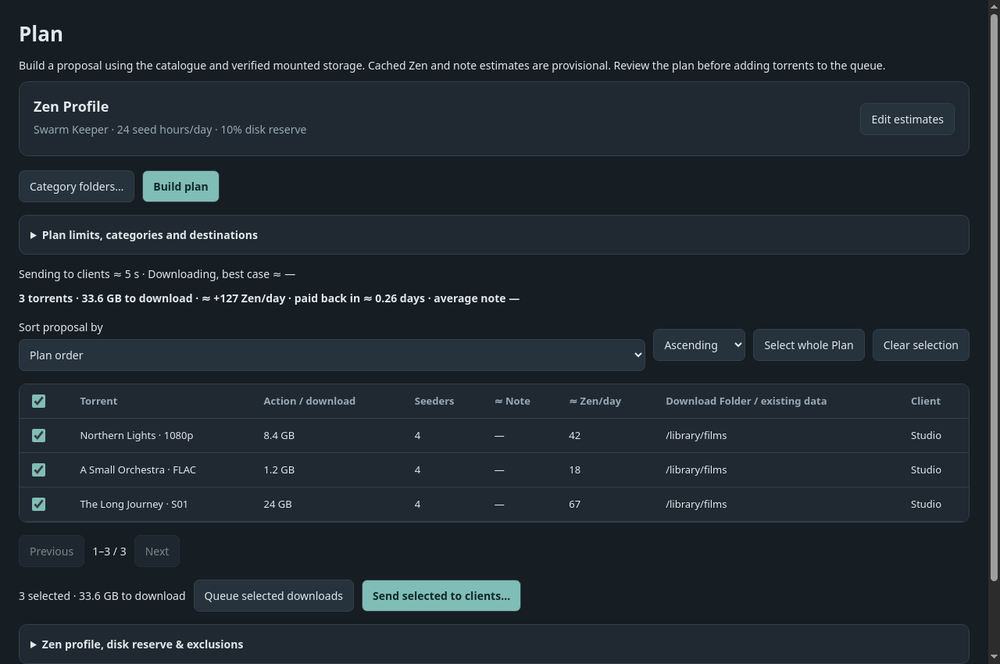
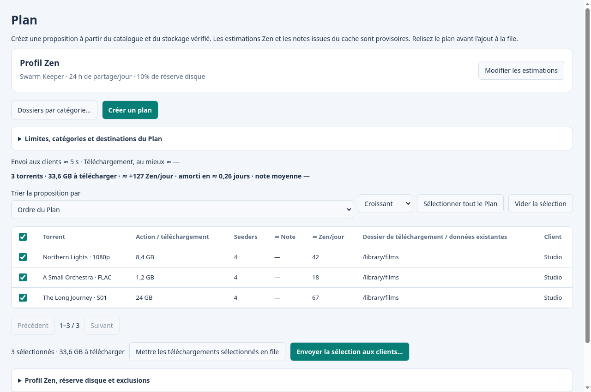
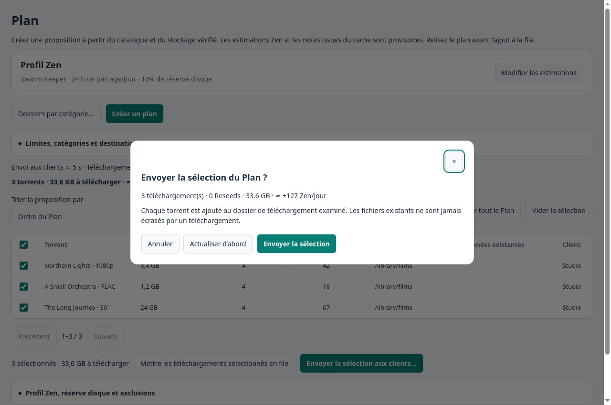

# Shared Plan building and sending, #92 and #93

The desktop and Web UI load `web/static/plan/view.html` through the shared panel base. The page owns the profile summary, planner inputs, sort and selection controls, review dialog, progress and stop controls. Limits, categories and client budgets are expandable so the proposed torrents remain visible. English and French use the shared light/dark tokens.

The desktop adapter keeps the existing planner and send workers. The Web adapter keeps the existing owner APIs, job registry and persisted Plan session. Both render the same `plan_workspace.plan_data` result. Progress updates retain row selection and unfinished inputs without retransmitting the full list. Queue requests use the reviewed rows' target clients and Download Folders. Sending requires a fresh review for the same Plan, selection and client.

## Validation

- Planner, desktop controller, interrupted-send, rate-limit and missing-folder tests use temporary data and simulated clients. The migrated controller group passed 120 tests.
- Browser acceptance builds cached Plans, edits limits, sorts and selects one row, reviews and sends it, reloads the remaining Plan, and edits another client's Download Folder without losing its unfinished budget.
- Desktop interface tests exercise selection and review, stale-client refusal, progress and Stop, input focus, wheel handling and narrow layouts.
- Actual desktop display checked on DP-4 with Qt xcb. Captures below show English/dark, French/light and the French review dialog.
- Browser capture covers French at 390 pixels. No live tracker posting or user's torrent client was used.

## Retained host differences

Desktop folder selection uses the native directory picker and checks local directories. Web folder selection uses the server folder browser and the existing client verification job. Paths always belong to the TorrentLinker host.

A desktop Reseed that needs disk renames retains the existing per-item native consent. Web review lists the rename operations before final approval. Both retain their existing collision checks and safe rollback behavior.

Speed tests measure the desktop connection or Web server connection respectively. Owners can enter the Torrent Client's rate instead. Zen preferences are edited from the shared Plan; the remaining native Settings editor is replaced under #113.

