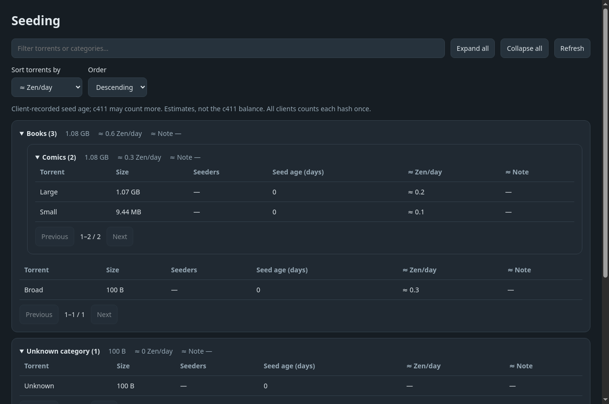
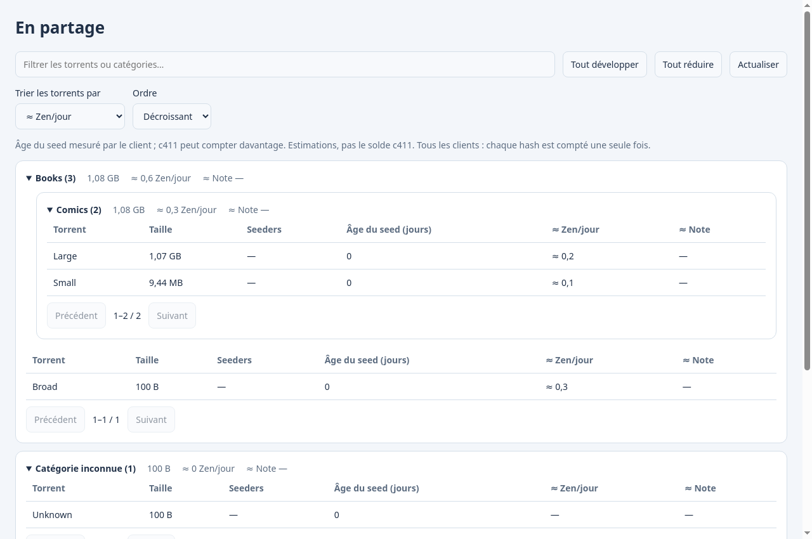
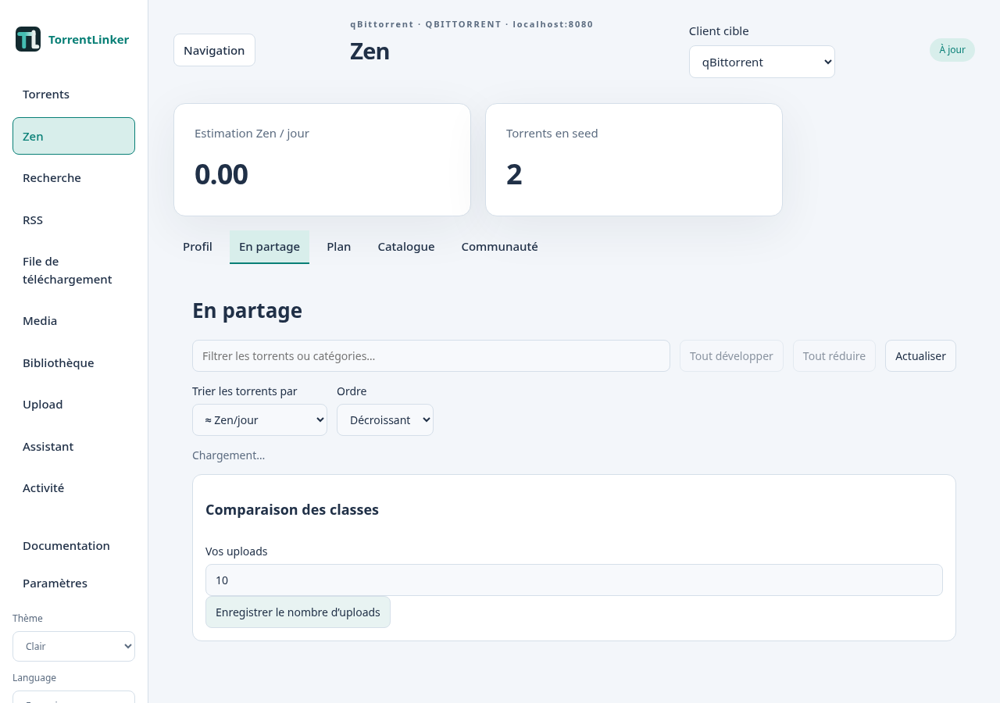
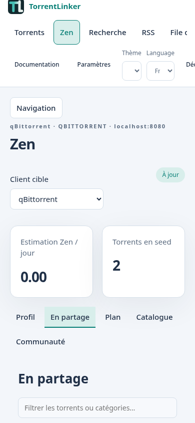

# Shared Seeding, #94

Desktop and Web load `static/seeding/view.html`. The page owns the category tree, bounded torrent pages, filter, numeric sort, expand/collapse controls, estimates and class comparison. The old native tree, native comparison widgets and Web renderer are removed.

Both hosts use `web.seeding.seeding_page`, which computes category aggregates, unknown values and account totals independently of the requested row page. Desktop page calculations run off the GUI thread; the hidden desktop tab keeps only its latest observation until opened. The existing desktop update signals still feed the Zen band, Library estimates and Reading Room. Refreshing observations remains separate from repainting the page.

Expanded categories use stable category IDs. Desktop remembers them in the owner's QSettings, scoped by settings path and client, and imports the previous native tree preference once. Web remembers them in owner-browser storage scoped by server base path and client. Filtering opens matching ancestors without changing saved expansion. Sort, filter and typed upload counts survive environment updates.

## Validation

The first desktop interface regression failed against the native renderer, then passed with the shared page. The desktop/controller group passed 84 checks and exposed two old widget assertions; those checks passed after moving them to observed data. Browser acceptance passes at both `/` and `/tl`, covering grouping, numeric sort, filter, reload, per-client expansion, client refresh, upload estimates, French/light and 390-pixel layout. The broader browser setup workflow and shared Plan regression also pass with Seeding installed.

An actual desktop display check on DP-4 rendered English/dark and French/light. The French view and the narrow Web view were inspected. Tests use temporary settings, databases and simulated clients. Ruff and mypy pass.

## Retained platform differences

The shared HTML table replaces native column-width dragging and native row highlighting. It supports text selection and horizontal scrolling for the torrent columns. Category expansion is saved by the desktop owner or Web browser, so it does not transfer between browsers or hosts. Desktop category-tag reconciliation results remain visible; Web continues to show client observation failures from its existing API.

